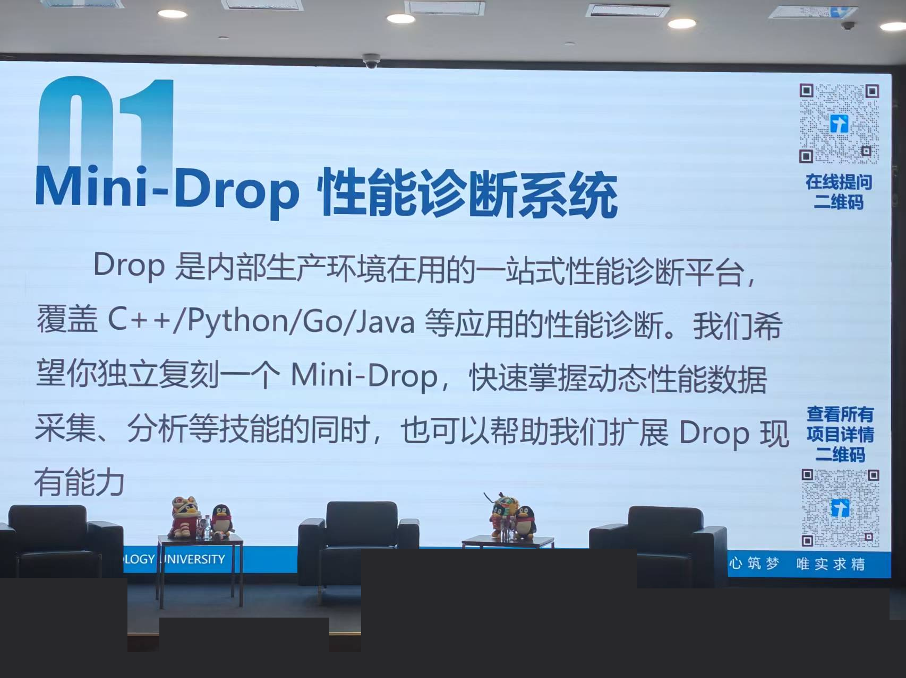
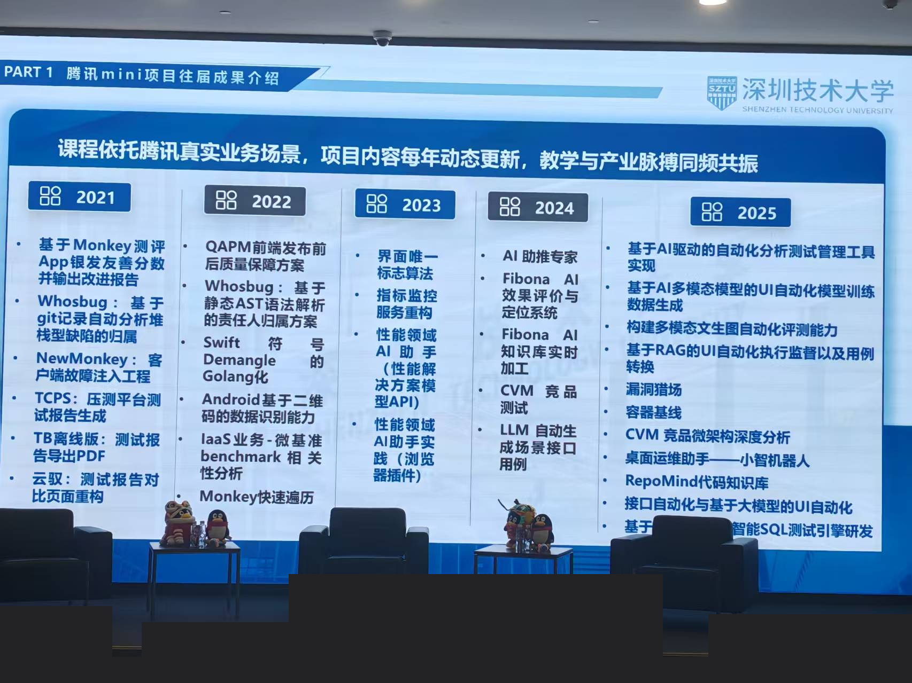
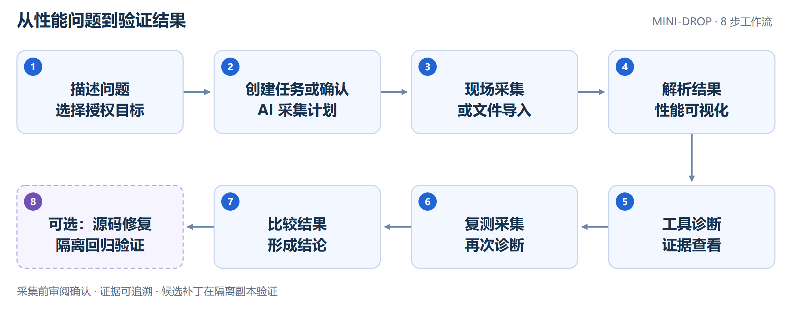

# Mini-Drop · 分布式性能诊断与 AI 调查平台

## 项目来源：腾讯 Mini 项目

本仓库基于腾讯 Mini 项目课程中的 **「Mini-Drop 性能诊断系统」** 题目进行个人复刻与扩展。基础链路参考导师提供的《Drop 性能诊断系统架构与复刻指南》，在采集与分析能力之上扩展 AgentScope AI 诊断、复测与测试工具。本仓库代码为个人实现，非腾讯内部源码；具体能力及验收结果见代码与交付记录。

<details>
<summary>什么都没有，不要打开哦😮</summary>

以下为活动现场照片，展示 Mini-Drop 题目介绍及课程背景。人物头部已遮挡，投影内容保留原样。

**Mini-Drop 性能诊断系统：项目题目与目标介绍**



**腾讯 Mini 项目课程背景与往届成果介绍**



**同场专项：性能工程 skill 评估，作为课程相关方向参考**


</details>

## 项目简介

Mini-Drop 面向 Linux 后台服务的性能排查，将**远程采集、性能分析、可视化、AI 调查和复测验证**放在同一个工作空间中。开发和测试人员可以从“这个服务为什么变慢了”开始，选择授权进程，查看线程与函数热点、内存或 I/O 数据，再结合复测和回归测试判断优化是否有效。

项目提供两种使用方式：熟悉性能工具的用户直接创建采集任务；需要辅助排查的用户用自然语言描述问题，由 **AgentScope + DeepSeek** 读取节点能力、提出采集计划并调用诊断工具。关联已登记的 Python 源码后，还可以定位代码行、生成候选补丁，并在隔离副本中验证。

[演示工作空间](https://82.157.81.79) · [面试演示步骤](docs/INTERVIEW_DEMO.md) · [本地开发说明](docs/LOCAL_DEVELOPMENT.md)

## 解决什么问题

性能排查通常需要分别登录机器、选择采集工具、整理原始文件、生成火焰图，再手工记录优化前后的差别。Mini-Drop 把这些步骤组织成有状态的任务，保留采集参数、执行过程、原始制品、分析结果和诊断依据，让一次调查可以回看、比较和复核。

| 排查场景 | 在平台中可以做什么 |
| --- | --- |
| CPU 占用升高 | 按运行语言选择采集器，查看线程或函数热点，沿火焰图调查耗时路径 |
| 内存占用增长 | 查看堆快照、对象引用、分配记录或原生内存事件，按对应数据类型分析 |
| 接口响应变慢 | 在已登记业务信号的服务上，关联性能数据、延迟指标、结构化日志、Trace 与变更记录 |
| 优化后是否有效 | 用可比参数复采并再次诊断；已接入的 Python 项目还可执行冻结回归、输出一致性检查和 CPU A/B 对照 |

## 核心能力

| 能力 | 实现与使用结果 |
| --- | --- |
| 多语言性能采集 | 覆盖 C/C++、Java、Go、Python 的 CPU、堆与分配分析，以及锁、I/O、资源快照和 BOLT 等任务；契约包含 18 类任务，其中 16 类具有现场采集 Runner，按节点实际能力开放 |
| 分析与可视化 | 独立 Analyzer 解析原始格式，提供火焰图、热点、堆对象图与类型专属结果；支持原始文件导入、制品下载和 SHA 校验 |
| 自然语言调查 | 官方 AgentScope 执行 ReAct 工具循环，依据真实观测提出假设、补证计划及验证建议；采集计划经过用户确认后执行 |
| 复测与证据比较 | 编排复采、解析、再次诊断和结果比较，保留两次执行的参数与来源；追加采集草案另行确认 |
| Python 源码定位与修复 | 绑定登记源码的版本与 SHA，结合 cProfile 定位代码行；候选补丁在隔离副本中执行回归和性能对照，生成可审阅的代码与测试 diff |
| 诊断知识复用 | 内置诊断 Skill、版本化个人/团队/项目方法库及个人历史案例；方法经审阅发布，使用记录可追溯 |
| 任务管理与协作 | 节点能力自检、任务取消与重试、事件时间线、组权限和共享、定时任务及综合 DAG 编排 |
| 测试与质量记录 | 单元、接口、安全、协议、并发和恢复验证；AI 生成受限业务测试输入，由独立断言判定；质量页展示保留历史失败的不可变运行摘要 |

采集能力取决于目标语言、工具、内核和授权配置。平台分别保留 CPU 样本、CPU ticks、分配事件和字节等单位，不将不同来源的数据直接当成同一项指标。

## 一次性能调查怎样完成



[查看矢量图](docs/assets/diagnostic-workflow.svg) · [查看 Mermaid 源文件](docs/assets/diagnostic-workflow.mmd)

1. **选择目标与采集方式。** 查看节点实际支持的工具，指定授权进程、采集时长和参数；也可先让 AI 提出计划，再审阅确认。
2. **查看真实执行与分析结果。** 平台显示采集、上传和分析状态；完成后查看火焰图、热点及对应原始制品。离线文件导入会明确标记来源。
3. **调查与补充证据。** 智能体读取热点、采样质量及已登记的业务信号，输出带来源的事实和待验证假设。需要追加采集时先提出草案。
4. **复测并比较。** 在授权范围内创建复测，完成后自动再次诊断，比较参数、数据质量和结果；热点重复出现本身不能确认根因。
5. **验证候选修改。** 对已经接入的 Python 源码，可继续定位、生成补丁、运行隔离测试与性能对照，最后下载补丁和验证结果。

## AI Agent 是怎么做的

智能体使用 **官方 AgentScope 2.0.10 + DeepSeek**。它通过 ReAct 循环选择工具、接收执行观测，再决定补充调查还是提交报告。例如，`inspect_hotspots` 读取热点，`check_collection_quality` 检查采样质量，`compare_profiles` 比较两次采集。

Go API 负责身份、目标、工具参数、调用预算、状态和证据校验；独立 Python runtime 负责模型与工具循环。模型只能使用已开放的工具，不能把自由文本直接变成宿主命令。指标、日志、Trace 和拓扑来自管理员登记的数据源，诊断 Skill 与历史案例用于提供排查方法和先验。

报告将**程序核对的结构化事实**与**模型提出的业务解释**分开展示。事实引用通过校验，仍不代表解释或因果关系已经成立，需要结合复测、干预和人工复核。

源码执行目前提供通用 **Python** 接入，以及 CRM/Saber 的专用接入。补丁只应用于无网络、无业务凭据的隔离副本，原回归与性能门槛由平台控制；通过后交付 diff 供审阅，不自动发布原业务仓库。

实现细节见 [AgentScope 接入](docs/AGENTSCOPE_INTEGRATION.md)、[诊断能力扩展](docs/AGENT_EXPANSION.md) 和 [诊断知识层](docs/DIAGNOSTIC_KNOWLEDGE.md)。

## 可以演示什么

| 场景 | 可查看或操作的内容 |
| --- | --- |
| Python CRM | 受控品牌配色计算的采集、热点分析、源码定位及隔离优化；联系人测试另接真实 PostgreSQL、PostgREST 与 RLS |
| Python Saber | 受控 FTS5 搜索组件的采集、诊断、复测与隔离修复流程 |
| 通用 Python 项目 | 通过管理员 manifest 登记冻结源码与验证命令，演示独立回归生成、候选补丁及性能正负对照 |
| 双服务业务信号 | 在仓库自有合成业务中制造 CPU、慢 SQL、超时等现象，查看已登记指标、日志、Trace 及服务关系 |
| 质量验证页 | 查看真实执行记录、失败时间线、来源哈希、未知指标与 JSON 导出；该页面只读展示记录 |

入口：[智能调查](https://82.157.81.79/investigations) · [诊断知识](https://82.157.81.79/knowledge) · [质量验证](https://82.157.81.79/quality)。使用已配置账号，现场操作顺序与各场景范围见 [演示文档](docs/INTERVIEW_DEMO.md)。演示使用合成负载和明确接入的组件，单个函数的优化结果不等于整个业务系统的性能收益。

## 技术架构

| 层次 | 技术 | 职责 |
| --- | --- | --- |
| Web 工作空间 | React、TypeScript、Vite | 任务、火焰图、调查、知识与质量记录界面 |
| HTTP 与业务编排 | Go、Gin、GORM | 身份权限、任务生命周期、事件、调查与工具校验 |
| 调度与采集 | C++20、gRPC、mTLS | 节点注册、任务派发、目标身份核对和受控采集 |
| 结果分析 | Python Analyzer | 格式解析、异步分析、类型专属结果与制品生成 |
| 智能体运行时 | Python、AgentScope、DeepSeek | 采集规划、工具诊断、知识调用与补丁生成 |
| 状态与制品 | PostgreSQL、私有 MinIO | 任务/attempt/分析租约/事件，以及原始文件与分析制品 |

C++ **采集 Agent** 与 Python **AI Agent** 承担不同职责：前者执行采集工具，后者调用平台提供的调查工具。数据库保存执行状态，MinIO 保存文件；采集进程和浏览器不持有长期存储密钥。

工程实现包含独立的采集/分析状态、attempt 与租约栅栏、事务事件、Outbox、幂等请求和恢复机制。任务失败、取消或重试后保留原执行记录，方便排查平台自身的问题。

## 测试与验证

项目配有 [质量工具包](scripts/quality/README.md)，覆盖真实 PostgreSQL 状态与权限、HTTP 拒绝矩阵、并发竞争、Go Fuzz、C++ ASan/UBSan，以及浏览器到采集、存储、分析的整链与故障恢复。AI 生成的业务数据和操作序列交给独立需求断言执行，并用受控变异检查测试能否检出错误。

2026-10-23 功能提交 `2d413e4a4abd` 的两套 CI 共 10 项检查跨 attempt 成功；其中前端 job 曾因依赖下载超时取消，仅该项重跑，原记录保留。普通未插桩 PROC_CPU 整链通过 5 个任务、20 份制品 SHA 及 3 类恢复，Linux Fuzz 实报 600011 次。具体版本与执行范围见 [CI 收据](docs/evidence/jd-depth-20261023/ci/github-ci.json)。

AI 效果单独评测：已记录的一组六轮因果实验中，12 次诊断执行成功，但综合判定仅 **2/6**，SQL/超时方向仍有缺口，独立人工语义评分尚未完成。程序测试通过不能代替根因准确率；当前适合展示可追溯的调查与验证流程，不能宣称可靠的通用自动根因定位。

完整验收、历史失败、版本绑定与剩余范围见 [交付矩阵](docs/DELIVERY_MATRIX.md)、[测试深度说明](docs/JD_QUALITY_DEPTH.md)、[能力边界](docs/CAPABILITY_GAPS.md) 及 [开发日志](DEVELOPMENT_LOG.md)。不同版本、不同采集器和不同评测的结果分别记录。

## 快速开始

本地开发使用独立环境，不读取生产 `.env`、Secret 或数据卷。需要 Python 3.11+、Docker 的 Linux 容器环境和 Compose 2.24.4+：

```sh
python scripts/dev.py doctor
# 首次环境如缺少旧版 MinIO 缓存，先从官方同版本二进制及固定 SHA 构建依赖。
docker build -t minio/minio:RELEASE.2025-07-23T15-54-02Z -f deploy/minio/Dockerfile .
python scripts/dev.py up
python scripts/dev.py smoke
```

上述 MinIO 构建使用官方固定版本二进制，来源、SHA 和缓存镜像说明见 [MinIO 构建说明](deploy/minio/README.md)。

打开 `http://127.0.0.1:18080`。账号文件位置由启动器输出，口令不打印。停止执行 `python scripts/dev.py stop`，保留本地数据；状态/日志分别使用 `status` / `logs`。前端热更新执行 `cd web`、`npm ci`、`npm run dev:local`。Windows也可使用 `powershell -File scripts/dev.ps1 up`。默认Agent只采集自己的受控真实进程，未开放宿主PID、Docker socket或BPF额外权限。更多说明见 [开发与验证](docs/LOCAL_DEVELOPMENT.md)。

生产部署、权限覆盖、已有数据的升级和回滚见 [运维手册](docs/RUNBOOK.md)。模型接入、专用采集工具及外部业务源码需要各自配置；本地默认环境使用受控进程。

## 工程结构

| 目录          | 职责                                                   |
| ------------- | ------------------------------------------------------ |
| contracts     | 单一 Proto / TaskKind 真源                             |
| core          | C++ Server、Agent、安全进程执行、受控负载及测试        |
| api           | Go 身份、权限、REST/SSE、调度及测试                    |
| analyzer      | Python 解析、分析、租约、对象存储及黄金样本            |
| agent_runtime | 官方 AgentScope ReAct、DeepSeek 模型适配及私有工具回调 |
| web           | React 界面、独立 API Client、可视化、浏览器测试        |
| db/migrations | PostgreSQL schema                                      |
| deploy        | Compose、证书/Secret 初始化与运维脚本                  |
| ops           | 对象生命周期、完整性维护、监控状态与告警审计           |
| docs          | 协议、部署、验收与范围说明                             |

## 文档导航

阅读源码可从 [中文注释阅读路线](docs/CODE_READING_GUIDE.md) 开始，先追一条采集任务，再看 AgentScope 工具循环、自动复测和隔离修复。注释重点解释上下游、设计原因和失败边界，不逐行复述代码。

| 想了解的内容 | 文档 |
| --- | --- |
| 本地开发与日常检查 | [本地开发](docs/LOCAL_DEVELOPMENT.md) |
| 任务、状态和接口契约 | [实现契约](docs/CONTRACT.md) |
| Agent 框架与平台分工 | [AgentScope 接入](docs/AGENTSCOPE_INTEGRATION.md) |
| 业务信号与通用源码接入 | [双服务演示](integrations/observability-demo/README.md)、[通用 Python](integrations/generic-python/README.md) |
| 测试工具及岗位对应能力 | [质量实验](docs/JD_QUALITY_LAB.md)、[测试工具包](scripts/quality/README.md) |
| 部署、备份、恢复与发布 | [运维手册](docs/RUNBOOK.md)、[公开范围](docs/GITHUB_PUBLICATION.md) |
| 更多设计和验收记录 | [文档索引](docs/README.md) |
