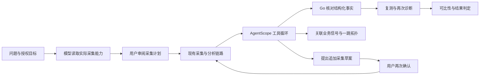

# 诊断 Agent 扩展：实现、使用和验收边界

本轮在现有 AgentScope 2.0.10 / DeepSeek、Go 工具网关、PostgreSQL 和隔离源码执行器上增加八项能力。发布状态与实际运行记录以 [交付矩阵](DELIVERY_MATRIX.md)、[开发日志](../DEVELOPMENT_LOG.md) 和本次发布收据为准。本文说明代码契约，不把实现完成等同于生产准确率验收。

## 一次调查怎样执行



采集 C++ Agent 与 Python 智能体是两个进程边界。智能体只选择固定工具并输出待验证假设；Go 从当前用户、任务、attempt、分析 job/run 和租约裁决执行。浏览器和模型进程没有数据库、对象存储或 Docker 长期凭据。模型不能提交 shell、SQL、任意 URL、PID 或不同项目 ID 来切换授权目标。

## 八项扩展

| 能力 | 实现 | 使用方式与限制 |
| --- | --- | --- |
| 事实校验 | 新 AI 报告协议2：引用工具 E 编号、固定 JSON 路径、操作符、值与单位；Go 用精确数值比较并生成中文描述 | 模型自由解释单列为“未经事实核验”；字段一致不等于因果正确。旧协议1历史报告保留，不补发新可信标签 |
| 动态补证 | `propose_followup_collection` 从实际可用采集器提出草案，数据库保存来源和摘要，确认后创建普通任务；完成分析后再次诊断 | 每根调查最多2分支、20分钟；继承同一目标，跨单位结果不冒充可直接比较。SCRIPT/BOLT/COMPOSITE等需独立配置的类型不自动补证 |
| 跨信号调查 | 固定 `metrics/logs/traces/changes` 工具、已登记一跳上下游拓扑；Prometheus/Loki/Tempo及Drop结构化adapter | 只查询可信配置中的固定语句和地址；日志正文、自由属性及真实Trace ID不进入模型。拓扑是登记关系，不能自动证明根因 |
| 通用项目接入 | 管理员离线 manifest 描述冻结源码、镜像ID、读写范围、构建/回归/profile/benchmark argv及预算 | 当前已实现通用 **Python** adapter；并非任意语言或任意仓库上传执行。CRM/Saber旧preset与冻结业务快照继续独立兼容 |
| 方法库 | 个人/团队/项目草稿、不可变版本、管理员明确审阅发布、退役与有效期 | 当前请求仅使用申请前已发布的最高有效版本，整版替代。组和项目方法不授予采集或数据源权限；历史案例仍为个人范围 |
| 恢复与容错 | PostgreSQL检查点、工具请求摘要/回执、SDK可见上下文、累计预算；有界上游重试和熔断 | 不保存隐藏思维链或 capability；无法确定是否执行的 pending 工具不盲目重做。进程故障后保留原模型、工具和时间预算 |
| 可复现评测 | 新合成 holdout 含正常、证据不足、复合现象、错误归因负控；预登记随机成对重复试验、独立人工评审导入 | 计划不是实跑；重复同情境不是新增独立故障。报告/分析摘要绑定人工标签；没有独立人工审阅时准确率、误报和拒答语义指标保持 `null` |
| 回归生成与补丁 | 模型为新通用Python项目提出独立回归测试，在同一测试文件下验证基线失败/候选通过；冻结原回归、输出类型/值、6组CPU正控与负控；生成SHA绑定的 unified diff | 只在隔离快照应用补丁，包含代码与测试供审阅下载，没有自动发布原业务仓库。纯性能优化没有行为缺陷时，不编造红绿行为测试 |

## 事实与解释为什么分开

模型先通过 `inspect_hotspots`、`check_collection_quality` 等工具获取有界观测，再返回事实引用。例如：

```json
{
  "report_version": 2,
  "facts": [
    {"id": "F1", "evidence_id": "E3", "path": "/top_functions/0/self_percent", "operator": "eq", "value": 70, "unit": "percent"}
  ],
  "hypotheses": [
    {"kind": "cpu_hotspot", "fact_ids": ["F1"], "evidence_ids": ["E3"], "unverified_interpretation": "需要结合负载和对照验证的模型解释"}
  ],
  "verification_requests": [{"origin": "model_proposal", "kind": "controlled_intervention"}]
}
```

此例只解释字段格式，具体假设枚举与最低证据要求以 `diagnosis_facts.go` 和系统提示为准。Go 拒绝不存在的 E 编号、未允许路径、错误单位、数值不一致、缺失必要工具及把人工导入建议冒充已校验复测计划的输出。程序可计算的是返回Top表中正 self 项目数，不能把70%热点或表内仅一项扩大成全树唯一叶帧。最终 summary、claim 与 verification 使用程序模板；模型仍可能对业务解释错误，因此自由解释单列，不能用结构校验通过率代替语义正确率。

## 业务数据源登记

参考 [双服务登记示例](../integrations/observability-demo/observability.example.json)。管理员填写真实 Agent ID、可选组、依赖和每类连接器，API 启动时通过 `AI_OBSERVABILITY_CONFIG` 读取有界JSON文件。它是配置路径；不要将JSON作为环境变量值。部署覆盖见 [compose.agent-expansion.yml](../deploy/compose.agent-expansion.yml)。令牌通过服务器只读文件引用，需要单独挂载，不能嵌入方法库、问题文本或Web配置。

指标只允许固定延迟P95毫秒、错误比例和每秒请求数；Prometheus按窗口取实际点，Loki只投影固定结构字段，Tempo只投影实际Trace数量/时长。Drop adapter还需核验返回服务身份、信号类型、单位与实际 `observed_at` / `started_at`。来源错误时清空部分结果，不能残留一个看似正常的指标。空数据不填零。

20261021版本使用绑定attempt执行起止各扩展一分钟；20261023因果评测实际发现历史正常流量稀释故障P95，后续修复改为优先有界collector执行时钟、旧任务明确attempt窗回退。旧扩窗仅保留为未查询的context_window。起止来源、无效时钟拒绝和源预聚合语义见[当前契约](CONTRACT.md)。查询与脱敏后的数据源版本保存在证据中；配置整体版本改变仍拒绝继续使用旧快照，无热重载。旧评测分数及旧报告不改写。

S1固定为根服务，其余按完整登记范围排序形成S2..S8。撤权后保留内部空占位，不重排其他服务别名；越权服务不查询、不进入模型上下文。历史报告读取和成功提交都重验实际读取数据源的授权，不能通过分享profile任务绕过业务信号权限。当前为组级数据源隔离，不宣称字段级或Loki标签级多租户授权。

## 方法与历史经验

知识页的方法库可以创建草稿，明确填写步骤、反证、停止条件和验收方法；管理员勾选审阅后发布。发布内容不可原地更改，用新版本替代；同一逻辑键不能改变所有者、团队或项目作用域。仅已发布、申请前可用、仍在有效期且本轮匹配的方法进入模型。引用已经退役、撤权、超期或申请后发布的版本会阻止迟到报告提交。

个人历史案例仍只保存固定特征、人工纠正类型或有真实受控修复回执的结构信息，不把自由历史指令或旧模型全文送回模型。案例中的 `skill_refs` 是当前内置目录匹配引用；自定义库方法的实际使用来源保存在原诊断的知识快照，不把案例列表宣称为全部实际方法谱系。团队共享的是审阅过的方法，尚未把个人历史案例跨用户共享，也没有自动将模型自评提升为可信经验。

## 检查点、重试和预算

新协议2的SDK诊断最多8次普通模型调用加1次格式纠错，每轮最多2个工具，累计活动执行时间150秒。同时执行两道工具上限：SDK最多14次回调，Go轨迹最多15条（包括自动提供的E1和知识开启时的E2）；因此知识开启时至多13次后续SDK工具。运行时 `tool_calls` 只统计SDK回调。旧协议预算保持原约束。规划和源码修复使用各自原预算，不能通过恢复、新调用ID或重试清零。

活动时间以5秒预付片计入持久化预算；进程崩溃不退回已经领取的片，离线等待租约恢复不算模型执行时间。检查点保留24小时不表示允许执行24小时。模型回执中的 `elapsed_ms` 仅本Python会话墙钟时间，累计活动预算以Go账本为准。

429、500/502/503/504和瞬态网络失败可以在原模型调用预算内重试，每次逻辑调用最多3次实际请求，每次实际请求都消耗模型预算；退避不超过2秒且取消可中断。400/401/403/404/422不重试。按 endpoint+model 的进程内熔断器在5次瞬态故障后开路30秒，只放一个恢复探针。它不等于跨副本共享熔断或高可用系统。已有工具完整回执可复用，执行状态不明的pending回执拒绝盲重放，仍需错误恢复或重新发起调查。

诊断阶段对已通过工具名、ID、严格JSON及长度校验的Schema参数错误支持原预算内重选：整批不执行，不截取其中合法工具；只把已知工具名、固定校验类型和Schema声明字段反馈给模型。失败参数、未知字段值和自由说明不进入检查点，也不成为测量事实或Skill完成凭据。模型请求用量、已见ID和检查点仍继续累计；非法ID、未知工具、重复JSON键、超长及格式轮工具保持硬拒绝。此机制不绕过Go的第二层参数、权限、来源与租约校验。

最终报告被拒绝时，Go 仅返回白名单字段组成的纠错提示，包括报告分区、条目序号、固定原因和预期工具来源。例如，追加采集草案不能作为 `propose_verification` 的回执；模型须移除错误引用、改成无来源的待确认建议，或取得真实复测计划。反馈不会回显任意路径、原始数值、业务文本或通用错误详情，格式纠错轮仍沿用原预算且不能执行工具。原报告保留失败结果，只有重新提交并通过全部校验的报告才可展示为已核验事实。

同份报告有多处错误时，反馈按事实、复测建议、假设分区轮转，最多6项且完整JSON不超过3500 UTF8字节，兼容运行时原4096字节上限；截断时明确标记，未列出不代表已通过。依赖无效事实的假设不再产生派生提示，但原事实错误仍使整份报告失败。程序不接受局部成功，也不修改模型报告来替它通过。

资源快照通过同一E1返回实际 `sample_count` 和CPU、RSS、虚拟内存、线程、FD及可用主机内存峰值。只投影固定字段，缺失不补零；原始samples、PID与dmesg不进入智能体。CPU多核百分比可超过100，独立限制不放宽函数热点的0至100占比约束。程序生成资源摘要，不把零函数权重当作资源采集失败；峰值不等于持续压力、整容器用量或根因。假设反馈也会具体指出所引用事实缺少哪类前提，例如空变更列表不支持deployment_regression；模型可删除该方向或明确证据不足，程序不替它补造事实。

py-spy原始采样可能包含无法解析的空栈或帧。只有当前attempt的可信py-spy来源才启用专用适配，保留原文件摘要和所有权重，并用明确未知占位符标记缺失；导入数据及通用collapsed语法不放宽。采样质量工具只返回经来源、单位与总权重核对的固定计数，不转发原始栈和自由元信息。可信占位热点标记`unresolved`；仅未知权重不能支持CPU业务热点方向，更不能用它定位源码或声称根因已确认。

## 演示与评测分开验收

[实时双服务演示](../integrations/observability-demo/README.md) 使用真实HTTP、SQLite慢SQL和Python CPU计算，支持normal、slow_query、cpu、upstream_error、timeout及normal恢复。其数据为仓库自有合成业务，遥测内存有界且重启清空，不是生产持久监控系统。

[通用Python项目](../integrations/generic-python/README.md) 提供管理员manifest登记和真实红绿回归/正负性能对照。项目没有实时workload绑定时，只可在独立源码模式使用，不能借用CRM/Saber PID。

[评测流程](../scripts/evaluation/README.md) 要求真实API记录所有预登记trial，包括失败，不择优重跑后删历史；独立人类按报告与分析摘要审阅后才能填语义指标。现有程序能验证工具、字段、数值、授权与测试回执，仍不能保证任意故障的解释和根因正确。面试中应分别说明真实采集、真实模型、受控修复与合成评测各自验证了什么。
