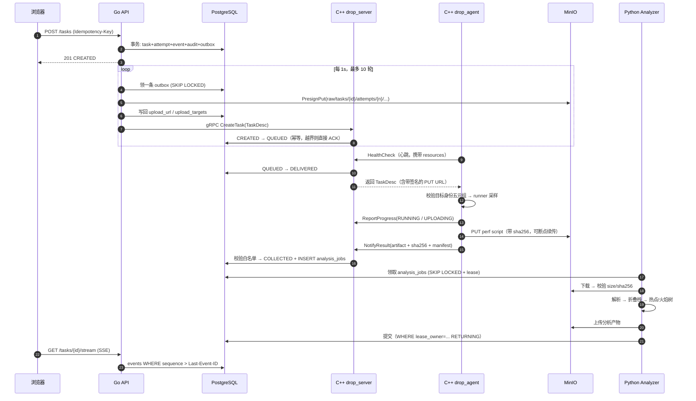

# 一条链路拆到底：PERF_CPU 从点击到火焰图

> 教学用文档。目标不是让你背结论，而是让你在这条链路上有能力自己回答"如果这里挂了会怎样"。
> 所有结论都能在仓库里指到具体文件与行为，标注为 `文件:行`。

---

## 0. 面试官为什么只挑这一条链路

因为一条 `PERF_CPU` 链路就横跨了分布式系统的大部分难点，而且**每个难点都有真实实现可查**：

| 考察维度 | 这条链路上对应的位置 |
| --- | --- |
| 幂等与重试 | HTTP 幂等键 + 请求摘要；Outbox 重投；Core 接单幂等 |
| 事务边界 | task/attempt/event/audit/outbox 五写一事务；对象存储无法入事务 |
| 并发控制 | `SKIP LOCKED` 领任务；`pg_advisory_xact_lock` 配额；分析租约 |
| 迟到消息 | attempt 栅栏（fencing），旧轮次结果不得覆盖新轮次 |
| 安全 | 预签名 URL、对象键前缀、argv 白名单、rlimit、目标身份五元组 |
| 可解释性 | 两条状态轴、事件表、SSE 续传、采样质量证明 |
| 归因诚实 | 丢样"未知不能写成零"、perf.data 不入库的取舍 |

**面试官真正想听的不是"我用了什么"，而是"你在哪里被迫做了取舍，以及你怎么知道取舍没错"。**
下面每一跳都按这个标准写。

---

## 1. 全景时序



**八阶段状态表**（这是面试时你能画出来的最有价值的一张表）：

| 阶段 | collection_status | analysis_status | attempt.status | 谁写的 |
| --- | --- | --- | --- | --- |
| 建任务 | CREATED | PENDING | CREATED | Go（同一事务） |
| 已派发 | QUEUED | PENDING | QUEUED | C++ server |
| Agent 领走 | DELIVERED | PENDING | DELIVERED | C++ server |
| 采样中 | RUNNING | PENDING | RUNNING | agent 上报 |
| 上传中 | UPLOADING | PENDING | UPLOADING | agent 上报 |
| 采到 | COLLECTED | PENDING | COLLECTED | C++ server + 建 analysis_jobs |
| 分析中 | COLLECTED | RUNNING | COLLECTED | Analyzer |
| 完成 | COLLECTED | SUCCESS/FAILED | COLLECTED | Analyzer |

---

## 2. 逐跳拆解

### 第 1 跳｜HTTP 入口：为什么不许"裸重试"

**代码事实**

- `api/internal/service/tasks.go:58` `Create`：先 `CanWrite()` → 校验幂等键 → `Normalize()` → `Validate()` → 检查组 → 算 `RequestHash`。
- `tasks.go:82-92`：同一个 `(creator_id, idempotency_key)` 已存在时，**比对请求摘要**：一致则返回原任务（replayed），不一致直接 `IDEMPOTENCY_CONFLICT`。
- `tasks.go:101-109`：目标 Agent 必须存在、非 disabled/offline、心跳 45 秒内、`Supports(kind)`、资源预算够。
- `tasks.go:120`：`collection_deadline = now + 10min`，在**建任务时**就固定，不是派发时才定。

**它在防什么**

1. 用户双击提交 → 不能产生两个采样任务（浪费目标机 CPU）。
2. 用户改了参数但复用旧幂等键 → 必须报错，不能"悄悄返回旧任务"（否则用户以为新参数生效了）。
3. 建任务时就定 deadline，避免"排队 9 分钟后才开始采集"这种必然超时的任务。

**面试官会问**
> 「幂等只按 key 去重不行吗，为什么还要算请求摘要？」

**答法**：key 只证明"是同一次意图"，摘要才证明"是同一次内容"。只有 key 会出现"客户端复用 key 发新请求"被静默吞掉，返回一个参数完全不同的旧任务——这种 bug 在线上表现为"用户说参数没生效"，极难复盘。摘要冲突要显式失败，让客户端换 key。

**追问下一刀**
> 「摘要用什么算？包含哪些字段？」

`tasks.go:80`：`json.Marshal(in)` 全量序列化后 `DigestBytes`。注意这是**归一化之后**的输入（`Normalize()` 在 `Validate()` 之前），所以"不填时长"和"填默认 10 秒"摘要一致——这是有意的，否则同一语义会撞成冲突。

---

### 第 2 跳｜一个事务写五张表：Outbox 到底买到了什么

**代码事实**（`api/internal/repository/postgres.go:119-175`）

一个事务内依次写：`tasks` → `task_attempts` → `task_events(TASK_CREATED)` → `outbox(DISPATCH)` → `audit_logs`。
并且事务开头先拿 `pg_advisory_xact_lock("task-quota:"+owner)`（`:124`），再做配额检查（`:139`，最多 10 个在跑）。

**它在防什么**

| 做法 | 如果不用会怎样 |
| --- | --- |
| 事件同事务写 | 页面可能看到"没有历史的中间状态"，SSE 收到不存在的跃迁 |
| Outbox 同事务写 | 进程在"写完 task"和"发 RPC"之间崩溃 → 任务永远卡在 CREATED，没人发现 |
| advisory lock 做配额 | 两个并发请求都读到 9 个在跑 → 都放行 → 11 个任务压到同一台机器上 |
| 配额在 DB 层而不是内存 | 多副本 API 部署时，内存计数器各算各的 |

**面试官会问**
> 「Outbox 能保证 exactly-once 吗？」

**答法**：不能，只能保证 **at-least-once 投递**。因为数据库事务无法把远端 gRPC 一起提交——要么先提交再发（可能发两次），要么先发再提交（可能丢）。所以真正的正确性必须由**接收端幂等**兜住：`server.cpp:496` 的 `CreateTask` 会重读持久化状态，`state != CREATED && != QUEUED` 就直接 ACK 返回（`:517-522`），不重复入队。

**追问下一刀**
> 「那 Core 重放时怎么知道这是同一次请求而不是新任务？」

靠 `(task_id, attempt_id)` 身份。`drop.proto:3` 的注释把这条写成了协议级约束：`task_id` 是业务身份，`attempt_id` 是一次执行，二者必须一起参与迟到结果和重试校验。Core 用 `current(task_id, attempt_id, agent_id)`（`:509`）一次校验三者同时对得上。

---

### 第 3 跳｜派发器：一条 SQL 里的三个设计动作

**代码事实**（`postgres.go:355-418`）

```sql
SELECT outbox.* FROM outbox
JOIN tasks ON tasks.id = outbox.task_id
WHERE outbox.published_at IS NULL AND outbox.available_at <= now()
ORDER BY (event_type='CANCEL') DESC,      -- 取消优先
         tasks.priority DESC,             -- 再按业务优先级
         outbox.created_at ASC, id ASC    -- 最后 FIFO
FOR UPDATE OF outbox SKIP LOCKED
LIMIT 1
```

领到之后：`Dispatchable()` 判定 → 调用 `fn`（真正发 RPC）→ 成功才写 `published_at`。

**三个设计动作**

1. **`SKIP LOCKED`**：多副本 API 并发抢同一条 outbox 时，数据库直接跳过被锁的行，不排队等待。这是"用数据库当队列"的标准做法，代价是严格 FIFO 只在不冲突时成立。
2. **`Dispatchable()` 栅栏**（`repository/fencing.go:8`）：`o.AttemptID != latestID || a.ID != latestID` 直接判死。含义是——**一条 DISPATCH 消息只能作用于它出生的那一轮 attempt**。重试后旧消息既不能派发也不能取消。
3. **网络调用不持锁**（`:380` 调用 `fn`，`:377` 之前已判定）：注释写得很清楚，如果持锁发 RPC，Core 自己在处理时会尝试写同一行，形成跨服务死锁。

**失败处理**（`:384-416`）
- 退避：`min(attempt², 60s)`，最多 10 次。
- 耗尽后**重新加锁重读**当前状态再决定是否写 FAILED（`:391-402`）。因为 RPC 返回 `error` 不代表 Core 没收到——可能是 ACK 丢了。
- 判死条件里还有 deadline：`t.DeadlineAt != nil && now > deadline` 也立即放弃。

**面试官会问**
> 「RPC 超时了，你怎么知道任务没被下发给 Agent？如果直接标 FAILED 会怎样？」

**答法**：不能确定，所以不能直接标。Core 可能已经入队（QUEUED），Agent 可能已经开始采样。这时 API 把任务标 FAILED，而 Agent 还在跑，采集结果回来时就会发现任务终态、结果无处安放——数据白采，还留下一台机器被无谓占用的现场。正确顺序是：**先重读持久状态，如果它已被推进，就只放弃这条消息，不覆盖状态。** 这就是 `:399` 那次 `Dispatchable(current, ...)` 重判的意义。

**追问下一刀**
> 「那 Core 处理重复 CreateTask 时会不会重复入队？」

不会。`server.cpp:518`：状态已不是 CREATED/QUEUED 就直接 ACK，连 event 都不写。

---

### 第 4 跳｜授权面：预签名 URL 是"能力"，不是"权限"

**代码事实**

- `api/internal/storage/minio.go:56`：`PresignPut` TTL **10 分钟**；`PresignGet` 5 分钟。
- `api/internal/service/dispatch_v2.go:70-86`：除了 RAW，还**固定**下发 `runner.log`（≤16KB）和 `collection-manifest.json`（≤64KB），对象键按 `raw|manifest|binary/tasks/{id}/attempts/{n}/` 三段分域。
- `dispatch_v2.go:74-77`：先断言 `path.Dir(RawObjectKey)` 必须等于 `raw/tasks/{id}/attempts/{n}`，否则 `INVALID_STATE`。
- `tasks.go:322-328`：签名后把 URL **写回 `task_attempts.raw_upload_url`**，再随 TaskDesc 下发。

**它在防什么**

预签名 URL 本质是一张**有时效的写凭证**。如果不在服务端构造，而是让 Agent 自己拼对象键，Agent 就获得了"往任意 key 写任意内容"的能力——一台被攻陷的采集机可以覆盖别的任务的制品。所以：

- 键由服务端生成，Agent 只能拿到 URL；
- 每个 URL 的作用域被前缀锁死到一个 attempt；
- 辅助制品有**名字白名单 + 字节上限**（`dispatch_v2.go:70-73`），因为 Agent 能控制内容，不能让它把 `perf script` 原文塞进"日志"里绕过制品校验。

**面试官会问**
> 「URL 存在数据库里，数据库泄露等于上传权限泄露，你怎么看？」

**答法**（这条要诚实）：确实是残余风险，缓解有三层：
1. TTL 10 分钟，不是长期密钥；
2. 任务进入终态时会清空 `raw_upload_url` 并把 `upload_targets` 收敛（`postgres.go:207`、`:406`）；
3. `repository/upload_grants.go:88` 有独立的清理扫描，专门找"已终态或已不是最新 attempt 但还留着授权"的行。
但它**不是零风险**：DB 快照 + 10 分钟内的时间窗仍然可以写。更彻底的做法是让 MinIO 只信任短时 STS 或让 Agent 走服务端中转，代价是带宽全部压到 API。

**追问下一刀**
> 「为什么不直接把文件传给 API，由 API 转存？」

因为大文件不能过 HTTP handler 或 gRPC（`docs/CONTRACT.md` 的硬约束）：一次 32MB×N 并发会把 API 的内存和连接池吃穿，而且 API 重启会打断上传。直传对象存储把这条路径的失败域限制在 Agent 与 MinIO 之间。

---

### 第 5 跳｜Core 接单：它也必须幂等，而且要注意锁顺序

**代码事实**（`core/src/server.cpp:496-546`）

1. `require_api(context)`：mTLS 证书必须是 API 那本，Agent 不能冒充 API 下单。
2. `pg_advisory_xact_lock(hashtextextended(target_agent_id, 41762032))`（`:507`）。
3. 优先级一致性校验：请求里的 priority 与库里的不一致就拒（`:513-516`），防止旧版 API 回滚把优先级覆盖成 0。
4. 队列上限：同一 Agent `QUEUED` 数量 ≥ 32 且当前不在 QUEUED → `RESOURCE_EXHAUSTED`（`:530`）。
5. 状态推进 CREATED → QUEUED + 写 `DISPATCH_QUEUED` 事件。

**锁顺序那段注释是全项目最值得背的一句**（`:505-506`）：

> 队列准入使用独立的 Agent 级锁空间；若持有 Task 锁之后再取 Agent 行锁，就会与 Collect 的 Agent→Task 顺序相反，从而引入死锁。

**面试官会问**
> 「为什么不用数据库行锁，用 advisory lock？」

行锁的粒度是"现有的行"，而队列准入要保护的是**一个逻辑区间**（某 Agent 的 QUEUED 集合），这个集合里可能一行都没有，锁不住。advisory lock 可以是纯逻辑键。同时它必须和 `Collect` 路径的加锁顺序一致，否则两条路径互相等。

**追问下一刀**
> 「32 这个数字怎么来的？」

不是拍的：`task-kinds.json` 里 `PERF_CPU.max_concurrency_per_agent = 1`（采集器本身串行），32 是排队深度上限——超过这个数说明目标节点已经严重积压，继续接单只会让 deadline（10 分钟）成批失效。这是**背压**，不是限流。

---

### 第 6 跳｜Agent 执行：先证明"你确实是你"，再限制"你能干什么"

**代码事实**

目标身份校验（`core/src/target.cpp:106-137`）用的是一个**五元组 + inode**：

```
pid, uid, namespace_pid, start_time_ticks, pid_namespace，(executable, dev, inode)
```

- `start_time_ticks`（`/proc/PID/stat` 第 22 字段）→ 防 PID 复用（`:132-133` "Target PID was reused"）；
- `pid_namespace` → 防容器内外的 PID 编号空间被混用；
- `executable + dev/inode` → 防"同名可执行文件被替换"。

策略开关（`:139-162`）默认全关：`ALLOW_HOST_PROCESSES=false`、`ALLOW_CONTAINERS=false`、`ALLOW_HOST_RESOURCES=false`，只允许采集 Agent 自己的受控进程；allowed UID / container ID 都是白名单。

进程执行沙箱（`core/src/process.cpp:238-382`）：

| 手段 | 位置 | 作用 |
| --- | --- | --- |
| 可执行文件必须绝对路径 | `:243` | 禁止 PATH 查找被劫持 |
| argv 内不得含 `\0` | `:247-249` | 防参数注入截断 |
| `setpgid(0,0)` + `kill(-child, …)` | `:296`、`:359` | 按进程组回收，避免采集器的孙进程残留 |
| `PR_SET_PDEATHSIG(SIGKILL)` | `:297` | Agent 死了，采集子进程必须跟着死 |
| `umask(0077)` | `:298` | 产物默认不可被同机其他用户读 |
| `RLIMIT_FSIZE / CORE / CPU / NOFILE / AS` | `:302-321` | 文件、core、CPU 秒、句柄、地址空间五重上限 |
| 只传三个环境变量 | `:326-333` | 不继承 `LD_PRELOAD` 之类的注入面 |
| 进程数预算每 50ms 采样 | `:352-363` | fork 炸弹防护；读数失败按超预算处理 |
| `SIGTERM` → 2s → `SIGKILL` | `:364-372` | 先给清理机会，再硬杀 |

**面试官会问**
> 「为什么要 `start_time_ticks`？PID 不是唯一的吗？」

**答法**：PID 会复用。用户点"采集 PID 1234"，从 API 到 Agent 拿到任务可能隔几秒，这期间原进程退出、系统把 1234 分配给了另一个进程。此时采集的不是用户想看的服务——最坏情况是采到了监控进程或数据库，产出完全错误的火焰图，而报告看起来"很正常"。`start_time_ticks` 是内核维护的启动时刻，配合 pid_namespace 和可执行 inode 才能唯一确定"还是那个进程"。

**追问下一刀**
> 「那 API 侧为什么还要传 `expected_uid`？」

纵深防御。身份四元组能证明"是同一个进程"，但证明不了"你有权采它"。UID 校验是权限层，`target_policy.allowed_uids` 是授权层，两层都在 Agent 本地判，不依赖 API 的善意。

---

### 第 7 跳｜采样本身：一条命令背后的三个决定

**代码事实**（`core/src/runner.cpp:1220-1254`）

```
perf record --clockid mono -e <event> -F <hz> -g -p <pid> --call-graph fp|dwarf,8192
perf script --ns --show-lost-events -F comm,pid,tid,time,event,ip,sym,dso -i perf.data
```

- `event` 只允许 `cpu-clock / cycles / instructions`（`:1228-1229`）；`call_graph` 只允许 `fp / dwarf`（`:1231-1235`）。**白名单，不是自由参数**——perf 支持上百个 event，放开等于给了一个任意内核探针入口。
- `--clockid mono`：用单调时钟，避免 NTP 跳变让时间轴出现回退。
- `protocol_version >= 2` 上传 **perf script 文本**；`== 1` 才在本地折叠成 folded（`:1246-1254`）。
- `scan_perf_loss()`（`sampling.cpp:16-90`）：直接解析 `perf.data` 的二进制记录，统计 `PERF_RECORD_LOST`(type 2)、`LOST_SAMPLES`(type 13)、样本数(type 9)。遇到 `COMPRESSED`(81) 直接放弃——因为压缩块里可能嵌套丢失记录，只看外层会漏。
- 解析失败时 `complete = false`，metadata 里写成 `lost_records: null` + `loss_proof: "unknown"`（`:1258-1265`）。

**这段是整个项目"诚实性"的样板**（`sampling.cpp:86-87` 的注释）：

> 数据未知或被截断时不能报告零丢失，否则会给诊断造成错误的质量保证。

**面试官会问**
> 「为什么要把 perf script 上传，而不是上传 perf.data？」

**答法**（取舍题，必须讲两面）：
- 选 script：文本可审计、体积可控、分析侧不依赖目标机的 build-id 与符号文件、跨机可复现。
- 代价：丢失了 perf.data 里的原始样本元数据（精确 period、raw registers、mmap 历史），事后无法用 `perf report` 重新挖掘，也无法换一套符号解析重新出图。这是个**单向的信息损失**。

**追问下一刀**
> 「那 `native_data_sha256` 这个字段有什么用？」

**这里就是这条链路的第一个真实伤口**：`runner.cpp:1272` 把 `perf.data` 的 sha256 写进 metadata，但 `perf.data` **不上传、`agent.cpp:1521` 还把它删掉**。所以这个哈希只能证明"采集那一刻本地文件是这个内容"，无法被任何第三方复核。面试官如果顺着问"这个 sha 谁能验"，你必须承认：**没人能验**。诚实的说法是它是"采集端自证"，不是"可审计证据"。修法是上传 perf.data（体积换证据）或干脆不记这个字段（避免制造无法兑现的可验证性）。

---

### 第 8 跳｜上传与回报：先把结果落盘，再谈网络

**代码事实**

`agent.cpp:945-990` 的 `complete()`：**先 `persist_result()` 把 ResultRequest 序列化成 `result.pb` 落盘**（`:626-628`），再上传。注释（`:622-623`）：

> 网络成功但响应丢失时，可依据同一记录重放，避免重新执行昂贵采样。

上传的恢复机制（`agent.cpp:711-782`）：
- 每个制品上传成功后写一个 `uploaded-<name>` 标记文件，内容是 sha256；
- 重来的时候先比对标记里的 sha256 与本地文件，一致就跳过；
- 有 overall deadline 与 per-retry 上限，超时就失败而不是无限重试；
- 失败降级（`:975-989`）：`result.set_success(false)`，`error_code` 在 `TASK_CANCELED / TASK_TIMEOUT / ARTIFACT_UPLOAD_FAILED` 之间选，然后 **`result.clear_artifacts()`** —— 失败任务绝不允许把一个没传完的 RAW 登记成成功制品，只保留受限的 LOG。

**面试官会问**
> 「既然有 `result.pb`，为什么还要标记文件？」

**答法**：两个不同层次的幂等。`result.pb` 保证"这次执行的结果整体不丢"，标记文件保证"这次上传不必从头再来"。32MB 在一个受限带宽的节点上可能要几十秒，全部重传会挤掉其他任务的上传窗口。标记文件 + sha 校验让重试成本从 O(全量) 降到 O(未完成部分)。

**追问下一刀**
> 「Agent 本地磁盘不够怎么办？」

有独立的 `recovery_disk_bytes_` 预算（`agent.cpp:928-938`），失败任务的 RAW 只保留一个配置期，超预算直接放弃保留。这是一个明确的取舍：**优先保证节点可用，其次才是可恢复性**。

---

### 第 9 跳｜结果落库：Core 是最后一道校验闸

**代码事实**（`core/src/server.cpp:396-489`）

NotifyResult 的接收顺序：

1. 状态必须是 `UPLOADING`（`:397`），否则拒绝；再走 `collection_transition_allowed` 校验（`include/drop/domain.hpp:64-76`）。
2. RAW 校验（`:396-410`）：`content_type` 必须等于目录声明、`format` 在允许集合内、`size > 0 && <= budget`、`sha256` 必须 64 位小写十六进制。
3. 辅助制品校验（`:412-449`）：数量 ≤ 4、名字必须与下发的 grant 一一对应、object_key 必须完全一致、大小不超 grant 上限、`content_type`/`format` 必须匹配；`kind` 只能是 `BINARY / LOG / MANIFEST`。
4. MANIFEST 校验（`:435-445`）：key 必须是 `manifest/tasks/{id}/attempts/{n}/collection-manifest.json`，大小 ≤ 64KB。**缺了直接抛错**（`:450-454`）——采集回执是强制项。
5. 一个事务里：`tasks → COLLECTED / analysis_status=PENDING`（`:466`）→ attempt `COLLECTED` + 清空上传授权（`:471`）→ `INSERT analysis_jobs ... ON CONFLICT DO NOTHING`（`:480`）→ 两个事件。
6. 状态机（`domain.hpp:64-76`）明确：终态不可离开；任何非终态只能走向 FAILED/CANCELED；正向只能 `CREATED→QUEUED→DELIVERED→RUNNING→UPLOADING→COLLECTED`。

**面试官会问**
> 「为什么制品校验放在 Core，不放 Analyzer？」

**答法**：Core 是唯一同时知道"我下发了什么授权"和"Agent 声称传了什么"的一方。Analyzer 只看到 artifacts 表，它无法判断"这个 object_key 是不是当初 grant 的那一个"。校验放在 Core，是在**写入真相之前**拦截；放在 Analyzer 就变成"先信了，再检查"，DB 里已经有脏数据。

**追问下一刀**
> 「`ON CONFLICT DO NOTHING` 会不会导致分析永远不跑？」

不会导致静默，是**恰好一次**语义：`(task_id, attempt_id)` 唯一，重放不会建第二个 job。但如果第一次 INSERT 成功、事务却回滚，`analysis_jobs` 也没了——两者同事务，不会出现"结果在、job 丢"。

---

### 第 10 跳｜Analyzer：租约不是锁，是"带过期的所有权"

**代码事实**

- 领取（`analyzer/drop_analyzer/repository.py:116-140`）：
```sql
WHERE (j.status='pending' AND j.available_at<=now())
   OR (j.status='retry' AND j.available_at<=now())
   OR (j.status='running' AND j.lease_expires_at<now())
ORDER BY j.priority DESC, j.created_at, j.id
FOR UPDATE OF j, t SKIP LOCKED
LIMIT 1
```
  注意第三条：**过期的 running 可以被重新领取**，`attempt+1`，`max_attempts` 默认 3，耗尽的转 `failed(ANALYSIS_RETRY_EXHAUSTED)`（`:89-95`）。
- 续约（`:172-187`）不只查自己，还带一个 EXISTS：
```sql
AND EXISTS (SELECT 1 FROM tasks t JOIN task_attempts a ON a.id=j.attempt_id
  WHERE t.id=j.task_id AND t.collection_status='COLLECTED'
    AND t.analysis_status='RUNNING'
    AND NOT EXISTS (SELECT 1 FROM task_attempts newer
                    WHERE newer.task_id=t.id AND newer.attempt>a.attempt))
```
- 提交（`:428-435`）：`UPDATE analysis_jobs ... WHERE lease_owner=? AND attempt=? AND lease_expires_at>clock_timestamp()`，**`rowcount != 1` 就 `raise LeaseLost`**。
- 时间用 `clock_timestamp()` 而不是 `now()`：`now()` 是事务开始时间，长事务里会"冻结"，导致租约判断失真。

**它在防什么**

| 场景 | 靠什么挡住 |
| --- | --- |
| 两个 worker 抢同一个 job | `SKIP LOCKED` |
| worker 卡死但没退出 | 租约过期 → 被重新领取 |
| 旧 worker 醒来继续写结果 | 提交时的 `lease_owner + attempt + lease_expires_at` 三重条件 |
| 用户取消了任务，分析还在跑 | 续约/加锁 SQL 里 `t.analysis_status='RUNNING'` 不成立 → 直接失权 |
| 任务已重试到新 attempt | EXISTS 里 `NOT EXISTS newer.attempt > a.attempt` |

**最漂亮的一点**：取消不需要"通知 Analyzer"。API 把 `tasks.analysis_status` 改成 CANCELED（`postgres.go:200`），worker 下一次续约（默认几十秒内）就自然失败，然后走 `LeaseLost` 退出。**用共享状态做栅栏，比发消息可靠**——消息会丢、会迟到，而状态是所有人读同一份。

**面试官会问**
> 「租约会话 60 秒，但解析一个大文件要 3 分钟，怎么办？」

**答法**：靠后台续约线程（`worker.py:130` 起的 `analysis-lease` daemon），把租约延长到 `clock_timestamp()+60s`。关键风险是**续约线程自己卡住**（比如 DB 连接池耗尽），这时主线程还在算，租约却过期了。所以真正的安全边界不只在续约，还在提交时的 `lease_expires_at > clock_timestamp()`——提交那一刻再验一次，过期就丢弃结果。代价是可能白算一次，收益是绝不会发布两个 worker 的冲突结果。

**追问下一刀**
> 「续约失败后主线程怎么知道？」

`LeaseGuard.check()`（`worker.py:212/224/284/312/361/364/392`）被插在每一个可能耗时的节点前：下载前、下载后、解析前、上传前、提交前。这是一张**检查点网**，而不是依赖一个全局标志位。

---

### 第 11 跳｜展示：SSE 为什么是"每秒查数据库"

**代码事实**（`api/internal/httpapi/resources.go:338-390`）

- `Last-Event-ID` 作为游标，`Events(id, after)` 按 `sequence` 升序取（`postgres.go:305-309`）。
- 循环里每次先重验 session 和任务权限（`:361-368`），权限被撤销立刻断开。
- 1 秒轮询 + 15 秒 keepalive（`:356-359`）。
- 只有成功写出的事件才推进 `after`（`:379`），写失败就退出，保证游标不会"越过"没送达的事件。

**面试官会问**
> 「为什么不用 `LISTEN/NOTIFY` 或者消息队列？每秒轮询不浪费吗？」

**答法**（诚实）：这是明确的取舍。
- 轮询的好处：**实现简单且天然幂等**——SSE 断线重连只要带上 `Last-Event-ID`，从表里补就行，不依赖任何内存态。多副本 API 也不需要共享订阅。
- 代价：N 个在线客户端 = N 次/秒的 `SELECT ... WHERE sequence > ?`；`idx_task_events_task_sequence` 让它是索引区间扫描，单条成本低，但规模上不去。
- 如果要做大：`LISTEN/NOTIFY` 只做"有新事件"的信号，数据仍然回表读（避免 NOTIFY 的 8KB payload 限制和丢消息问题），同时保留轮询作为兜底。**信号可以丢，数据不能丢。**

---

## 3. 五个必须能背下来的不变量

1. **一个 task 可以有多个 attempt，但任何写操作都必须绑定"当前最新 attempt"**。
   违反示例：旧 attempt 的迟到结果把新 attempt 的 COLLECTED 覆盖成 FAILED。
   防线：`Dispatchable()`、`NotifyResult` 的 `task_id+attempt_id` 校验、`upload_grants` 清理。

2. **采集状态与分析状态是两条独立轴，不能互相冒充**（`domain/task.go:3` 的包注释、`:203 Terminal()`）。
   `Terminal()` 特意写成：采集成功**不算结束**，还要等分析成功或失败。因为 `COLLECTED` 不代表有火焰图。

3. **对象存储的写入不在任何事务里，所以只能靠"稳定键 + 完整性信息 + 幂等重试"恢复**（`postgres.go:317-318` 注释）。
   推论：可能出现"对象在、DB 没记"的孤儿对象（可清理），但绝不能出现"DB 记了、对象不在"（会被 sha256 校验挡在 Analyzer 门口）。

4. **所有"能力"都有作用域和时效**：预签名 URL 绑定 prefix + 10 分钟；租约绑定 worker + attempt + 到期时间；工具参数绑定白名单。

5. **未知不等于零**。丢样未知写 `null`、`loss_proof: "unknown"`；日志只记安全类别不记凭据。

---

## 4. 面试官深挖题库（按难度四档）

### 第一档｜能把流程讲清楚（筛人线）

**Q1. 讲一下从点击到出图的完整路径。**
要点：11 跳，每跳"谁 → 写什么状态 → 失败会怎样"。不要背技术名，要讲状态跃迁。

**Q2. 为什么中间要有一个 C++ 的 server，Go API 直接连 Agent 不行吗？**
要点：Go 管身份/业务/权限（有状态、要事务），C++ 管长连接、心跳、队列、进程执行（要低延迟、要贴近内核）。混在一起会让"用户请求"和"机器长连接"共享同一个故障域。而且 Agent 需要 mTLS + 协议版本协商 + 能力探测，这些和 HTTP 业务语义不是一类东西。

**Q3. 两条状态轴为什么分开？**
要点：采集成功 ≠ 分析成功。合成一条会丢失"采到了但解析失败"这个非常常见的状态，用户看到"失败"就以为要重新采，实际只需要重跑分析。

### 第二档｜一致性与并发（分水岭）

**Q4. 讲一个你处理过的"迟到消息"场景。**
要点：重试后旧 attempt 的结果回来。防线三层：Core 按 `(task_id, attempt_id)` 校验、`Retry` 时清空旧 attempt 的上传授权（`postgres.go:272`）、Analyzer 续约 SQL 里的 `NOT EXISTS newer.attempt`。
追问：**最早在哪一层能拦住？** 答：最早在 API 的 `Dispatchable`（连消息都不发），最晚在 Analyzer 提交（`LeaseLost`）。越早拦越省资源，越晚拦越安全——所以三层都要有。

**Q5. 分析 worker 明明超时了，结果还写进去了，你怎么防？**
答：靠提交那一刻的 `WHERE lease_expires_at > clock_timestamp()` 且检查 `rowcount`。写库之前一定再验所有权，不能"我领到过"就等于"我还拥有"。

**Q6. 取消一个正在上传的任务，怎么保证不出现半成品？**
答：API 侧事务里同时改 `tasks/attempt` 并清空上传授权（`postgres.go:200-215`）；Agent 侧上传前检查 deadline 与 cancel 标志（`agent.cpp:753-756`）；Core 侧只有 `UPLOADING` 状态才接受结果（`server.cpp:397`）。三处任何一处生效，结果都进不了库。

**Q7. 为什么要用 advisory lock 而不是 `SELECT ... FOR UPDATE` 做配额？**
答：配额保护的是"某个 owner 当前在跑的任务集合"，不是某一行；集合为空时没有行可锁。advisory lock 是纯逻辑锁，且 `_xact_` 变体随事务自动释放，不会泄漏锁。

### 第三档｜安全（能拉开差距）

**Q8. 你的采集 Agent 能跑 perf，等于给了 root 一半的能力，怎么限制？**
答：六层。① 目标白名单（默认只允许自己的受控进程，UID/容器 ID 白名单）；② 参数白名单（event 三选一、callgraph 二选一，`extra_parameters_json` 只做 schema 校验，**不能变成 argv**，见 `drop.proto:99`）；③ 执行沙箱（绝对路径、清空环境变量、五重 rlimit、进程组回收）；④ 产物约束（大小/格式/类型/manifest 强制）；⑤ 授权最小化（预签名 URL 只对一个 attempt 的一个 key 有效）；⑥ 失败降级（没传完就不许登记成功制品）。

**Q9. 如果 Agent 被攻陷，攻击者能做什么？**
答（必须诚实）：
- 能在自己那台机器上伪造采集内容（这是**无法从客户端证明的**，只能靠 manifest + 质量指标（丢样、样本数）做启发式怀疑）；
- 能写自己那一个 attempt 前缀下的对象，不能覆盖别人的；
- 不能调任意进程参数（argv 由 Agent 的 runner 构造，API 只给白名单枚举值）；
- 不能拿到长期存储密钥（只有 10 分钟预签名 URL）。
**边界**：平台无法证明"采到的数据是真的"，只能证明"格式合法、来源可追溯"。这一点必须在报告里写清楚，而不是假装有签名就能证明真实性。

**Q10. 为什么日志只允许白名单字段？**
答：`dispatch_v2.go:68-70` 注释：采集器原始 stderr 可能含路径、环境变量、甚至连接串。日志是**最容易泄露凭据的制品**，所以它有独立的 16KB 上限和 `log_jsonl` 格式，而不是"把 stdout 全传上来"。

### 第四档｜归因与诚实（区分"做过"和"想清楚了"）

**Q11. 你的系统能定位根因吗？**
答（最关键的诚实题）：不能可靠定位。README 记录的一组六轮因果实验里，12 次诊断执行成功，综合判定只有 2/6，SQL/超时方向仍有缺口。系统能保证的是"事实可追溯 + 假设可验证"，不是"根因正确"。

**Q12. 热点重复出现，能说明是根因吗？**
答：不能。热点只是"CPU 花在这里"，可能是结果不是原因（比如锁竞争的热点在下游）。所以平台把**程序核对的结构化事实**和**模型提出的业务解释**分开展示（README 的"报告"段），并且要求复测/干预才能升级为结论。

**Q13. 丢样率 0 就是好数据吗？**
答：先问"这个 0 是怎么来的"。`scan_perf_loss` 只在**完整解析完整个 perf.data 记录流**时才 `complete=true`；遇到压缩记录、截断、超限都归 `unknown`。所以"0"必须是"证明了是 0"，否则应该显示 `null`。这是本项目和"看起来有数据"的系统最大的区别。

**Q14. 如果让你重做，这条链路改哪里？**
答：见下一节，直接给三条，有具体方案而不是"加监控"。

---

## 5. 这条链路的五个真实伤口（面试时的加分项）

面试官最欣赏"自己指出问题 + 给出修法 + 说明代价"。下面五条都是代码里能指到的。

### 伤口 1｜`native_data_sha256` 指向一个不存在的对象

`runner.cpp:1272` 记录 `perf.data` 的哈希，但文件不上传且被删除（`agent.cpp:1521`）。这是一个**无法被任何第三方验证的完整性声明**。
- 面试话术：「这个字段目前只有采集端自证价值，不构成可审计证据，我在文档里会明确标注它的边界。」
- 修法 A：上传 perf.data（证据完整，代价是体积 ×5~10、以及可能的符号泄露）。
- 修法 B：删掉字段，只保留 `perf_script_sha256`（诚实但信息更少）。
- 修法 C：把 perf.data 落到节点本地保留期目录，metadata 里记录"存档位置 + 保留截止时间"，把它变成"可选取证"而不是"声称已验证"。

### 伤口 2｜状态机在两个服务里各写一半

`collection_transition_allowed` 只在 C++ 的 `Progress` 路径生效（`server.cpp:292`）；Go 侧的 `Cancel` 直接 UPDATE（`postgres.go:200`），`Retry` 也是直接 UPDATE（`:285`）。DB 只有 `CHECK(status IN (...))` 的**值域**约束，没有**迁移**约束。
- 风险：新增一条写路径时忘了调用迁移函数，就可能写出非法跃迁，而且没有任何测试会红。
- 修法：把迁移规则下沉到 PostgreSQL（`BEFORE UPDATE` 触发器）或至少做成两侧共享的测试向量（现在 `contracts/task-kinds.json` 是共享真源，状态机还没有）。

### 伤口 3｜预签名 URL 持久化在业务库里

`task_attempts.raw_upload_url` 存的是**可用凭证**。虽然 TTL 10 分钟 + 终态清理 + 独立 sweeper（`upload_grants.go:88`），但 DB 备份/只读副本会把它带出去。
- 修法：只存 `object_key + expires_at`，URL 在派发时即时生成、不落库。

### 伤口 4｜SSE 是每秒轮询数据库

`resources.go:356` 的 1 秒 ticker。单机能撑，副本一多、客户端一多就是 N×QPS 的固定成本，而且 `Events` 每条连接独立查询，没有合并。
- 修法：`LISTEN/NOTIFY` 只做唤醒信号，读取仍然回表；再加一个按 `task_id` 的进程内 fan-out，把同一任务的多个订阅者合并成一次查询。

### 伤口 5｜派发吞吐被单条串行 RPC 限住

`Run()`（`tasks.go:271-285`）虽然是"每 tick 最多 10 次 `dispatch()`"，但循环体里一旦 `dispatch()` 返回 error 就 **break**。所以 Core 慢的时候，实际是"每秒一次尝试、每次最多阻塞 4 秒被超时"——有效派发速率会掉到 0.2 条/秒量级，而且没有任何并发。
- 修法：`DispatchOne` 改成批量领取（`LIMIT n`）+ 并发发送，用 `errgroup` 控制并发度；失败不 break 整轮，只把该条退避；或者把派发从 API 进程里拆成独立 worker，与 HTTP 服务解耦。

---

## 6. 自测（不看上文，口头答一遍）

1. 用户在 00:00:00 建任务，Agent 在 00:09:50 才领到，会发生什么？哪一层先拒绝？
2. 同一条 DISPATCH 消息被投递了三次，Agent 会不会采三次？
3. Agent 上报 `sha256` 但对象实际不存在，谁先发现？报什么错？
4. 分析 worker 在第 55 秒提交成功，但第 61 秒才返回 HTTP 200，会有问题吗？
5. 用户取消任务时，Analyzer 正在做最后的 result 上传，结果会进库吗？
6. 为什么 `analysis_jobs` 要有 `UNIQUE(task_id, attempt_id)`，而不是只靠应用层判断？
7. 如果 Core 的 `NotifyResult` 事务提交成功但 ACK 丢了，Agent 重试时会怎样？
8. 一个任务的 `collection_status=COLLECTED` 但 `analysis_status=PENDING` 卡了两小时，你会先查哪里？

> 提示：第 1 题看 `DispatchOne:386` 与 Agent 的 deadline 检查；第 5 题看 `renew` 的 EXISTS 与 `complete` 的 rowcount；第 8 题先看 `analysis_jobs.lease_expires_at` 和 `attempt`，再看 `available_at`。

---

## 7. 陈述稿

### 30 秒版

> 这是一个分布式性能诊断平台。用户选进程和采样参数，平台把任务派到目标机的 C++ Agent，用 perf 采样后直传对象存储，Python Analyzer 解析成火焰图和热点，Web 用 SSE 实时推进状态。
> 我重点做了三件事：用 Outbox + attempt 栅栏保证重试不会让旧结果覆盖新结果；用数据库租约 + 提交时校验保证分析不会被两个 worker 写重；把"采到了但数据质量未知"显式表达成 `unknown` 而不是 0。

### 3 分钟版（按"取舍"组织，不按"模块"组织）

1. **取舍一：大文件不过 API**。代价是要处理"对象写了但 DB 没记"的孤儿，收益是 API 不承载带宽。
2. **取舍二：Outbox 而非分布式事务**。代价是至少一次投递 + 需要接收端幂等，收益是不丢任务。
3. **取舍三：状态栅栏而非通知**。取消任务时不去通知 Analyzer，而是让它的租约续期自然失败。代价是最多延迟一个续约周期，收益是不会因为消息丢失而取消不掉。
4. **取舍四：诚实标注不确定性**。丢样未知写 `null`，AI 结论与程序事实分开呈现，并且公开承认根因准确率只有 2/6。
5. 最后一句收尾：**这个项目的价值不在于"能自动找到根因"，而在于"每一次结论都能被复核，包括它错在哪里"。**
