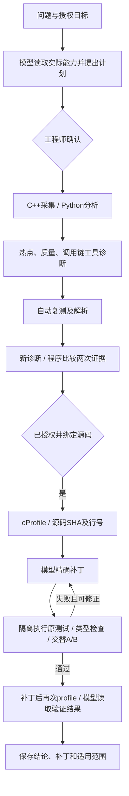

# Drop 性能调查 Agent V2 · AgentScope2.0.10

当前部署为API12/runtime2/Web10/AgentHelper3/SQL8，规划、诊断、源码修复均执行官方AgentScope Agent的原生ReAct。Go保留权限、状态、预算和最终验收，工具能力不会下放给任意shell。新Saber调查11/修复9完整网页76.4秒、四个独立SDK运行证明，原2+冻结6/384例/6组对照通过，CPU中位1.5587倍，仅为受控组件基准。

见[框架与平台分工](AGENTSCOPE_INTEGRATION.md)、[本轮发布与失败记录](releases/20261020-agentscope.md)、[面试操作](INTERVIEW_DEMO.md)。这是导师基础链路上的独立扩展，不代表腾讯内部实现。以下保留CRM早期验收与通用工作流说明。

管理员进入页面，选择已接入的Python CRM、描述问题，并授权采集及可选的源码处理。点“生成采集计划”，审阅采集器、时长、频率与理由后确认。计划生成期间不采集。平台随后自动采集、诊断、复测、再次诊断和比较；关联源码时继续完成隔离修复与回归。早期CRM真实记录是调查#4、原任务#11、复测#12、诊断#9/#10、源码修复#4。

当前由官方AgentScope Agent执行受控ReAct行动/观测循环。模型选择工具，平台执行并回填真实观测；参数拒绝也作为反馈。计划器最多6轮/10次工具/150秒，普通诊断4轮（第4轮无效报告允许第5轮纯格式纠错）/含初始证据最多8条/150秒，源码8轮/12次工具/2次实际沙箱测试/420秒。错误JSON可在剩余预算内修正。记录行动、观测与简短理由，不记录隐藏思维链。

从零计划依据实际Agent目录选择采集器，并受TaskKind参数与授权目标限制；不能指定任意shell、URL、SQL或替换目标。缺少专用端口、模板等配置时不能捏造配置。部分采集器需要人工补充配置，不是所有任务都能无条件自动复测。

## Python CRM 的实际结果

源码是用户的 `E:/crm/AiNativeCrm-python`。没有读取真实.env或客户数据，没有改写原TS项目。首个登记场景是品牌配色预览调用的 `crm/services/brand_palette.py`。快照408文件，版本`20eb8592d7a6c9b959113417de45ef99ec2c6b2125b9c635b9c15cd574cf12a5`；该文件SHA为`4c72a5853abef39e59c7b8df392e140333da4659f76ddea944a20e83528e3e9d`。root登记的镜像、源码及PID/启动时间/UID建立绑定，模型不猜仓库。

真实计划选择PYTHON_CPU、10秒、99Hz；原采集987个样本、258个树节点。复测后自动新诊断实际调用compare_profiles。原样本少于描述门槛1000，程序保留insufficient_evidence，重复采样root_cause_status仍为not_tested，没有以热点重复出现宣布根因成立。

源码Agent实际运行cProfile，定位linear第31行、contrast第96行及内部luminance第97行等重复颜色转换，在隔离副本对linear/lch/from_lch及独立亮度计算加入有界缓存，保留原Python类型和可变对象隔离。

| 验证 | 实际结果 |
| --- | --- |
| 原CRM回归 + 冻结Python类型/隔离/接口身份/60次限流检查 | 通过 |
| 6组交替A/B，每组4个边界色与60个随机色、两侧新进程 | 384次类型和值完全一致 |
| CPU process time中位加速比 | 4.3343×，6/6组超过1.05；门槛为中位至少1.10且至少5组超过1.05 |
| 补丁后profile | 实际重新执行，提供给模型生成最终报告 |
| 无逻辑变化的注释补丁 | 正确性通过；CPU比1.0540×、3/6组，性能门槛拒绝 |
| 把ramp返回list改成tuple的旧模型补丁 | 冻结Python契约回归拒绝；旧成功状态已审计撤销，失败记录保留 |

验证范围是该合成业务函数基准下的补丁组合。4.33×不代表整个CRM提速、生产P95/P99改善、每处修改的独立因果或任意输入都更快。门槛不是正式统计显著性检验。补丁已在隔离副本应用，原CRM业务仓库没有被自动发布。

## 工程与权限

SQL007/008持久化调查、复测与修复，绑定attempt、Analyzer job/run、输入哈希、源码版本和租约。任务/状态/事件事务提交；共享准入互斥先于任务锁；取消、撤权和重分析阻止迟到写入。源码仅管理员可见，降权后不能通过自己的历史调查绕过限制。

模型密钥仅在服务端API及独立AgentScope模型服务，浏览器和采集Agent不持有。普通诊断发送化名统计，源码工具单独同意发送登记片段。API只有Unix控制socket，无Docker socket/宿主源码。root broker限定登记的测量preset；生成代码在独立、无网络、无凭据、UID10001、只读根目录、512MiB/1CPU/64进程/240秒硬限容器执行，不共享Agent命名空间。只允许原SHA/唯一且不重叠上下文修改登记的纯计算文件，不能改测试、harness、权限或限流。

原始profile、密钥、Cookie和签名URL不进入日志/模型观测。引用存在、真实行号与测试门槛可程序验证，但不能保证模型解释的完整语义正确性。首个受控场景不等于完整CRM或通用事故自愈。

见[接入说明](../integrations/crm-python/README.md)、[HTTP契约](CONTRACT.md)、[产品/论文比较](AGENT_V2_RESEARCH.md)、[本轮证据](evidence/agent-v2-20261020/summary.json)。协议fixture、真实联调、失败历史和公网浏览器分别保存。
