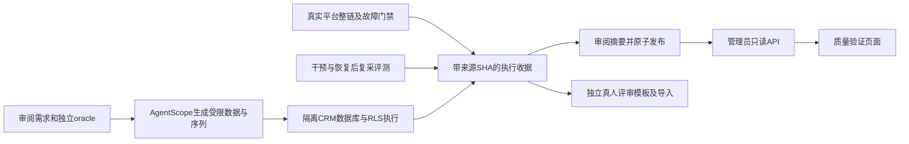

# 测试开发能力：整链门禁、真实数据库与因果评测

本轮继续补验收深度：让已有分层测试串成真实平台链路，把联系人测试接到真实数据库，并让Agent效果有独立于模型叙述的干预证据。测试执行仍使用CLI/CI；新增 `/quality` 页面展示已经审阅发布的实际运行摘要，不远程执行任意命令。

## 已完成的实现

| 方向 | 实现及执行入口 | 验收范围 |
| --- | --- | --- |
| 完整平台门禁 | [system](../scripts/quality/system/README.md) 创建可销毁平台，浏览器实际登录建任务，经Go HTTP、mTLS、C++采集、MinIO、Analyzer到gzip火焰图 | 当前固定PROC_CPU；包括页面取消、新attempt重试和制品字节/事件独立核验，不声称全部采集器或模型语义已通过 |
| 故障恢复与持续运行 | 同一工具只控制本轮project的Agent、Analyzer、PG；持续窗口有配置、硬限、原始失败和明确清理 | Agent采集中强杀与journal恢复、Analyzer未领取前暂停恢复、PG短断；不是已领取Analyzer lease崩溃或全部原生探针强杀验收 |
| CRM真实数据库 | [CRM数据库验收](CRM_DATABASE_QUALITY.md) 使用私有原始SQL、真实SupabaseRepository/PostgREST与非超管RLS角色 | 联系人和明确标识的配置事务夹具；本地签名issuer不能冒作外部GoTrue、SSO或MFA |
| 新增业务测试生成 | 原生AgentScope/DeepSeek生成受限字段与操作序列，独立需求oracle判定，sham和变异检查测试有效性 | 不限原47枚举；不允许模型指定断言、预期状态、URL、SQL或执行代码，当前领域仍为联系人 |
| Agent因果评测 | [causal](../scripts/quality/causal/README.md) 记录已知干预、采集、诊断、撤销、洗脱、同参数复采与新诊断 | CPU、慢SQL、deadline组合场景；客观干预与方向标签分列，精确根因及语义误报仍需独立真人审阅 |
| 结果展示 | [不可变摘要发布](../scripts/quality/reports/README.md)、Go管理员只读API、React运行记录/失败/时间线/未知指标/JSON导出 | 单独持久目录、原子新文件、不可覆盖旧失败；SHA不是签名，来源真实性由实际执行收据另证 |

## 结果如何进入页面

模型提出测试输入，固定oracle决定业务对错。模型提出诊断方向，实际测量及干预决定是否支持；人工语义评分另行提交。测试框架、真实业务请求、模型调用、采集制品与独立人审各有自己的分母，不合并为一个“总准确率”。

## 本轮实际检查

当前已经完成：真实生成4个新场景/17步，实际CRM Memory链76请求、基线4/4、sham4/4及3个受控变异；真实数据库固定套件和模型套件均通过8项SQL/RLS/事务、4项认证、4个新场景。具体开始结束、镜像、原始收据SHA与首次失败见 [业务证据](evidence/jd-depth-20261023/business-postgres.json) 和 [生成记录](evidence/jd-depth-20261023/business-generation.json)。重复执行不增加独立用例数。

结果模块本机Web155单测、6项新UI及5项既有外壳回归通过；桌面1440及手机375实际截图检查、两次axe无违规。Go文件读取/计数/重复键/权限边界与真实PG撤权回归通过，当前Linux交叉编译测试实际验证FIFO/路径边界。共享HTTP契约88路由/126schema、18任务类型/4RPC及V1负控通过。

整链第003轮已真实通过两个网页流程、5个成功任务的20份制品SHA和3项恢复场景；前两次启动/浏览器驱动失败保留。第004轮真实持续1800.011651秒、60/60窗口成功，加前置共65成功任务/260份制品SHA，3类恢复、128次生产29容器身份守护和本轮资源清理通过，见[原始公开收据](evidence/jd-depth-20261023/system/system-run-004/summary.json)。此轮API字节为窗口修复前版本。

v2因果6轮综合1/6，客观干预5/6、故障方向4/6、恢复方向3/6。两次报告阶段预算失败，最后恢复被总预算预留拒绝；54模型/69工具是保守记账。见[原分数](evidence/jd-depth-20261023/causal/v2/full-two-repetitions/score.json)。工具±60秒窗口把历史正常流量混进P95，独立故障1628.228ms时模型所见仅6.436ms；不能把方向失配全归模型语义。

取证窗口与报告修订指引已修复。43项真实PG/HTTP适配器回归通过且0skip，见[回归](evidence/jd-depth-20261023/window-regression.json)。取证优先有来源的collector执行时钟，旧任务明确回退attempt窗，原context_window未查询不聚合。日志只保留固定失败枚举和有界计数，未放宽验证器。r5已实际部署API23.2/Web23.1，内部API ready、公网API JSON、13条初始记录逐SHA及7监控通过，其他27容器/卷和三项目快照保持，见[部署](evidence/jd-depth-20261023/release/deployment.json)。

修复后在新目录唯一执行原六轮/原60模型80工具预算：12诊断终态成功，43逻辑模型/50工具，0未知计费；独立干预6/6、故障方向2/6、综合2通过4失败。恢复Top3 6/6只说明含normal_load或insufficient_evidence，六份正常报告也全含cpu_hotspot，因此不能当正常误报率0。四个SQL/timeout故障仍偏CPU，且六个故障轮都未主动查业务信号；唯一metrics在正常run125，已真实验证新Go窗口。详见[完整分数、未填人审及后验](evidence/jd-depth-20261023/causal/v2-r2/README.md)。修复了取证与报告执行问题，尚未解决通用诊断策略和语义可靠性；程序CI与模型语义分别验收。

新因果失败摘要已原子追加为第14条，原13条逐SHA保持，发布前后29容器身份/镜像/卷完全相等、零重启/SQL/模型，见[追加收据](evidence/jd-depth-20261023/release/records-append.json)。真实公网浏览器通过管理员登录、14条SHA、未登录401、7条历史失败筛选、未知人审显示、重新鉴权JSON导出及1440/375两宽无溢出，0页面错误，logout200；已实际查看两份截图，见[浏览器收据](evidence/jd-depth-20261023/release/public-browser.json)。

收尾按功能提交 `2d413e4a4abd` 的Git blob同步12份工具、门禁与契约源码，全部SHA及原有权限核对通过。同步不构建或重启服务、不执行SQL/模型，29容器身份/镜像/卷完全保持。随后独立只读观察确认29容器健康、真实API就绪、7监控up，14条记录逐个与仓库Git blob相同；这是交付观察，不新增一次浏览器、持续运行或模型验收。见[工具源码同步](evidence/jd-depth-20261023/release/source-tools-sync-2d413e4a4abd.json)及[最终只读观察](evidence/jd-depth-20261023/release/final-readonly.json)。

最终功能提交 `2d413e4a4abd` 的GitHub基线7项和JD3项检查跨attempt全部成功。原bounded前端job因APT依赖下载耗尽外层12分钟而取消，6项UI断言此前已通过；仅该job被接受重跑并成功。protocol/memory的attempt2展示ID复用原attempt1的物理执行，不能多算两次测试。普通未插桩整链实际通过5成功任务、20份制品SHA、3类故障恢复、页面取消和同task新attempt重试，native解析运行设置核验且12个owned容器清理成功；持续预算为零。Linux三目标Fuzz实际200011/200000/200000，合计600011次，空反例目录不保证没有潜在缺陷。见[最终CI收据与版本绑定](evidence/jd-depth-20261023/ci/github-ci.json)，不替代私有CRM、付费模型或独立人审。

## 使用与发布边界

普通GitHub CI不用生产凭据、真实外部CRM源码或付费模型；CRM真实DB与模型另有授权环境执行收据。整链测试业务流完全在可销毁QA内，外层控制器另外只读核对生产29个容器的身份、镜像和卷名，不向生产注入故障。

最终API/Web新增只读记录能力，同时修正业务信号取证窗口、报告修订指引与安全日志；不增加SQL迁移、采集执行权限或浏览器长期密钥。原业务源码和登记快照不自动发布。Android/iOS真机、全部Runner开销、多日长稳、全部当前镜像漏洞扫描与签名仍是独立范围。
