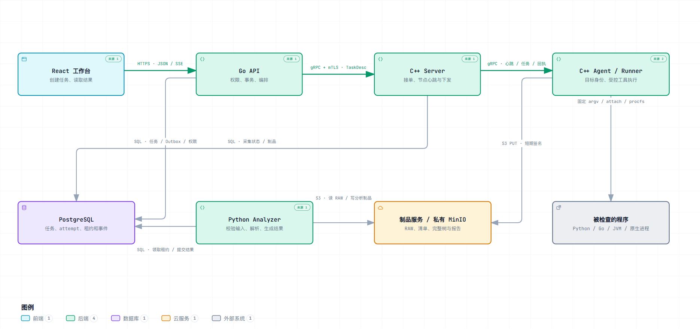
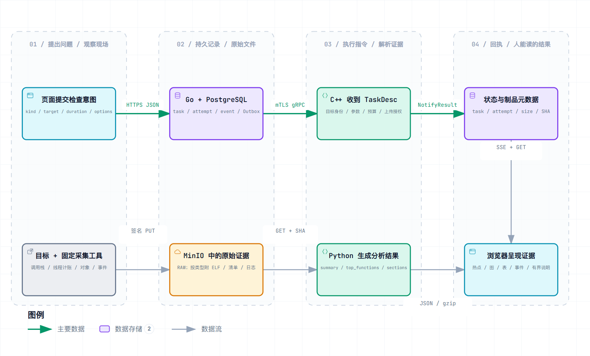

# Mini-Drop 项目详细说明

整理日期：2026-10-25。本文根据当前工作区源码、接口契约、数据库迁移和已有运行记录，介绍项目用途、开发与测试职责、模块通信、数据处理、可靠性、安全和验证结果。AI 辅助诊断在后文单独简述。

源码机制与历史执行结果分别说明。历史测试保留原来的日期、版本和环境；本次文档整理没有重新执行应用测试、现场采集、性能实验或模型请求。

- [01 · 项目定位与解决的问题](#chapter-01)
- [02 · 我的开发与测试职责](#chapter-02)
- [03 · 页面功能与基本使用链路](#chapter-03)
- [04 · 系统架构与模块边界](#chapter-04)
- [05 · 一条任务从创建到展示的完整流转](#chapter-05)
- [06 · 技术选型与维护成本](#chapter-06)
- [07 · HTTP 创建入口与参数准入](#chapter-07)
- [08 · Task 与执行轮次的数据模型](#chapter-08)
- [09 · 幂等创建与事务性持久化](#chapter-09)
- [10 · 持久化 Outbox 与 gRPC 派发](#chapter-10)
- [11 · 取消、采集重试与旧轮次隔离](#chapter-11)
- [12 · 分析作业领取、租约与结果发布](#chapter-12)
- [13 · 管理员重分析与当前结果选择](#chapter-13)
- [14 · 导入任务与对象存储发布边界](#chapter-14)
- [15 · 部分分析结果与输入身份](#chapter-15)
- [16 · 会话、资源授权与下载能力](#chapter-16)
- [17 · 请求限流与账号采集额度](#chapter-17)
- [18 · 持久任务事件与 SSE 持续读取](#chapter-18)
- [19 · 持久计划与日历调度](#chapter-19)
- [20 · 复合诊断 DAG 的持久编排](#chapter-20)
- [21 · C++ 控制服务与现场采集](#chapter-21)
- [22 · 现场采集器与真实数据](#chapter-22)
- [23 · Python 格式解析与分析结果](#chapter-23)
- [24 · React 结果读取与火焰图渲染](#chapter-24)
- [25 · 测试体系与质量验证](#chapter-25)
- [26 · 平台监控与性能数据](#chapter-26)
- [27 · AI 辅助功能](#chapter-27)
- [28 · 当前限制与源码依据](#chapter-28)

<a id="chapter-01"></a>

## 01 · 项目定位与解决的问题

### 性能排查中的实际工作

Mini-Drop 是面向 Linux 服务的性能诊断平台。用户在页面选择已授权机器和进程，平台安排采集工具运行，保存原始文件，异步分析，再把热点、调用关系和类型化结果展示出来。任务记录会保留采集对象、参数、执行轮次、状态变化、文件位置和失败原因。

例如，一个 Python 服务在特定负载下 CPU 占用升高。使用者可以选择对应节点和进程，运行 20 秒 Python CPU 采样。现场采集组件核对进程身份，调用 py-spy 得到调用栈文件；分析器把文件转换成热点和调用树；页面显示 CPU 样本主要落在哪些函数、这些函数由谁调用。

这个结果提供的是采样期间的运行证据。如果要判断用户请求慢了多少，还要关联实际请求延迟或业务 Trace。CPU 热点占比、机器 CPU 利用率和请求 P95 是不同的数据，平台分别处理。

项目题目来自腾讯 Mini 项目课程，本仓库是围绕该题目的个人复刻与扩展。现有能力、实现范围与验证结论以仓库契约和证据为依据。项目来源见[首页说明](../README.md)。

### 功能的主体与工程难点

平台包含账号、权限组、节点、规则、计划和任务记录等管理功能，也包含跨进程执行和文件处理。管理页面是入口，核心处理对象是一次真实的采集与分析活动。

一次活动会经过数据库、网络、远端进程、对象存储和后台分析器。用户可能取消任务，网络可能丢回包，进程 PID 可能被复用，分析器也可能在上传文件后失去租约。系统需要回答：当前是哪一轮执行、谁仍有修改权、已经完成了哪个阶段、哪些文件可以作为当前结果发布。

因此，项目主要的技术工作包括：

- 把创建请求转成可持久恢复的异步任务。
- 在重放、取消、重试与迟到回执之间保持执行身份一致。
- 受控调用现场工具，限制目标、参数、执行时间、资源和输出。
- 正确解析不同采集格式，保留单位和来源，避免把不同含义的数字混在一起。
- 将大文件、关系状态与页面通知分开处理，同时约束它们的发布顺序。
- 用真实数据库、真实工具链和浏览器验证故障窗口，而不只验证正常请求。

### 功能范围

当前任务目录有 18 种类型：16 种现场 runner、`IMPORT_COLLAPSED` 和 `COMPOSITE`。能否在某台机器实际运行，取决于该节点的工具、内核权限、目标类型与允许策略。类型出现在目录里不代表每台机器都具备对应能力。

现场类型覆盖 CPU、内存分配、堆快照、I/O 事件和资源快照等。文件导入复用后续分析链，复合诊断负责安排多个普通任务。平台还提供计划调度、任务对比、规则、知识与质量记录；自然语言调查是普通采集链的一种可选使用入口。

来源：[TaskKind 目录](../contracts/task-kinds.json)、[权威契约](CONTRACT.md)、[当前交付范围](DELIVERY_MATRIX.md)。

<a id="chapter-02"></a>

## 02 · 我的开发与测试职责

### 开发职责

我在这个个人项目中承担开发与测试工作。开发侧围绕采集任务的完整生命周期展开：把页面请求、Go 编排、C++ 现场执行、Python 分析和 React 结果展示接成完整链路，并处理模块之间的协议、执行身份、权限和恢复。

| 工作范围       | 具体开发内容                                                                                          | 对应代码                                                                                                                                                                            |
| -------------- | ----------------------------------------------------------------------------------------------------- | ----------------------------------------------------------------------------------------------------------------------------------------------------------------------------------- |
| 契约与领域模型 | 维护任务类型、目标描述、预算、文件格式、采集与分析状态；对齐 HTTP、protobuf 和数据库字段              | [任务模型](../api/internal/domain/task.go)、[gRPC 契约](../contracts/drop.proto)、[任务类型](../contracts/task-kinds.json)                                                          |
| Go 任务编排    | 参数归一化与校验、资源授权、幂等创建、Outbox 派发、取消、采集重试、重新分析和结果授权                 | [任务服务](../api/internal/service/tasks.go)、[事务仓储](../api/internal/repository/postgres.go)、[轮次栅栏](../api/internal/repository/fencing.go)                                 |
| C++ 现场执行链 | 节点注册与心跳、能力探测、目标身份复核、固定 argv、进程组回收、资源与输出限制、文件上传和恢复记录     | [Agent](../core/src/agent.cpp)、[Runner](../core/src/runner.cpp)、[目标校验](../core/src/target.cpp)、[进程执行](../core/src/process.cpp)                                           |
| Python 分析链  | 作业领取与续租、下载校验、格式分派、调用树与类型化结果、有界摘要、带条件结果发布                      | [Worker](../analyzer/drop_analyzer/worker.py)、[分析仓储](../analyzer/drop_analyzer/repository.py)、[解析注册表](../analyzer/drop_analyzer/registry.py)                             |
| React 工作台   | 创建与查询、状态更新、SSE 重连、结果身份隔离、Profile Worker 解析、Layout Worker 布局、交互查看与对比 | [任务详情](../web/src/views/TaskDetail.tsx)、[事件流](../web/src/event-stream.ts)、[Profile Worker](../web/src/profile.worker.ts)                                                   |
| 平台功能与交付 | 权限组、节点授权、计划调度、复合任务、制品保留与下载、审计、构建和发布检查                            | [平台路由](../api/internal/httpapi/platform.go)、[复合任务](../api/internal/service/composites.go)、[权限仓储](../api/internal/repository/authorization.go)、[部署配置](../deploy/) |

perf、py-spy、async-profiler、MinIO 等是集成的外部工具和组件。项目开发的范围是工具接入、执行约束、跨模块编排、数据处理和平台功能。

### 测试职责

测试侧从权限、状态、并发、解析和恢复风险拆解需求，编写自动化工具、断言和 CI 门禁。依赖事务或行锁的机制使用真实 PostgreSQL；完整链路同时检查本次任务身份、实际文件和页面结果。

| 工作范围           | 具体测试工作                                                               | 形成的产出                         |
| ------------------ | -------------------------------------------------------------------------- | ---------------------------------- |
| 需求与风险拆解     | 将取消、重试、授权和恢复拆成允许状态、拒绝状态、竞态和迟到请求             | 状态与接口测试矩阵                 |
| 测试环境与数据     | 建立临时数据库、受控采集目标、标明来源的导入文件和隔离输出目录             | 可重放输入、环境配置与迁移记录     |
| 自动化工具开发     | 编写请求驱动、状态序列、Fuzz、文件字节与摘要核对、浏览器动作和收据解析     | 测试代码、脚本和 CI jobs           |
| 预期结果设计       | 独立计算预期，核对数据库副作用、单位和文件内容，区分工具自报与外部验证     | 可解释的通过与失败判据             |
| 故障与测试检出能力 | 注入已限定的断连或强杀；用语义不变的 sham 与临时坏实现检查测试能否正确区分 | 原始失败、负控结果和修复回归       |
| 结果与交付         | 记录版本、实际执行数、跳过、失败和未覆盖范围，把结果接入只读质量记录       | 执行收据、质量报告、门禁与交付记录 |

开发改动和回归验证相互对应。例如，活跃调查额度调整后，要检查同账号并发准入和幂等重放；取消和重试逻辑要检查旧轮次的消息不能修改新轮次。后文按实现模块介绍这些机制及实际测试结果。

<a id="chapter-03"></a>

## 03 · 页面功能与基本使用链路

### 各个入口的作用

| 页面           | 主要用途                                                 | 产生或读取的内容                     |
| -------------- | -------------------------------------------------------- | ------------------------------------ |
| 工作空间总览   | 看近期任务、节点在线情况和队列分布，进入新建诊断         | 已保存任务与当前节点摘要             |
| 诊断任务       | 创建采集或导入、筛选任务、查看结果、取消、重试与选择对比 | 普通 task、attempt、事件和制品       |
| 智能性能调查   | 描述问题、选择目标、查看并确认计划，再查看采集与复测结果 | 调查记录与关联的普通任务             |
| 复合诊断       | 将多个普通任务组织为有依赖关系的流程，查看各节点执行结果 | 复合运行、依赖节点和子任务           |
| 接入节点       | 查看节点心跳、运行环境、已探测工具和允许目标             | Agent 能力与目标信息                 |
| 计划任务       | 设置周期触发，查看执行记录                               | 调度配置、调度记录与派生任务         |
| 权限组         | 管理成员与资源授权                                       | 用户、组及资源 grants                |
| 诊断规则       | 管理分析时使用的规则                                     | 规则与分析建议的关联                 |
| 诊断知识       | 查看或维护诊断方法、经验及反馈相关内容                   | 知识条目与来源记录                   |
| 质量验证       | 管理员只读查看已发布测试记录                             | 有界质量摘要，不负责运行任意测试命令 |
| 设置与使用指南 | 查看配置入口、使用说明和学习内容                         | 按角色开放的配置与文档               |

界面会按角色隐藏部分入口。服务端仍对每次资源访问校验权限，隐藏按钮本身不构成安全控制。页面入口与路由见[应用外壳](../web/src/App.tsx)。

### 一次在线采集的操作顺序

1. 登录后进入“接入节点”，确认目标节点在线，并查看它支持哪些采集方式。没有工具或没有目标授权时，先完成环境与权限配置。
2. 在总览或“诊断任务”进入新建页面，选择“在线采集”，选择节点和该节点支持的类型。
3. 选择实际目标进程或容器，核对进程名称及身份，填写任务名称、采集时长和该类型支持的参数。CPU 类型中的频率参数只对真正使用该参数的工具生效。
4. 点击“创建诊断”。页面创建成功后，任务仍会继续派发和执行，不能据此判断已经采集完毕。
5. 在任务详情观察采集和分析两组状态。采集完成后，等待分析器生成结果；失败时先看所属阶段和错误，再决定重试采集或重新分析。
6. 分析成功后，查看摘要、热点和该类型支持的图表。完整调用树按需下载，页面可以搜索函数、展开路径并切换显示方式。原始文件通过单独的授权下载入口取得。
7. 若需要比较两次运行，在“诊断任务”中选择两个已完成的同类型任务，点击“对比结果”。还要核对单位、采集模式、输入负载和时长是否适合比较。

导入模式在同一创建页选择已有原始文件或填写折叠栈数据，明确输入格式。导入数据走分析链，不会因此在目标机器重新采样。取消、重试和重新分析分别影响不同阶段，具体规则见后文。

操作实现见[新建任务](../web/src/views/NewTask.tsx)、[任务详情](../web/src/views/TaskDetail.tsx)、[结果对比](../web/src/views/Compare.tsx)。[系统图册](diagrams/drop-system/index.html)提供各条链路的时序图与字段说明。

<a id="chapter-04"></a>

## 04 · 系统架构与模块边界

### 组件分工



| 组件                 | 主要职责                                                         | 主要通信方式                                          |
| -------------------- | ---------------------------------------------------------------- | ----------------------------------------------------- |
| React 工作台         | 提交请求、查询任务、接收变化通知、展示结果                       | HTTP、SSE、浏览器 Worker 消息                         |
| Go API               | 会话与授权、参数校验、任务事务、Outbox、计划和复合编排、文件授权 | HTTP、gRPC/mTLS、PostgreSQL、S3                       |
| C++ Server           | 接收控制请求、维护节点连接、派发任务、处理现场回执               | gRPC/mTLS、PostgreSQL                                 |
| C++ Agent / Runner   | 探测能力、核对目标、受控执行工具、上传与恢复                     | 主动注册/心跳/领任务、受限对象上传、必要的本机 helper |
| Python Analyzer      | 领取分析作业、校验文件、解析与聚合、上传和发布结果               | PostgreSQL 租约、S3 下载上传                          |
| PostgreSQL           | 保存任务、轮次、作业、事件、权限和有界结果                       | 各可信服务使用独立配置的数据库连接                    |
| MinIO 与私有存储网关 | 保存 RAW、附件和分析制品，提供受限对象操作                       | S3 API、限时签名 URL、同源只读对象代理                |
| Maintenance          | 保留期清理、维护对账与固定格式告警接收                           | 数据库、存储及受限维护接口                            |
| 可选监控组件         | 采集平台指标、接收 Trace、展示和告警                             | Prometheus 抓取、OTLP、Grafana 查询                   |

这里的 C++ Agent 是机器上的采集执行组件。AI 诊断运行时是另一种可选组件，二者的协议、权限和职责不同。普通采集与分析不要求调用模型。

### 指令、文件与执行事实

系统把三类数据分开传输和保存。

**控制指令**描述采集对象、工具参数、时间、预算、执行轮次和回执。Go 通过 gRPC/mTLS 向 Core 提交任务；Agent 主动联系 Server，并从响应或领任务调用中取得指令。浏览器不直接连接采集控制面。

**文件数据**包括采样 RAW、类型所需二进制或清单、受限日志、完整调用树和分析制品。文件经过受控对象上传下载，gRPC 不承载整份大型 profile，数据库只保存文件元数据和有界结果。

**执行事实**包括当前状态、attempt、分析 job/run/lease、权限、事件和制品归属。相关变化在数据库事务中保存。浏览器和现场 Agent 不持有数据库凭据，也不持有对象存储长期密钥。



关系库与对象存储没有共同事务。文件上传和结果发布之间存在失败窗口，系统用执行身份、条件发布、孤立对象清理与维护对账约束这些窗口。

### 核心数据身份

| 字段或身份                           | 表达的含义                 | 使用范围                               |
| ------------------------------------ | -------------------------- | -------------------------------------- |
| `task_id`                            | 用户看到的逻辑任务         | 请求、状态、历史与权限归属             |
| `task_attempts.id`                   | 一次实际采集的唯一身份     | 派发、回执、文件和取消的轮次隔离       |
| `task_attempts.attempt`              | 同一任务内的采集序号       | 历史顺序与展示                         |
| `analysis_jobs.id`                   | 某次采集输入对应的分析作业 | 分析队列和结果归属                     |
| `analysis_jobs.attempt`              | 作业内的一次分析 run       | 解析重试、上传路径和发布栅栏           |
| `lease_owner / lease_expires_at`     | 当前分析执行者及租约期限   | 判断现在是否仍可提交                   |
| `artifacts.id / object_key / sha256` | 文件记录、位置和内容指纹   | 完整性、缓存身份、下载与保留期         |
| `task_events.sequence`               | 事件续读序号               | SSE 游标和历史读取，不等于提交顺序     |
| `request_id`                         | 单次请求的关联标识         | 日志与调用关联，不作为幂等键或授权凭据 |

公共 bigint ID 按十进制字符串传输，避免 JavaScript `Number` 对大整数发生精度丢失。采集 attempt 和分析 run 是不同维度，不能只用一个“重试次数”表示。

### 主要表的关系

```text
users / groups / grants  ── 约束资源访问

tasks ──1:N── task_attempts ──1:N── artifacts ──引用── MinIO 文件
  │                │
  │                ├── analysis_jobs ── 有界结果与分析 run
  │                └── outbox
  └──1:N── task_events

schedules ── schedule_records ── 派生普通任务
composite_runs ── composite_nodes ── 普通任务
```

这是一张阅读用的简化关系图。实际列、外键、唯一约束和索引由[全部 SQL 迁移](../db/migrations/)定义；当前结构需要结合后续迁移阅读。基础模型见[任务领域模型](../api/internal/domain/task.go)。

<a id="chapter-05"></a>

## 05 · 一条任务从创建到展示的完整流转

### 请求与派发

页面先取得任务类型目录、节点能力和允许目标，再提交结构化请求。Go 归一化参数，校验类型与范围，并按当前用户校验节点和目标权限。创建事务一起写入 task、首个采集 attempt、事件、审计和 `DISPATCH` Outbox。

HTTP 创建响应返回后，后台派发器读取 Outbox，在确认当前 task/attempt 仍可派发后向 Core 发送 `TaskDesc`。Core 幂等接收并持久记录。Agent 随后领到该轮任务，在现场复核真实目标与工具条件。

### 采集与上传

Runner 将允许参数转换成固定可执行文件和 argv，启动工具，在时间、资源和输出预算内执行。工具输出经过对应类型的转换或检查，形成 RAW 和允许附件。Agent 使用本轮限时上传授权发送真实字节，再把文件位置、大小、SHA、格式和执行结果报告给 Core。

Core 校验回执授权、轮次、对象位置和元数据，原子登记采集结果。成功进入 `COLLECTED` 时，才建立待分析作业。Core 的这一步不下载原始文件重新计算哈希；实际内容校验由 Analyzer 下载后执行。

### 分析与可见结果

Analyzer 领取分析作业，记录 owner、run 和租约，持续续租。下载文件后核对实际长度和 SHA，再按任务类型、pipeline 和格式分派解析器。解析成功生成数据库有界摘要、热点和对象存储中的完整结果制品。

发布事务再次验证当前采集 attempt、分析 run、租约 owner 及数据库实时租约期限。通过后才把这些文件作为当前成功结果引用。租约过期的旧 worker 即使上传了对象，也不能取得当前结果的发布权。

React 根据 REST 查询和 SSE 通知刷新状态，按需通过 Profile Worker 处理分析响应与 gzip 调用树，再由 Layout Worker 计算图形布局。原始 RAW 文件走独立的授权下载入口。

### 各跳传递的数据

| 方向                  | 主要内容                                                                                                                            | 接收方执行的检查                                     |
| --------------------- | ----------------------------------------------------------------------------------------------------------------------------------- | ---------------------------------------------------- |
| 浏览器 → Go           | 顶层 `kind/target_agent_id/visibility/group_id`，`parameters` 中的目标 `target`、预算 `budget` 和类型参数；请求头 `Idempotency-Key` | 严格输入、当前资源授权、类型能力与准入               |
| Go → Core             | `task_id/attempt_id`、`parameters/target/budget`、`deadline_unix_ms`、`raw_format/analysis_pipeline` 与上传授权                     | 服务身份、协议、任务身份和幂等接收                   |
| Agent → 采集工具      | 已核对目标、固定 argv、允许选项与预算                                                                                               | 工具路径和摘要、目标身份、执行约束                   |
| Agent → 对象存储      | RAW 和允许附件的真实字节                                                                                                            | 限时、限对象、限操作的上传授权                       |
| Agent → Core          | `ResultRequest` 与 `ArtifactInfo`：状态、退出码、受限错误、位置、大小、SHA、格式                                                    | 当前 attempt、合法状态与元数据，不在此处复算文件 SHA |
| Analyzer ↔ 对象存储   | 输入下载与分析制品上传                                                                                                              | 下载后真实字节校验、解析预算和输出上限               |
| Analyzer → PostgreSQL | 当前 job/run/owner、结果、制品引用与事件                                                                                            | 当前轮次和有效租约条件                               |
| Go → 浏览器           | 状态、摘要、热点、类型化结果、事件与临时下载地址                                                                                    | 每次资源读取和文件授权；页面继续核对当前结果身份     |

任务耗时包含排队、派发、工具准备、采集窗口、转换、上传、分析排队、解析、发布和页面可见延迟。POST 请求耗时只覆盖创建阶段，采集窗口也不等于该进程消耗的 CPU 时间。

通信字段见[gRPC 契约](../contracts/drop.proto)、[HTTP 路由](../api/internal/httpapi/server.go)、[任务服务](../api/internal/service/tasks.go)、[Core Server](../core/src/server.cpp)和[Analyzer Worker](../analyzer/drop_analyzer/worker.py)。

<a id="chapter-06"></a>

## 06 · 技术选型与维护成本

### 语言与服务边界

Go 承担 HTTP、事务、权限、后台编排和 gRPC 客户端工作；C++ 负责现场系统接口、工具执行与本机资源管理；Python 接入 profile 解析与分析处理；React 实现结果交互。

实际采样主要由 perf、py-spy、async-profiler 等工具完成。C++ 平台代码负责安排和约束这些工具，语言选择本身不构成采样性能提升的证据。

多语言使各部分可以独立构建与限制资源，也增加了生成代码、依赖、镜像和跨语言整数、时间、JSON、错误语义的维护成本。项目通过共同契约和分层测试约束这些差异。

### 内部 RPC 与浏览器接口

Go 与 C++ 使用 protobuf/gRPC 描述目标、预算、轮次和结果元数据，便于生成跨语言代码并检查字段兼容性。mTLS 负责连接对端身份，业务授权和状态条件仍由服务执行。protobuf 字段变更保留既有编号。

浏览器通过 HTTP 创建、查询和管理，通过 SSE 接收单向事件。用户操作仍走 HTTP，页面无需持有采集控制面身份。SSE 当前通过间隔查询数据库取得事件，连接量与数据库查询量是其运行成本。

### PostgreSQL 队列与 Outbox

创建事实和待派发意图需要原子写入，因此使用数据库 Outbox。分析队列也围绕数据库中的执行身份与状态工作，行锁、`SKIP LOCKED`、条件更新和租约可以直接表达领取及发布规则。

这种实现需要维护轮询、数据库连接、锁等待、索引和历史清理。外部消息系统并不是当前运行链的必要组件；引入后仍需保留幂等、轮次、重试、取消和发布条件。

共享 HTTP 限流也使用 PostgreSQL。配置真实仓储时，数据库出错不会退回更宽松的进程内计数；内存 limiter 仅用于无数据库的路由测试。相关实现见[分布式限流适配](../api/internal/httpapi/distributed_limiter.go)。

### 大文件与事务数据分开保存

RAW、二进制和完整调用树放对象存储，状态、权限、索引和有界结果放关系库。这样可以限制数据库行和响应大小，也让分析器独立于采集进程运行。

代价是需要明确结果的可见发布点，并处理上传成功但事务未发布的孤立对象。下载要同时满足当前授权、制品归属和保留期条件。

当前主要验证环境是受资源限制的单机多容器系统。服务能够独立启动，不代表已经完成多机高可用、跨地域容灾或大规模弹性伸缩验证。

构建与依赖见[Go](../api/go.mod)、[C++](../core/CMakeLists.txt)、[Python](../analyzer/requirements.lock)、[Web](../web/package.json)。

<a id="chapter-07"></a>

## 07 · HTTP 创建入口与参数准入

普通任务通过 `POST /api/v1/tasks` 创建。处理器完成请求解码后，将当前用户、请求标识、幂等键与结构化输入交给 `Tasks.Create`。首次创建成功返回 201，同一创建意图的合法重放返回 200。响应表示任务及后续派发意图已经持久化，采集是否开始、原始文件是否交付、分析是否成功分别由后续状态表达。HTTP 连接结束或浏览器关闭不会撤销已提交任务。

请求体有两层大小限制。普通 JSON 写请求上限为 4MiB；任务创建包含 base64 文件导入，外层上限单独放宽为 64MiB。领域校验仍按解码后的主文件和附件总量限制到 32MiB。外层限制约束 HTTP 解码成本，内层限制约束实际输入，两者同时生效。

`Server.bind` 使用 `DisallowUnknownFields` 拒绝结构体中的未知字段，并在第一次解码后要求再次解码得到 EOF，拒绝尾随第二份 JSON。当前这个入口没有专门检测重复 JSON key；这些措施不构成对所有重复字段和动态 map 内容的完整校验。动态参数仍需进入领域层的类型与边界检查。

`Tasks.Create` 依次检查全局写角色、幂等键、归一化输入、领域有效性与组写权限。`CreateTask.Normalize` 补齐任务名、任务类型默认时长与频率、scope 和 private 可见性，并协调显式 target 与兼容 PID 字段。`CreateTask.Validate` 检查已知类型、优先级 −10 到 10、名称字节长度、可见范围、目标类型、导入约束，以及任务目录规定的参数与预算。`COMPOSITE` 有独立编排入口，不作为普通现场类型提交。

客户端提交的非空 `source` 和 `traceparent` 会被拒绝；导入来源与追踪信息由服务端注入。客户端可以选择协议允许的采集参数，不能直接提交任意 executable、argv、脚本或采集 URL。参数规则以 [task-kinds.json](../contracts/task-kinds.json) 为准，页面、Go 和现场执行器还各自承担对应层的验证。

首次创建现场任务时，服务层进一步核对 Agent 的 operate 权限、节点状态、最近心跳与采集能力；disabled、offline 或超过当前 45 秒心跳准入窗口的节点会被拒绝。`validateTargetResources` 按节点资源快照核对目标范围、进程或容器授权，必要时补入 `start_time_ticks`、`expected_uid`、`check_uid` 等身份约束。快照与真正执行之间仍存在时间差，Agent 必须按操作系统中的真实身份再次核对，防止 PID 复用或容器变化导致误采。

实现入口见 [resources.go](../api/internal/httpapi/resources.go) 的 `Server.createTask`、[server.go](../api/internal/httpapi/server.go) 的 `Server.bind`、[tasks.go](../api/internal/service/tasks.go) 的 `Tasks.Create`、[task.go](../api/internal/domain/task.go) 的 `Normalize/Validate`，以及 [targets.go](../api/internal/service/targets.go) 的 `validateTargetResources`。

<a id="chapter-08"></a>

## 08 · Task 与执行轮次的数据模型

Task 保存用户持续访问的逻辑任务身份。一次具体的现场执行保存为 `task_attempts`，重新采集会增加一行，旧执行历史不被新执行覆盖。原始输入交付后，`analysis_jobs` 保存这份输入对应的分析作业；同一份输入可以因自动恢复或管理员重分析被多次领取执行。

| 字段                      | 含义                      | 使用边界                                         |
| ------------------------- | ------------------------- | ------------------------------------------------ |
| `tasks.id`                | 逻辑任务身份              | 单独使用不足以接受执行回调                       |
| `task_attempts.id`        | 某次采集执行的数据库身份  | RPC、制品和事件绑定该身份                        |
| `task_attempts.attempt`   | 同一任务内递增的采集轮次  | 重新采集增加，RPC 重放不增加                     |
| `tasks.collection_status` | 当前采集状态              | 表达是否取得并登记本轮输入                       |
| `tasks.analysis_status`   | 当前分析状态              | 表达这份输入是否完成分析                         |
| `analysis_jobs.attempt`   | 当前 Job 被领取的分析轮次 | 与采集轮次独立递增                               |
| `tasks.version`           | 任务状态版本              | 用于状态更新与前端缓存身份，不能替代全部后端栅栏 |

正常采集路径为 `CREATED → QUEUED → DELIVERED → RUNNING → UPLOADING → COLLECTED`，未完成的采集也可能以 `FAILED` 或 `CANCELED` 结束。创建 Task 时分析状态已经是 `PENDING`，但分析 Job 通常要等原始输入交付后才建立，因此 Task 的分析字段与 Job 是否存在是两个事实。

Task 的分析状态使用大写 `PENDING/RUNNING/RETRY/SUCCESS/FAILED/CANCELED`；AnalysisJob 使用小写 `pending/running/retry/success/failed`，没有 canceled 状态。取消活动分析时，Task 标为 CANCELED，活动 Job 标为 failed，并记录 TASK_CANCELED，不能把两套字段混为同一状态枚举。

`Task.Terminal` 将采集 FAILED、CANCELED 判为终态；采集 COLLECTED 后，只有分析 SUCCESS 或 FAILED 才判为终态。COLLECTED/PENDING、COLLECTED/RUNNING、COLLECTED/RETRY 仍未结束。采集 attempt 的 finished_at 只说明采集执行结束，不能推断完整分析已经完成。

任务、attempt 和事件序号等 bigint 身份在 JSON 中采用字符串，避免浏览器 Number 无法精确保存较大整数。后端写入并非统一依赖 `version=旧值` 的单条 CAS：具体路径结合 Task 行锁、当前采集轮次、Job owner、分析轮次、租约和条件 UPDATE 决定资格。状态版本增加不等于所有写者都使用同一种并发控制。

字段与枚举见 [task.go](../api/internal/domain/task.go)、[001_initial.sql](../db/migrations/001_initial.sql) 和 [repository.py](../analyzer/drop_analyzer/repository.py) 的 `Job`。任务与制品的跨服务字段还受 [drop.proto](../contracts/drop.proto) 约束。

<a id="chapter-09"></a>

## 09 · 幂等创建与事务性持久化

普通创建的 `Idempotency-Key` 按创建者隔离，长度要求为 8–128，并拒绝 CR、LF 和 NUL。服务层对规范化的结构化请求计算 SHA-256，已有同 owner、同 key、同摘要的任务返回原身份；同键不同摘要返回 409、IDEMPOTENCY_CONFLICT。键表达一份确定的创建意图，不用于覆盖既有任务参数。

摘要计算早于服务端注入 traceparent、导入 source，也早于目标准入补充资源身份。因此它表示规范化的用户意图，既不受本次追踪 ID 变化影响，也不是最终执行参数全部字节的摘要。归一化只覆盖代码明确支持的默认表达，不承诺任意语义近似的 JSON 都得到相同摘要。

服务层先查已有任务以加速重放，仓储事务内仍会再次检查。`Repository.CreateTask` 先获取基于 `task-quota:<owner>` 的事务级 advisory lock，再核对同键记录与当前额度。单次事务写入 Task、第一轮 attempt、TASK_CREATED、必要的 DISPATCH Outbox 和创建审计。事务未提交时进程退出，这些记录一并回滚；已经提交但 HTTP 响应丢失时，客户端保留原键重发可以读取同一任务。

数据库约束提供最后的数据边界：任务表的 `UNIQUE(creator_id,idempotency_key)` 约束初次创建身份；`UNIQUE(task_id,attempt)` 约束采集轮次；AnalysisJob 的 `UNIQUE(task_id,attempt_id)` 约束每份采集输入的 Job；Outbox 的 `UNIQUE(attempt_id,event_type)` 约束该轮控制意图。仅在事务外先查一次不足以解决并发，约束也不能代替授权和状态判断。

合法快速重放仍先经过角色、请求与组检查，但已有现场任务的返回早于再次检查 Agent 在线和目标资源。它读取已存在的操作，不重新执行首次准入或重新派发。当前没有独立可过期的幂等请求回执表，也不承诺每次重放返回操作首次发生时的完整响应版本。

采集重试另有幂等实现：`Repository.Retry` 在持锁后读取 TASK_RETRIED 事件 payload 中的 key，识别同一重试操作。它不会改写 Task 初次创建的幂等键。幂等及唯一约束约束重复请求的业务效果，网络本身仍可能重复发送。

实现见 [tasks.go](../api/internal/service/tasks.go) 的 `ValidateKey/Tasks.Create`、[postgres.go](../api/internal/repository/postgres.go) 的 `Existing/CreateTask/Retry`，以及 [001_initial.sql](../db/migrations/001_initial.sql)、[002_platform.sql](../db/migrations/002_platform.sql)。

<a id="chapter-10"></a>

## 10 · 持久化 Outbox 与 gRPC 派发

Outbox 保存已经与 Task 一起提交的跨进程控制意图。后台 `Tasks.dispatch` 调用 `Repository.DispatchOne`，领取 `published_at IS NULL` 且已到 `available_at` 的记录。排序优先处理 CANCEL，再按任务优先级、创建时间与 ID 选择，多个派发器通过 `FOR UPDATE OF outbox SKIP LOCKED` 避免重复领取同一行。

当前派发事务在调用远端 RPC 期间仍持有 Outbox 行锁，并占用事务连接；它在网络调用前不持有 Task 行锁。Core 的接受事务本身需要锁定并更新 Task。如果 API 持有 Task 锁等待 Core，而 Core 等待该锁，就会形成跨进程等待环。这里保留的是 Outbox 记录的处理互斥，不把 Task 在整个网络阶段锁住。

派发前普通读取 Task、attempt 和最新轮次，运行 `Dispatchable`。DISPATCH 要求消息仍绑定最新采集 attempt，而且 Task 与 attempt 都为 CREATED；CANCEL 也需要当前轮次及对应取消状态。过时控制意图可以直接填写 published_at 收尾，不继续作用于新执行。

真正发送时，Go 刷新本轮固定对象键的短期 PUT 授权，保存上传目标，再构造 `TaskDesc`。描述包含 task/attempt 身份、kind、参数、目标、对象键、期限和有界上传授权，通过 mTLS gRPC 请求 Core。Agent 和浏览器不获得对象存储长期凭据。RPC 当前设置 4 秒超时；Core 根据数据库中既有身份接受任务，不再创建另一份 Task。

Core 已提交 QUEUED、ACK 丢失时，API 可能先按 RPC 错误记录退避。下一轮会重读已推进状态，发现不再满足 CREATED 条件，直接将旧 Outbox 标为已处理，而不是必然再次发送 CreateTask。其他网络时序仍可能产生 RPC 重放，因此 Core 同样按当前身份和状态幂等接收：CREATED 才推进 QUEUED，QUEUED 不重复写入队事件，已进一步推进的任务按既有事实确认。

派发失败按 `min(attempt²,60)` 秒退避，最多十次，还受 Task deadline 约束。这里的 attempt 是 Outbox 派发计数，与采集轮次和分析轮次不同。准备将耗尽派发判为 FAILED 时，代码在 RPC 返回以后才锁住 Task 与当前 attempt，重新检查 Dispatchable。若另一事务已取消、重试或接受任务，就退休旧消息，不能用迟到错误覆盖新事实。

SKIP LOCKED 支持并发处理不同记录，但不保证严格 FIFO 或无饥饿；优先级和 CANCEL 排序也会改变等待顺序。慢 RPC 延长当前 Outbox 事务，是现有实现的成本。当前没有把领取与网络发送拆成独立的派发租约阶段。

实现见 [postgres.go](../api/internal/repository/postgres.go) 的 `DispatchOne`、[fencing.go](../api/internal/repository/fencing.go) 的 `Dispatchable`、[tasks.go](../api/internal/service/tasks.go) 的 `Tasks.dispatch`，以及 [server.cpp](../core/src/server.cpp) 的 `CreateTask`。

<a id="chapter-11"></a>

## 11 · 取消、采集重试与旧轮次隔离

取消首先是一笔持久化状态变更。`Repository.Cancel` 在写授权范围内锁定 Task，终态任务直接保留原结果，不追加重复取消记录；非终态任务在同一事务更新 Task、当前采集 attempt、活动分析与 AI 作业，清理上传授权，并写取消事件、CANCEL Outbox 和审计。已有活动 AnalysisJob 变为 failed，并清空 lease。

取消 API 返回表示取消事实与控制意图已提交。远端工具停止仍需通过控制链路传播，OS 子进程可能继续短暂收尾。发布栅栏负责拒绝晚到成功，执行器的取消与进程回收负责缩短资源占用，两者不能互相代替。若最终成功已经先提交，随后取消读取到终态就保留成功；若取消先提交，旧分析执行不能再通过状态与租约检查发布成功。

采集重试只接受允许的终态任务，并要求有原现场 Agent；导入没有现场目标，需要重新提交输入。重试先核对操作者对 Task 的 operate 权限，再以原 owner 的额度锁检查容量。随后新增采集 attempt，使 Task 回到 CREATED/PENDING，更新期限并写重试事件和新 DISPATCH。旧 attempt 和历史制品继续保留，旧上传授权不再有效。

Core 的 `current` 先单独锁定 Task，再以新的 SQL 查询请求 attempt、Agent 与最新轮次。锁等待期间发生重试时，新查询能看到等待结束后的事实，避免把之前读到的旧轮次继续视为当前。`NotifyResult`、进度和取消接收均需遵守轮次边界；旧 CANCEL 已在网络上时，`CancelTask` 对不匹配当前 attempt 的请求确认后结束，不停止新采集。

当前上传终态存在一个受限例外：同一当前 attempt 已获得的固定 `runner.log` 授权，在 120 秒宽限内仍可用于补交有界日志。这不允许补交 RAW 或 BINARY。重试一旦生成新 attempt，旧轮次连这个日志例外也失去资格。终态约束需要按制品类型判断，不能概括为任意迟到文件均可接收或均不可接收。

实现见 [postgres.go](../api/internal/repository/postgres.go) 的 `Cancel/Retry`、[server.cpp](../core/src/server.cpp) 的 `current/CancelTask/NotifyResult`，以及 [upload_grants.go](../api/internal/repository/upload_grants.go) 的 `TerminalUploadMetadata/persistActiveUploadGrant`。并发派发与取消恢复的回归入口在 [dispatch_recovery_integration_test.go](../api/internal/repository/dispatch_recovery_integration_test.go)。

<a id="chapter-12"></a>

## 12 · 分析作业领取、租约与结果发布

采集完成后，当前输入对应的 AnalysisJob 进入 pending。`Repository.claim` 在短事务内查询到期的 pending/retry，或仍有尝试预算的过期 running，同时要求 Task 为 COLLECTED、分析状态合法、采集 attempt 仍是最新。候选按优先级与创建顺序排列，以 `FOR UPDATE OF j,t SKIP LOCKED` 锁住 Job 和 Task；领取递增分析 attempt、保存 lease_owner 与过期时间、把 Task 标为 RUNNING，并写 ANALYSIS_STARTED。

领取事务不会贯穿解析全过程。worker 通过 LeaseGuard 定期续租，默认租约为 60 秒、续租间隔 10 秒，配置另有范围检查。这些是默认配置，不是每个部署固定不变的协议常量。高内存与普通队列按任务类型分离，使相应 worker 可以使用不同资源预算，但队列划分本身不保证公平等待或无限处理规模。

租约表示当前发布资格，不会物理停止失联 worker。过期进程仍可能占用 CPU 或上传文件，因此续租与最终 SQL 都需要核对 Job owner、分析轮次、当前采集 attempt、Task 状态及未过期租约。仅检查 owner 不足以区分同名 worker 的旧上下文；仅检查 running 也无法区分接管前后的执行。

`renew`、`_lock_owned` 和关键条件 UPDATE 使用 `clock_timestamp()` 检查实时期限，避免长事务起点的 now 掩盖执行期间已经过期。旧执行即使尚无人接管，也不能自行续活已过期归属。LeaseGuard 的本地失效标记用于尽早停止，数据库中的受保护写入才决定能否发布。

输出对象键包含 task、采集轮次、analysis job 与 run，防止不同执行把同名结果写到相同位置。worker 先上传输出，再由 `complete` 在持有归属的事务中登记制品、建议、Job.success、Task.SUCCESS 和事件，条件更新必须命中一行。上传成功而 SQL 发布未完成时可能留下未引用对象，但不会因此宣布完整结果成功。

可重试错误在剩余预算内把 Job 标为 retry、Task 标为 RETRY，退避为 `min(60,2**attempt)` 秒；下次领取再增加分析轮次。过期 running 可以直接被正常 claim 接管，不要求先经过显式 retry。最后一次尝试的租约过期会收敛为 ANALYSIS_RETRY_EXHAUSTED，避免永久停留在 running。失去 owner、run 或有效期限的旧执行连失败状态也无权写回。

实现见 [repository.py](../analyzer/drop_analyzer/repository.py) 的 `claim/renew/_lock_owned/complete/fail`、[worker.py](../analyzer/drop_analyzer/worker.py) 的 `LeaseGuard/process_job`，以及 [config.py](../analyzer/drop_analyzer/config.py)。租约接管与迟到发布的回归入口在 [test_repository_integration.py](../analyzer/tests/test_repository_integration.py)。

<a id="chapter-13"></a>

## 13 · 管理员重分析与当前结果选择

管理员重分析复用当前采集输入，不启动新的现场采集。`Tasks.Reanalyze` 仅向平台管理员开放，要求 Task 已 COLLECTED、最新采集 attempt 的当前 Job 为 success 或 failed，而且 RAW 仍 ready、未过保留期。pending、running、retry 的作业不能被该动作直接覆盖。

事务先锁 Task 与当前 Job，归档上一分析执行到 `analysis_job_runs`，清空当前 result、错误和租约，把旧建议标为 superseded，再使 Job 回到 pending、Task 回到 PENDING。分析 attempt 保留原值，`max_attempts` 设为当前 attempt 加三；下一次 claim 才递增新的执行轮次。这样历史执行与后续三次可用预算都能保持明确身份。

`Repository.Result` 只选择最新采集 attempt 的成功 Job。重分析排队、运行或失败时，不会悄悄回退到旧成功报告。历史制品与归档仍可能存在，但它们不自动成为当前结果；前端必须按当前身份与状态决定展示。采集重试、分析自动恢复和管理员重分析分别改变输入身份、分析执行身份或分析预算，三者不能合并成一个无差别重试动作。

实现见 [administration.go](../api/internal/service/administration.go) 的 `Tasks.Reanalyze`、[queries.go](../api/internal/repository/queries.go) 的 `Result/ResultSummary`，以及 [repository.py](../analyzer/drop_analyzer/repository.py) 的 `claim`。

<a id="chapter-14"></a>

## 14 · 导入任务与对象存储发布边界

导入沿用普通 Task 和 attempt 身份，但不建立现场 DISPATCH。服务端清除 PID、时长、频率、scope 和 target 等现场执行字段，保存来源 import，再把用户提交的原始字节写到稳定对象键。文件内部的时间不作为平台现场采集承诺，导入结果也不能证明现场 profiler、节点授权和网络链路可用。

主文件和辅助 ELF 必须全部上传成功后，`ImportWithAux` 才在 SQL 事务中统一登记 RAW、附件、COLLECTED、pending Job 和事件。部分 PUT 成功不会提前把输入声明为完整。事务锁住 Task，只接受仍为 CREATED 的导入；已经 COLLECTED 的相同操作可以按既有事实返回。

对象存储与 PostgreSQL 没有共同事务。上传失败时，任务可暂留 CREATED，客户端在期限内保留原键和相同输入重放，继续补齐稳定对象键和数据库登记。上传成功、SQL 失败时，对象可能存在但尚未被数据库发布；是否为可用输入仍以状态、元数据和摘要登记为准。原始文件正文不长期存放在 SQL，孤立对象的收敛依赖另外的存储维护与对账。

`SweepStaleImport` 领取超过 deadline、没有目标 Agent、仍为 CREATED 的导入，锁住任务，将 Task 与 attempt 标为 FAILED/IMPORT_TIMEOUT 并写事件。它无法从客户端恢复未提交文件；超过期限后需要重新提交输入。扫描先提交失败时，迟到的登记不能再把旧任务复活为 COLLECTED。

这个发布边界也适用于 Analyzer：上传完成不等于当前完整结果已经提交。稳定对象身份、可重放输入与 SQL 发布点减少半完成状态的歧义，但没有把跨存储操作变成强原子事务，也没有证明所有并发对象覆盖问题均被消除。

实现见 [tasks.go](../api/internal/service/tasks.go) 的导入分支、[postgres.go](../api/internal/repository/postgres.go) 的 `ImportWithAux`、[import_recovery.go](../api/internal/repository/import_recovery.go) 的 `SweepStaleImport`，以及 [worker.py](../analyzer/drop_analyzer/worker.py) 的输出发布流程。

<a id="chapter-15"></a>

## 15 · 部分分析结果与输入身份

部分结果保留已经完成解析、但完整分析未能发布时的有限信息。`process_job` 在输入完整性校验与解析成功后调用 `build_partial`，合法时保存来源、单位、计数和最多二十个函数。解析器未提供可验证摘要时可以省略检查点，因此没有部分结果不等于从未执行过解析。

检查点通过 `Repository.save_partial` 写入 `analysis_jobs.result` 的 JSONB 字段，并与 ANALYSIS_PARTIAL_SAVED 事件一起提交。它是最多 16KiB 的白名单内联 JSON，不是对象存储中的中间制品，不包含完整火焰树或原始工具报告，也不把 Task 推进为 SUCCESS。completed_stages 固定记录 input_verified、parsed；missing_stages 表示这个投影省略哪些后续输出，不能据此断言后续阶段从未运行。

读取入口 `GET /api/v1/tasks/{id}/partial-result` 先验证 Task 读取权限，再要求当前状态为 COLLECTED/FAILED、最新采集 attempt 的当前 Job 为 failed，并且 lease_owner 和 lease_expires_at 均为空。pending、running、retry、success、取消和旧采集轮次都不能借此入口展示历史检查点。该功能目前用于失败排查，并非运行中持续公开的渐进火焰图。

检查点正文绑定 task_id、attempt_id、analysis_job_id、analysis_run、input_artifact_id 与 input_digest。任务详情的 `analysis_identity` 提供当前 Job/run 与最新 ready RAW 的身份，仓储查询再核对正文、Task kind 与数据库事实。前端 `partialQueryKey` 还带 Task.version、updated_at，避免任务变化后复用旧缓存；version 不是检查点正文的字段，也不是后端发布资格的替代条件。

`save_partial` 先验证结构与输入，再通过 `_lock_owned` 锁定当前归属，读取并锁住最新 RAW 元数据。条件 UPDATE 核对 owner、run 与实时未过期 lease；写入检查点及事件后再核期限，过期事务整体回滚。下一轮 claim 清空旧 result，complete 用完整结果替换它。管理员重分析或重新采集后，不使用旧 run 内容填补当前空缺。

当前实现存在错误码命名漂移：HTTP 处理器无可用检查点时返回 409、RESULT_NOT_READY，而 OpenAPI 生成描述与前端特殊分支使用 PARTIAL_RESULT_NOT_READY。两者不能视为已经一致的契约；本文保留该现状，不将未完成的协调描述为已修复。

实现见 [partial.py](../analyzer/drop_analyzer/partial.py) 的 `build_partial`、[repository.py](../analyzer/drop_analyzer/repository.py) 的 `save_partial`、[partial.go](../api/internal/repository/partial.go) 的 `AnalysisIdentity/PartialResult`、[resources.go](../api/internal/httpapi/resources.go) 的 `Server.partialResult`，以及 [partial-analysis.ts](../web/src/partial-analysis.ts) 的 `partialIdentity/partialQueryKey`。协议在 [partial-result.schema.json](../contracts/partial-result.schema.json)，相关回归见 [partial_integration_test.go](../api/internal/httpapi/partial_integration_test.go) 和 [test_partial.py](../analyzer/tests/test_partial.py)。

<a id="chapter-16"></a>

## 16 · 会话、资源授权与下载能力

登录后的请求使用持久化 `drop_session`，服务器读取会话时同时查询当前 User，而不永久沿用登录时角色。非 GET、HEAD 的认证请求还需要匹配 `X-CSRF-Token`。会话、全局角色、资源范围和目标准入分别解决身份、可执行操作、可访问对象及现场执行边界。

全局 `CanWrite` 限定可写角色，资源查询再通过 `ResourceScope` 处理 owner、组可见性、组成员和显式 share。写范围额外要求对应组角色或 share.operate。viewer 不因拥有任务或获得 operate share 绕过全局只读角色；全局 group_admin 也不自动成为所有组的管理员。Agent 授权另由 `AgentScope` 处理，首次现场创建需要该节点的操作资格。

Task 列表、详情、结果、事件、制品和聚合查询必须在可见范围内读取。`Overview` 等统计先应用范围，再 COUNT、GROUP BY 或 SUM，避免列表隐藏了资源但总数与容量仍暴露。授权查询的用户值使用绑定参数；表名来自内部常量，不是用户可自由填写的 SQL 标识符。资源范围查询无结果通常以不存在或不可见统一返回，减少 ID 枚举暴露。

`TaskPermissions` 为前端提供当前按钮提示，不能作为后续请求的凭据。每次操作仍重新读取角色、资源范围和状态。Task 授权与 Agent 授权不是同一张关系：当前 retry 根据既有 Task operate 权限与保存目标推进，没有等同于重新执行首次创建全部 Agent 准入；现场仍需遵守本地执行策略。

`DownloadGrant` 重新授权 Task，确认制品归属、ready、download_allowed 和保留期，记录下载审计后才签发短期 URL。有效期最多五分钟，并受剩余保留期进一步限制。已经签发的 URL 是短期访问能力，撤销网页 share 不等于自动即时撤销已发 URL，更不能收回已经下载的字节。新授权请求与现有能力的有效期需要分开理解。

核心状态与对应事件有明确事务，但当前不能推广为所有管理审计都与业务变更原子。例如 `Tasks.Retry` 的额外 Audit 调用在仓储事务之外，部分管理入口也先修改再审计。审计接口存在不表示任意进程退出窗口都不会遗漏记录。

实现见 [authorization.go](../api/internal/repository/authorization.go) 的 `ResourceScope/AgentScope/AuthorizeTaskWrite/CanManageTask`、[permissions.go](../api/internal/repository/permissions.go) 的 `TaskPermissions`、[tasks.go](../api/internal/service/tasks.go) 的 `DownloadGrant/Retry`、[queries.go](../api/internal/repository/queries.go) 的 `Overview`，以及 [server.go](../api/internal/httpapi/server.go) 的 `authenticate`。

<a id="chapter-17"></a>

## 17 · 请求限流与账号采集额度

请求频率、入口并发和持久化任务容量是三个独立限制。认证写请求当前按用户每分钟 60 次、登录按 IP 每十五分钟十次处理。`AllowRate` 通过 PostgreSQL 参数化 upsert 更新固定窗口：相同窗口增加 hits，进入下一窗口重置计数。窗口边界附近仍可能出现短时突发，当前不是滑动窗口或令牌桶实现。

普通 HTTP 创建还有容量为一的 `createSlots`，限制单个 API 进程同时处理的创建入口。它只覆盖该进程路径，多实例各自有槽，计划任务、DAG 和 retry 也不都经过该入口。因此它控制的是入口资源占用，不能提供跨实例账号容量保证。

每个任务 owner 最多十个活跃采集，由 CreateTask 和 Retry 共用的数据库准入保证。计数条件为 `CREATED/QUEUED/DELIVERED/RUNNING/UPLOADING`；COLLECTED 后即使分析尚未完成，也不再占采集槽。导入未完成时仍为 CREATED，因此也被计入。首页进行中可能包含分析 PENDING/RUNNING/RETRY，不能直接拿该统计解释十个采集槽。

事务以 `pg_advisory_xact_lock(hashtextextended(...))` 获取 owner 级锁，再查询数量与写入新任务或 attempt。多个 API 实例竞争同一 owner 时，后取得锁的事务重新读取已提交容量，避免同时在九个活跃任务的基础上各放行一个。Retry 使用原 Task owner 的锁和计数，不因操作者持有共享权限就将容量转移到另一个账号。哈希碰撞可能增加无关 owner 等待，但实际计数仍按真实 owner 过滤。

调查与只读诊断另有配额。当前 `activeInvestigationLimit` 为十；基于任务发起的只读诊断则按 requested_by 跨任务统计 pending/running，上限为三，代码修复还有独立边界。这些名称相近的功能不共用同一张表、相同状态条件或统一十额度。

运行时配置了 Repository 后，数据库限流错误会返回失败，不降级为更宽松的本地计数。只有不配置数据库的路由单测使用内存替代。依赖数据库提供统一限制也意味着数据库异常会影响准入，这是当前选择的可用性边界。

实现见 [postgres.go](../api/internal/repository/postgres.go) 的 `CreateTask/Retry`、[authorization.go](../api/internal/repository/authorization.go) 的 `AllowRate`、[distributed_limiter.go](../api/internal/httpapi/distributed_limiter.go)、[server.go](../api/internal/httpapi/server.go) 的 `Router/authenticate`，以及 [investigation.go](../api/internal/service/investigation.go)、[diagnosis.go](../api/internal/service/diagnosis.go) 中的各自计数。

<a id="chapter-18"></a>

## 18 · 持久任务事件与 SSE 持续读取

任务状态事件保存在 PostgreSQL 的 task_events。`Repository.Events` 按 task_id 和 `sequence > after` 查询，按 sequence 升序返回，每批最多五百条。SSE 是读取这些事件的观察通道，不承担采集执行和派发；浏览器连接断开不会暂停或删除后台任务。

`Server.stream` 先授权 Task，解析 Last-Event-ID 并将负值归零，设置 text/event-stream、no-cache 和 `X-Accel-Buffering: no`。连接先发送 connected 注释，之后每秒轮询，每十五秒发送 keepalive。每条帧包含十进制 id、固定 transport event 名 task_status 和 JSON data；业务事件类型位于 JSON 的 type 字段。JSON sequence 保持字符串，前端也以字符串和 BigInt 保存、比较游标。

服务端成功写完一条格式化帧后才推进该连接 after，批次结束刷新输出。前端则需等完整空行封口才提交接收游标，半帧不能推进。写调用成功不表示客户端已经确认处理，断线边界仍可能重放；客户端按序号去重或执行幂等刷新。sequence 全局分配，同一任务的编号不要求连续，其他任务消耗的序号不是该任务丢事件的证明。

每轮读取前，连接从 Cookie 重新查询 Session、当前 User 与 Task 授权，失败即退出。终态不会自动关闭流，后续可能还有建议或诊断事件。权限撤销通常在下一轮重验时生效，但当前写阻塞会影响退出时间，已经发给浏览器的内容也不能收回，因此没有硬实时撤销已交付数据的承诺。

当前还有一项提交顺序缺口。bigserial 分配事件身份与排序键，不提供事务提交水位。并非所有同 Task 写者先通过 Task 行锁串行：`Suggestions.process` 的失败闭包更新 ai_requests 后插入 SUGGESTION_FAILED，`processDiagnosis` 的租约耗尽恢复分支插入 DIAGNOSIS_FAILED，都没有先锁 Task。反馈处理器写 suggestion_feedback 与审计，也不是统一 task_events 写入口。

在低序号事件先分配但尚未提交、较高序号事件先提交的交错下，SSE 可能先看到高序号并推进游标；低序号随后提交时，`sequence > after` 不会补回它。这个风险来自现有写路径与序列语义的静态推导，本次文档工作没有运行并发复现。可确认的是按 sequence 续读及完整帧推进机制，不能据此承诺严格提交顺序、极端并发下完整无丢或端到端 exactly-once。完整任务事实仍应通过授权 REST 查询收敛。

当前每连接独立轮询也会放大数据库读取，任务详情内联 events 同样是一次有界读取，不能当成全部历史。实现见 [resources.go](../api/internal/httpapi/resources.go) 的 `Server.stream/Server.events`、[postgres.go](../api/internal/repository/postgres.go) 的 `Events/Session`、[event-stream.ts](../web/src/event-stream.ts) 的分帧和订阅逻辑，以及 [suggestions.go](../api/internal/service/suggestions.go)、[diagnosis.go](../api/internal/service/diagnosis.go) 的上述事件写路径。

<a id="chapter-19"></a>

## 19 · 持久计划与日历调度

计划定义保存于 schedules，包含 owner、模板、启用状态、时区和 next_run_at；schedule_records 保存每个已处理时点的创建或失败记录。进程内 ticker 每秒唤醒扫描，但应执行哪个时点以数据库为准。多个 API 实例可以同时扫描，`TickSchedule` 使用 `FOR UPDATE SKIP LOCKED` 锁定到期启用计划，其他实例跳过已被领取的记录。

当前支持标准五段 Cron 或 1–10080 分钟 interval，创建时两者不能同时指定。默认时区为 Asia/Shanghai，支持 IANA 时区并将计算结果转为 UTC。固定间隔从计算基准 after 增加分钟，不对齐整分；Cron 按日历表达式选取时点。Cron 记录中的兼容 interval_minutes 可能保留为一，实际调度以非空 Cron 分支为准。

每次触发重新读取 owner，以当前用户身份将模板交回普通 `Tasks.Create`，因此写角色、组、Agent、目标和采集容量重新检查。保存计划不构成永久操作资格。任务键为 `schedule-<id>-<scheduledAtUnix>`，执行记录又有 `UNIQUE(schedule_id,scheduled_at)`；任务、时点记录与 next_run_at 推进在同一事务中完成，避免依赖某实例的内存去重。

领域错误记录为该时点 FAILED，随后计算下一未来时点；数据库内部错误则回滚本次事务，保留恢复入口。事务中的 Repository 被传递给普通创建路径，使子任务提交与计划推进保持同一边界。当前创建计划的 POST 本身没有沿用普通 Task 的完整幂等键协议，运行去重与定义创建去重不能混同。

服务恢复后处理当前持久 next_run_at 已到期的一次执行，再以 time.Now 计算未来时间；不会遍历补跑停机期间全部历史时点。这不等同于任何过期时点都不处理。暂停只阻止未来创建，已经生成的任务不随之取消；toggle 会从当前时刻重新计算下次时间。扫描间隔、数据库等待和创建过程仍会造成开始偏移，当前没有毫秒级准点或全部历史补偿语义。

实现见 [admin.go](../api/internal/httpapi/admin.go) 的 `createSchedule/toggleSchedule`、[platform.go](../api/internal/domain/platform.go) 的 `NextSchedule`、[postgres.go](../api/internal/repository/postgres.go) 的 `TickSchedule/ToggleSchedule`，以及 [tasks.go](../api/internal/service/tasks.go) 的 `Tasks.schedule`。

<a id="chapter-20"></a>

## 20 · 复合诊断 DAG 的持久编排

复合诊断保存有界 DAG，每个节点是一份普通现场任务模板，依赖满足后再调用普通创建路径。当前定义限制为 1–16 节点、总 deadline 1–3600 秒，拒绝重复 key、缺失依赖、环、导入子任务和嵌套 COMPOSITE。`CreateComposite.Validate` 以访问中与已完成标记检测环，创建事务保存父 run、WAITING 节点、定义和审计。组与可见范围由父定义覆盖子模板。

`TickComposite` 锁定一个父 run，在同一事务内读取节点与关联 Task。RUNNING 节点依据子任务终态收敛：子 Task 的当前分析成功才计节点 SUCCESS，其他终态计 FAILED。WAITING 节点的所有依赖都 SUCCESS 时可创建；任一依赖 FAILED 或 SKIPPED 时标为 SKIPPED、DEPENDENCY_FAILED，尚未完成的依赖则继续等待。

就绪节点以 `composite-<runId>-<nodeKey>` 为稳定键调用普通 `Tasks.Create`，继续受到授权、目标和 owner 容量限制。创建碰到 QUOTA_EXCEEDED 时保留 WAITING，而不是立即判永久失败；其他领域错误使节点失败。无依赖节点可以同时进入可调度集合，但是否物理并发仍受 Agent 单并发、账号额度和工具预算限制。

父状态由节点事实汇总。存在 WAITING 或 RUNNING 时先保持 RUNNING，不因一个必选节点失败就立即取消整图。全部结束后，任何必选节点 FAILED 或 SKIPPED、禁止部分成功却存在失败或跳过、或者没有任何成功，都会使父状态为 FAILED；允许部分成功且没有必选失败、至少一个成功并存在可选失败或跳过时为 PARTIAL_SUCCESS；全部成功才为 SUCCESS。

父 deadline 独立于各子任务。推进先检查父期限，超时通过普通 Cancel 收敛未结束子任务，WAITING/RUNNING 节点标为 SKIPPED，父状态变为 TIMED_OUT；用户取消对应 CANCELED。已经成功的子任务历史仍保留。不同类型结果的 samples、bytes、I/O 次数等口径不能直接相加为统一性能分数。

父节点关联与普通子任务创建复用事务 Repository，防止子任务独立提交而父关联回滚。稳定子键使崩溃后重新推进仍指向同一节点身份。当前机制面向小规模、不可随意修改的诊断图，不包含任意大型工作流、运行中动态改图或通用补偿事务。

实现见 [platform.go](../api/internal/domain/platform.go) 的 `CreateComposite.Validate/AggregateComposite`、[composites.go](../api/internal/service/composites.go) 的 `CreateComposite/TickComposite/stopComposite`，以及 [002_platform.sql](../db/migrations/002_platform.sql) 的父运行、节点与时点约束。

<a id="chapter-21"></a>

## 21 · C++ 控制服务与现场采集

### 任务协议与采集连接

C++ Server 接受已经在 PostgreSQL 中建立的任务，处理节点注册、心跳、任务领取、进度和采集结果登记。C++ Agent 运行在目标程序附近，读取现场进程信息，启动受控采集工具，保存文件并恢复尚未确认的交付。Agent 不持有共享数据库和对象存储的长期账号；单次上传使用服务端签发、绑定当前采集轮次和对象键的短期授权。

Agent 主动调用 `InitAgent.Init` 注册，调用 `HealthCheck.Do` 维持心跳，也可以通过 `Hotmethod.Collect` 领取任务。Server 把任务描述与取消列表放进 `HeartbeatResponse`，因此任务的业务方向是 Server 到 Agent，网络请求主要由 Agent 发起。响应中的 `tasks` 是完整任务描述，`cancel_attempt_ids` 指向需要停止的采集轮次，取消身份不能只用逻辑任务编号代替。

`TaskDesc` 把执行身份、目标、预算、参数和交付协议放在一起。字段分组如下：

| 字段                                                              | 执行含义                                                                      |
| ----------------------------------------------------------------- | ----------------------------------------------------------------------------- |
| `task_id`、`attempt_id`、`target_agent_id`                        | 逻辑任务、这次采集的数据库身份和执行节点；回调必须保持一致。                  |
| `kind`、`parameters`、类型化 `payload`                            | 采集类型、PID/时长/频率/scope及类型专属选项。                                 |
| `target`、`budget`                                                | 已选择目标的身份约束，以及文件、地址空间、CPU、进程数等预算。                 |
| `deadline_unix_ms`、`priority`                                    | 当前采集截止时间与派发优先级。                                                |
| `raw_object_key`、`raw_upload_url`                                | 主 RAW 的预定对象身份与短期上传地址。                                         |
| `raw_name`、`raw_format`、`raw_content_type`、`analysis_pipeline` | 文件名称、真实格式、内容类型和后续解析入口。                                  |
| `protocol_version`、`upload_targets`                              | 旧版主文件协议与多制品协议的协商结果；后者可包含 RAW、BINARY、MANIFEST、LOG。 |
| `extra_parameters_json`                                           | 经 schema 和大小检查的结构化选项，不是额外 argv。                             |

`UploadTarget` 限定文件名称、对象键、上传地址、制品角色和最大字节数。`ResultRequest.artifact` 保留主 RAW；`artifacts` 是辅助制品列表。每个 `ArtifactInfo` 传递对象键、实际大小、SHA-256、内容类型、文件名、格式、元数据和角色。它们传递文件身份与解释信息，不把完整 profile 内容塞进 gRPC 回执。

源码：[任务与上传协议](../contracts/drop.proto)、[`Services` 的 RPC 实现](../core/src/server.cpp)、[`Agent::run`](../core/src/agent.cpp)。

### 心跳、派发与当前轮次

Agent 心跳携带 `running_attempt_ids`。Server 对照数据库当前轮次和状态，决定继续执行、要求取消或派发新任务。Agent 主循环与采集工作线程分离，采样、上传退避和恢复交付在工作线程进行，心跳不需要等待采集工具结束。节点显示在线只表示最近存在有效心跳，不代表所有 profiler 都能附加到任意目标。

派发同时约束节点与任务。`Services::dispatch` 先锁在线节点行，确认该节点没有 `DELIVERED/RUNNING/UPLOADING` 的执行，再按优先级及同优先级的创建顺序选择候选任务。任务与 attempt 的锁配合 `SKIP LOCKED` 避免多个 Server 争抢同一执行；节点行锁另外保证当前实现的同节点单并发。仅锁候选任务不能阻止两个 Server 分别领取不同任务后同时交给同一节点。

涉及心跳续活、结果登记和取消的查询还需要核对“当前轮次”。实现先锁定 Task，再重新查询该任务最新 attempt，使用锁等待之后的数据库事实。查询前看到的 attempt 可能已经在等待期间被新的 retry 替代。旧 Agent 即使仍在运行，也不能用旧轮次的进度或结果修改新轮次。

采集进度与分析进度保持分离。Agent 上报 `RUNNING`、`UPLOADING`；采集文件登记成功后进入 `COLLECTED`，分析仍可能处于 `PENDING/RUNNING/RETRY`。Server 还会处理节点失联、采集 deadline 及执行活动超时，但数据库终态与现场进程真正停止之间存在传播时间，迟到回写仍必须执行身份和终态检查。

源码：[`Services::Do/Collect/dispatch/current/sweep`](../core/src/server.cpp)、[`Agent::run/progress`](../core/src/agent.cpp)。

### 目标身份与容器 PID

目标不能只由 PID 表示。PID 会复用，进程在排队期间退出后，同一编号可能已经属于另一个程序。`process_identity` 从 `/proc` 读取启动 tick、真实 UID、`NSpid`、PID namespace，以及可执行文件路径、设备号和 inode。`same_identity` 比较这些字段，用启动时刻识别 PID 回收，用 namespace 区分不同容器中的相同内部编号，用设备号和 inode 识别路径不变而文件实体已经变化的情况。

`start_time_ticks` 是内核记录的启动标识，不是浏览器显示的日期。读取 `/proc/PID/stat` 还需要正确跨过可能包含空格或括号的进程名，不能简单按空格固定下标切完整行。进程读取期间可能退出，无法组成一致身份时需要拒绝继续执行，不能通过进程名称相似来补齐。

请求中的 `expected_uid`、`check_uid` 和启动身份只收紧目标匹配条件。真正允许采集的范围来自节点本地 `TargetPolicy`：是否允许宿主进程、宿主资源、容器，允许哪些 UID 和容器 ID。平台用户拥有节点操作权限，并不意味着能够覆盖这份本地策略。客户端填写 UID 也不能自行取得相应内核权限。

容器目标还区分控制器可见 PID 与容器内部 PID。`resolve_target` 通过受控运行时查询定位容器 init，再核对容器、namespace 和 cgroup；查找容器内部指定进程时不能只比较 `NSpid` 的最后一个数字。运行时查询工具同样受路径和工具哈希约束，不能接受任意可执行程序代替 docker 或 ctr。

目标身份不只在初次准入时读取。`ManagedRunner::Poll` 在运行中复核，具体 Runner 在关键阶段继续检查。这样能够缩小并检测校验与使用之间的变化窗口，但不是对所有内核竞态的绝对消除。进程退出、容器重建或可执行文件更换都应形成明确失败，不能自动附加到后来的同名程序。

源码：[`process_identity/same_identity/validate_identity/resolve_target`](../core/src/target.cpp)、[`ManagedRunner::Poll`](../core/src/lifecycle.cpp)。

### 固定工具、argv 与本地 helper

用户提交采集类型与结构化参数，`build_runner_argv` 按类型构造命令。执行器使用绝对路径和 argv 数组，通过 `execve` 启动工具，不把用户输入交给 shell 解释。工具身份、参数语义与目标授权分别检查：没有 shell 注入并不代表可以执行任意程序，也不代表可以访问任意网络地址。

各采集分支限定动作范围。Python CPU 使用 py-spy 的固定 raw 输出参数，Java Heap 只执行受限的堆转储动作，Go pprof 使用经过目标归属检查的监听端口和固定 `/debug/pprof/` 路径。`SCRIPT` 只允许预定义 `/proc` 模板。工具从配置与清单解析，检查受信任路径、版本或哈希，受限环境避免继承任意 PATH、代理配置及长期凭据。memray 的 gdb 等嵌套工具也需要受控身份。

部分采集需要 ptrace、perf 或 BPF 能力，本地 helper 承担这部分额外权限。Agent 与 helper 使用 Unix socket 通信，结合 socket 文件权限和 `SO_PEERCRED` 核对真实连接方 UID/PID，再验证固定消息协议、任务身份、本地目标策略和预算。helper 不接收对象存储密钥、预签名上传地址或任意命令路径，只完成采集及有界文件交付。

helper 以持久 token 标识一次本地工作。同 token 的恢复必须匹配原输入，结果先交给 Agent 持久保存，Agent 确认后再 ACK helper 释放缓存。这样响应丢失可以恢复同一份文件，而不必重新采集。helper 未确认结果和 Agent 待交付文件仍受 TTL、空间预算及归属检查限制，不会无限留存。

工具安装与目标可附加性也不同。Agent 环境有 memray，并不证明目标 Python 环境能导入兼容 memray；procfs 可读不证明 ptrace 可用；节点有 perf 不证明当前内核策略允许对所选 UID/namespace 采样。这些检查影响具体 Runner 能否执行，不由节点在线状态替代。

源码：[`build_runner_argv/RunnerRegistry::collect`](../core/src/runner.cpp)、[helper 协议、peer 身份及结果交付](../core/src/helper.cpp)、[`execute`](../core/src/process.cpp)。

### Runner 生命周期与资源预算

`ManagedRunner` 将执行组织为 `Validate → Prepare → Start → Poll → Collect → Cleanup`。Prepare 建立工作目录与状态，Start 创建工作线程，future 传递结果或异常，Poll 检查取消、单调时钟 deadline 和目标身份。Collect 只接受已经结束且尚未提取的结果。Cleanup 设置停止标记、join 工作线程，再删除可丢弃中间文件，RAW、附件与恢复记录保留到交付确认。

外部工具运行在本次采集持有的进程组内。`execute` 设置进程组、父进程失效信号、受限环境和文件权限，并调用多项 `setrlimit` 约束单文件大小、CPU、地址空间、文件描述符和 core dump。父进程另外检查墙钟期限及本组进程/线程预算。取消或超时先发送 SIGTERM，宽限后发送 SIGKILL；工具主进程退出后仍清理本组残留，最后回收子进程。

资源限制使用不同计量口径。CPU 时间不包含阻塞等待，无法替代墙钟 deadline；`RLIMIT_FSIZE` 限制单个文件，无法替代 RAW、中间文件、日志、ELF 和索引并存时的目录总量；进程数和线程数也不能只用主工具 PID 的存活判断。`process_group_over_budget` 按当前组归属统计，不把全机相同 UID 的正常业务或无关任务纳入清理范围。

进程组是受控工具的运行与回收边界，不是任意恶意程序的完整容器沙箱。工具可信来源、目标策略、受限环境、helper 权限和进程组管理共同工作。`PR_SET_PDEATHSIG` 也是补充机制，不能概括成所有后代都必然随父进程自动退出。

当前 C++ `execute` 调用了多项 `setrlimit`，但没有逐项检查这些调用的返回值。这是从源码可见的静态限制：代码中存在资源限制调用，不等于已经确认每项限制都成功安装。本说明没有据此声称观察到实际超限故障，也不将其写成已经修复的能力。

源码：[`ManagedRunner`](../core/src/lifecycle.cpp)、[`execute/process_group_over_budget`](../core/src/process.cpp)、[helper 空间准入](../core/src/helper.cpp)。

### 文件持久化、上传恢复与结果验收

采集完成后，Agent 计算文件大小与 SHA-256，把 TaskDesc、结果元数据、原始文件及上传状态保存在当前 attempt 的受控目录。恢复交付使用这份字节，不重新运行 profiler 冒充原窗口。重新采集必须建立新的 attempt，因为业务负载、程序状态和目标身份都可能已经变化。

`atomic_write` 使用同目录临时文件、受限权限及拒绝符号链接的打开方式。文件写完后 fsync，rename 切换正式名称，再 fsync 父目录。本地 journal 包括 task/result 与逐制品上传 marker、receipt，成功信息绑定文件 SHA。`upload_retry` 在上传前再次检查文件身份；HTTP PUT 成功后持久保存回执和成功标记，再继续其他文件或回执登记。

429、部分 5xx 和暂时传输故障进入有界退避，重试时间也持久保存。本地损坏、身份变化或永久配置错误不会靠无限网络重试收敛。对象 PUT 与本地写标记不能原子提交，成功写对象后立即崩溃仍可能再次 PUT 同一份字节；ETag 只作为不透明存储回执，不能等同本地 SHA。该流程保留内容与轮次身份，没有全链路网络只发送一次的保证。

恢复目录有扫描数量、容量和 TTL 约束，身份不明或非当前进程拥有的目录不会被任意认领。只有 `task.pb` 而没有 `result.pb` 时，Agent 尝试使用同一 helper token 恢复已经完成的结果；不能恢复则保留 `AGENT_RESTARTED` 等明确失败，不自动重跑采样工具。已保存结果继续上传或重放 `NotifyResult`，收到可接受 ACK 后才清理。

`NotifyResult` 在 Server 事务中核对当前 task/attempt、Agent、状态及协商上传目标，再检查制品对象键、角色、文件名、格式、内容类型、大小和 SHA 字符串。它登记的是声明的文件身份，Core 不重新下载 RAW，也不复算真实文件字节 SHA。真实字节完整性在 Analyzer 下载后验证。

成功验收把 RAW 和附件索引、采集 `COLLECTED`、pending AnalysisJob 及事件一起写入数据库。相同结果重放必须与已登记制品身份匹配；旧 attempt、取消或失败终态不能被迟到成功改写。此前已经授权的有界 `runner.log` 有固定 120 秒终态补交窗口，但不能借此补交新 RAW/BINARY；retry 后旧轮次连该日志发布资格也失效。现场采集 manifest 与 Analyzer 后续生成的解析 manifest 属于不同阶段。

源码：[`Agent::complete/upload_retry/recover/resume_helper`](../core/src/agent.cpp)、[`sha256_file/upload_file/atomic_write`](../core/src/artifact.cpp)、[`Services::NotifyResult/store_log_artifacts`](../core/src/server.cpp)。

<a id="chapter-22"></a>

## 22 · 现场采集器与真实数据

### 类型目录与文件形态

`contracts/task-kinds.json` 是类型、参数白名单、支持目标、能力要求、默认时长、RAW 名称/格式、上传上限和分析 pipeline 的真源。当前有 16 个实际现场 Runner。目录表示实现可用的类型，不表示每个已接入节点都安装全部工具；节点能力、内核权限和目标可附加性仍需分别满足。

| 类型                | 实际采集来源与 RAW                                                 | 数据内容、单位与限制                                                                                                |
| ------------------- | ------------------------------------------------------------------ | ------------------------------------------------------------------------------------------------------------------- |
| `PERF_CPU`          | `perf record` 后转换为 `perf script`；`profile.perf-script`        | 执行栈样本、线程、时间、事件、符号和动态库等；主权重 `samples`。支持导入 `perf_data/folded`，不同格式保留信息不同。 |
| `PROC_CPU`          | 周期读取 `/proc` 中线程 CPU 差值；`profile.folded`                 | 单位 `cpu_ticks`，按进程、线程聚合，不能定位具体函数。                                                              |
| `JAVA_CPU`          | asprof 的 cpu/alloc/lock 事件；`java.folded`                       | 当前 folded 公开权重统一标 `samples`，没有随 alloc/lock 自动验证成 bytes/ns；导入 JFR 只解析支持的执行采样子集。    |
| `GO_CPU`            | 固定 `/debug/pprof/profile`；`cpu.pprof`                           | pprof 的样本类型、函数、位置和标签；选定列可为 cpu 纳秒或 samples，单位以文件声明为准。                             |
| `GO_HEAP`           | 固定 `/debug/pprof/heap`；`heap.pprof`                             | `inuse/alloc` 的 space 或 objects，常见 bytes/count；有分配栈，无完整对象引用图。                                   |
| `PYTHON_CPU`        | `py-spy record --format raw`；`python.folded`                      | Python 调用栈与整数权重；可信现场适配可保留无法展开的空栈权重，不将其静默丢弃。                                     |
| `PYTHON_MEMORY`     | 对目标执行 `memray attach`；`allocations.bin`                      | 分配、释放、高水位和捕获结束存活候选；主树 bytes，不提供 page fault 事件。                                          |
| `JAVA_HEAP`         | asprof 原生 jattach 受控执行 `GC.heap_dump`；`heap.hprof`          | 对象、类、roots 和引用边，生成 shallow/reachable/dominator/retained；大小不含全部 VM 开销。                         |
| `IO_TRACE`          | 固定 bpftrace syscalls/vfs/block 模板；`io.jsonl`                  | 事件次数、bytes、duration_ns、实际用户栈及起止信息；不同层耗时不能合并解释为同一磁盘延迟。                          |
| `MEMORY_TRACE`      | 固定 pagefault/alloc/mmap 模板；`memory.jsonl`                     | 缺页次数、观测分配/释放、地址和映射区间；pagefault-only 可以有事件而无正分配火焰树。                                |
| `GPERF_CPU`         | 已接入目标经受控 Unix socket 导出；`native.profile`                | gperftools CPU 采样、地址栈和 `period_us`；可使用匹配 ELF 符号化。                                                  |
| `GPERF_HEAP`        | 目标经相同控制协议导出 heap                                        | 分配栈的 inuse/alloc 字节与对象计数，默认选择 `inuse_space`；缺少对象引用图。                                       |
| `JEPROF_HEAP`       | 已启用 jemalloc profiling 的目标导出 `heap_v2`                     | 采样校正后的 bytes/count 是估计量，不是逐对象精确清点。                                                             |
| `BOLT_PROFILE`      | `perf cycles:u` 后执行 `perf2bolt -nl`；`profile.fdata` 及目标 ELF | 当前现场 no-LBR 基本采样，可生成优化 ELF；生成文件本身不证明业务正确或性能改善。                                    |
| `SCRIPT`            | 固定读取 status/limits/fd/maps/net 等模板；`script.json`           | 诊断文本、退出码和耗时；不接收任意 shell，不产生函数 CPU 采样。                                                     |
| `RESOURCE_SNAPSHOT` | 周期读取目标/宿主 `/proc`；`resources.json`                        | CPU%、RSS/VMS 字节、线程/fd、I/O、namespace 网络计数和采集开销；不含函数调用树。                                    |

源码：[类型契约](../contracts/task-kinds.json)、[`RunnerRegistry::collect/build_runner_argv`](../core/src/runner.cpp)、[`PIPELINES`](../analyzer/drop_analyzer/registry.py)。

### CPU 采样、频率与权重

CPU profile 描述采样器观察到的执行位置，而不是逐条指令的完整执行日志。perf 样本可以保留 comm、pid、tid、time、event、ip、sym、dso，分析器据实际格式生成线程、时间和丢样证据。原生 perf 中 lost records 与 hardware lost samples 分开表示；没有文本丢样行不能推出零丢样。使用旧 folded 路径会失去部分线程、时间和事件上下文。

PROC_CPU 读取累计 CPU tick 的差值。线程差值乘以系统 tick 周期可得到 CPU 时间，除以窗口墙钟可形成单核口径占用。多线程跨多核累计时，这种百分比可以超过 100%。它的树只有进程到线程层级，无法从 tick 差值恢复 Python、Java 或原生函数栈。

采样参数在不同工具中并不等价。py-spy 分支把频率传为 `--rate`，perf 使用相应频率参数；当前 Java asprof 分支没有将表单 `frequency_hz` 转为实际间隔参数，Go pprof HTTP 也不会因表单值而修改 Go runtime CPU profiler 频率。用户参数、工具真实 argv 与文件内记录分别表示意图、实际启动动作和观测事实。

火焰图宽度是选定单位的权重。样本比例不能直接替代服务器 CPU 利用率、单请求墙钟时延或请求 P95/P99。并行、阻塞、其他请求及采集窗口会改变它们之间的关系。当前响应中的 `total_samples` 是兼容字段名，实际可能存纳秒、字节、对象数或其他权重；`summary.unit`、`profile_type` 与有依据的 `observation_count` 才说明口径。

Java alloc/lock 的事件名不能替代单位验证。当前 collapsed 文件进入通用 folded 路径后标记为 `samples`，因此表示分配或锁相关的工具权重，公开单位仍有通用化限制。JFR 支持也限于已实现事件类型，不能由“可以打开 JFR”扩大成全部事件可解析。

源码：[实际工具参数](../core/src/runner.cpp)、[perf 专用解析](../analyzer/drop_analyzer/perf.py)、[pprof 样本列选择](../analyzer/drop_analyzer/pprof.py)、[统一结果单位](../analyzer/drop_analyzer/result.py)。

### 堆、事件与原生优化的前提

Python 内存采集依赖目标 Python 环境、memray 版本和附加方式兼容，使用受控 gdb 等工具并受 UID/信号权限限制。Java 堆转储记录对象快照，与 CPU 连续采样的成本和数据结构不同。Go heap、gperftools heap 和 jemalloc heap 主要按分配栈聚合，不包含能支持完整支配分析的对象图。

原生 gperftools/jemalloc 采集要求目标已经接入控制协议或启用对应 profiler。`native_control` 向受限 Unix socket 发送预定义动作，让目标导出自身 profile；平台不能对任意未接入 C++ 进程自动得到同等分配数据。通用附件路径检查 ELF 字节、大小与 SHA，Analyzer 可使用附件符号化，但没有对所有原生和导入路径统一执行 build ID 与原始地址归属绑定。附件字节完整不自动证明它与该 profile 的地址匹配。

BOLT 现场分支对目标可执行文件与采样记录进行更严格的设备号、inode、build ID 和内容 SHA 绑定，先取得采样数据，再使用 `perf2bolt -nl` 生成 fdata。这套现场检查不能推广到所有导入路径。当前路径采用 no-LBR，不能描述成已经具备 LBR 分支轨迹质量。Analyzer 可以使用附带 ELF 生成 `optimized.elf`，但不会把上传的 ELF 当作业务程序执行；优化产物仍需独立验证正确性和性能，文件生成成功不等于优化收益成立。

IO_TRACE 的 syscall、VFS 和 block 数据位于不同观测层。事件可以包含操作类型、字节数、返回值、时长、线程、栈及丢失信息。MEMORY_TRACE 根据模板观察缺页、分配/释放或 mmap/munmap；窗口开始前已经存在的分配、窗口结束仍存活的对象和漏失事件都会影响解释。RESOURCE_SNAPSHOT 的网络计数来自目标网络 namespace 的接口，不能当作进程独占流量；进程上下文切换又是主线程口径。

源码：[`download_pprof/native_control/trace_program/resource_sample`](../core/src/runner.cpp)、[原生 CPU/heap/BOLT 解析](../analyzer/drop_analyzer/native.py)、[外部格式与 ELF 工具](../analyzer/drop_analyzer/external.py)、[事件与资源解析](../analyzer/drop_analyzer/events.py)。

### 导入类型与复合任务

`IMPORT_COLLAPSED` 只处理已有折叠调用栈，不在节点启动采样。其他非 COMPOSITE 类型也可按目录约束导入对应 RAW 和必要附件。导入保留 `source=import`，清除不能验证为现场事实的 PID、时长、频率和目标信息。文件内部可能包含这些字段，但不因此成为平台亲自观察的运行环境。

`COMPOSITE` 属于任务编排。它保存 DAG，满足依赖后建立普通子任务，再汇总各子任务状态。它没有独立的现场 profiler，也没有通用“综合 profile”解析器。不同子任务的 samples、bytes、事件数和对象数不能直接相加为统一总权重。类型目录中的占位格式不代表 Analyzer 注册了相应二进制解码分支。

源码：[导入 `Tasks.Create`](../api/internal/service/tasks.go)、[复合任务推进](../api/internal/service/composites.go)、[格式注册](../analyzer/drop_analyzer/registry.py)。

<a id="chapter-23"></a>

## 23 · Python 格式解析与分析结果

### 输入身份与严格格式注册

Analyzer 的 `process_job` 从当前 AnalysisJob 取得任务、采集轮次、pipeline、参数和登记制品。它先按预算流式下载，比较实际大小与 SHA-256，再允许解析。`ObjectStore.download` 禁用会改变对象字节的自动内容解码，按实际块累计输入；存储端返回成功不等于文件内容可信。主 RAW 和需要的 ELF 等附件分别验证，不能用主文件校验代替整套输入校验。

解析选择由 `kind + pipeline + format` 共同决定。`Pipeline.validate` 检查组合是否注册、文件是否存在、是否超过输入限制，以及声明的 ELF 附件是否具有合法魔数。`prepare` 使用已经准备的私有路径，`analyze` 分派到 folded、perf、pprof、JSONL、memray、HPROF、JFR、原生 profile 或 BOLT 分支。扩展名不是唯一依据，未知二进制不会通过“尝试按文本切分”降级成看似成功的空结果。

可信现场元数据与导入声明也分开使用。Python raw 空栈适配和 perf 采集器附带证据依赖可信来源，导入不能把同名 metadata 伪装成现场自检。解析完成后仍补充 provenance，保留输入制品与内容摘要身份。外部格式工具使用固定 argv，上传 ELF 只用于被允许的读文件、符号化或转换动作。

实际输入能力取多层预算交集。类型目录中的 RAW 上传上限、Analyzer 下载预算、具体解析器上限以及前端完整树上限不是同一个值。HPROF 类型允许上传较大的文件，并不意味着默认分析进程会接受同样大小。错误在相应边界明确返回，不能把下载成功扩大成全流程可处理。

源码：[`process_job`](../analyzer/drop_analyzer/worker.py)、[`ObjectStore.download`](../analyzer/drop_analyzer/storage.py)、[`Pipeline.validate/prepare/analyze` 与 `get_pipeline`](../analyzer/drop_analyzer/registry.py)。

### 隔离进程与解析限额

解析运行在一次性子进程。父进程持有数据库租约和存储身份，准备私有输入目录；子进程得到有界参数和本地文件路径，不继承 DB/S3 凭据。子进程设置资源限制及 no-new-privileges，父进程持续检查租约、墙钟、CPU、进程组和临时磁盘，异常时终止并回收当前组。

输入字节之外还约束展开字节、单行、单帧、栈数、节点数、深度和整数权重。压缩数据可以膨胀，短文件也可能包含极深栈或大量不同路径；HPROF 又会建立对象图、前驱和磁盘索引。只限制上传体积不能覆盖这些中间成本。当前运行配置还有内存、CPU、墙钟、下载与临时空间预算，任务参数只能收紧运维允许的范围。

`max_rss` 观测、RSS 周期采样与虚拟地址空间限制使用不同口径，不能互相替代。文件大小限制也不能替代工作目录总量，分析期间 RAW、附件、解码中间文件、索引和输出可能共存。对预算的说明需要保留“检查什么、何时检查”的事实，不将某个配置数字解释成所有平台上已经实测的吞吐承诺。

默认 folded 限制为输入 32MiB、深度 128、节点 100000、栈行 500000、单帧 4096 字节、单行 64KiB，总权重不超过 `2^53-1`。这些约束同时保护解析资源和后续 JavaScript 安全整数表示。合法空结果、未知值与解析失败分开表达，不能用零补齐格式根本没有提供的观测。

源码：[父进程隔离 `analyze_isolated`](../analyzer/drop_analyzer/isolate.py)、[一次性子进程](../analyzer/drop_analyzer/child.py)、[运行配置](../analyzer/drop_analyzer/config.py)、[folded `Limits`](../analyzer/drop_analyzer/folded.py)。

### 折叠栈、火焰树与函数聚合

folded 每行由分号分隔的根到叶路径及末尾正十进制整数权重构成。解析严格检查 UTF-8、行长、帧内容和权重；负数、零、指数形式、控制字符、空帧及超过安全整数范围的总量被拒绝。空白行不形成样本，路径行数、不同路径数和权重总量分别统计，含义不能互换。

火焰树按完整路径建 trie。根节点累计所有权重，沿输入路径的每个节点累计 `value`，仅最后一帧累计 `self`。树中同名函数出现在不同父路径或不同递归深度时仍是不同节点。对每个节点都应满足 `value = self + sum(children.value)`，因此父节点包含后代，父子宽度不能再求和解释为总开销。

函数 Top 表使用函数名聚合，与路径树是不同视角。每条输入路径先对帧名去重，再给出现过的每个函数增加一次 inclusive 权重；self 只加到最后一帧。这个去重避免递归函数在同一次采样中重复计算函数级 inclusive，但不会删除树中的递归层。Top 的同名聚合与树中某个具体位置并非一一对应。

建树与逐行去重的期望成本随所有路径总帧数增长，另外还有 Top 排序和输出 freeze 成本。空间与不同路径节点及函数数量相关，不只与文件行数相关。深度上限控制后续遍历成本；输出排序使结果更稳定，但并不把哈希操作变成严格常数复杂度。

其他栈格式经过适配后进入相近的权重树模型。`stack_result` 保留对应单位和元数据，零权重处理与合法空树依据类型语义。统一树结构方便渲染，不能据此认定所有来源都是 CPU 样本，更不能把内存字节树改读成函数耗时。

源码：[`analyze_folded`](../analyzer/drop_analyzer/folded.py)、[`stack_result`](../analyzer/drop_analyzer/stacks.py)、[前端树守恒校验](../web/src/components/flame-analysis.ts)。

### pprof、perf 与事件结果

pprof 包含样本类型、单位、位置、函数、映射及标签，CPU 与 heap 需要选择正确样本列。CPU 可选时间或次数权重，heap 可选当前存活/累计分配的字节或对象数。解析结果保留所选 `profile_type` 与单位，不能把多个列直接相加，也不能凭响应字段叫 `total_samples` 就按采样次数展示。

perf 专用解析保留实际输入中存在的线程、时间、事件和丢样证据。`perf_script` 与 `perf_data` 分支能够产生 folded 无法表达的附加 sections，导入 folded 不能恢复已经丢失的线程或时间。采样事件名与硬件事件精确总数仍有区别，cycles/instructions 采样权重不自动等于完整硬件计数。

`analyze_io` 对实际有时长的事件计算时长分布和分位数，对错误返回单独计数，负系统调用结果不作为负字节吞吐。队列深度来自已观察起止区间的重叠，表示观测范围内的并发估计，不是设备硬件队列读数。过滤阈值、事件类型、捕获窗口和漏失都会改变样本集合，I/O 事件 p99 也不是 HTTP 请求 p99。

`analyze_memory` 根据实际类别生成缺页、分配、释放和映射信息。pagefault-only 可以有观测结果而没有正分配火焰树；窗口结束仍存活不直接等于泄漏。`analyze_resources` 与 `analyze_script` 保留各自结构化 sections、scope 和 limitations，不能为了统一页面把缺少函数树的格式伪造成函数采样。

源码：[pprof](../analyzer/drop_analyzer/pprof.py)、[perf](../analyzer/drop_analyzer/perf.py)、[`analyze_io/analyze_memory/analyze_resources/analyze_script`](../analyzer/drop_analyzer/events.py)。

### HPROF 对象图与 retained

HPROF 解析建立类、对象、数组、GC roots 和引用边。对象是否可达由根出发的强引用遍历决定；对象支配另一个对象，表示从虚拟根到后者的所有路径都必须经过前者。能访问某个对象不等于独占保留它，共享引用会改变支配关系。

当前实现先建立有界 SQLite 索引，处理类字段继承、实例字段、对象数组和基本类型数组，再构造只指向已知对象的图。虚拟根连接实际 roots，迭代 DFS 生成逆后序。显式栈避免输入图深度直接决定 Python 递归深度。落盘索引有利于解析索引管理及阶段恢复，但后续图、前驱、对象映射和支配计算仍有内存成本。

直接支配节点使用 Cooper/Harvey/Kennedy 算法。节点按逆后序处理，已经有直接支配节点的前驱通过 rank 向上交汇，迭代直到 idom 稳定。它不为每个节点保存完整支配集合。随后按逆序把每个节点的 retained 权重累加到 idom，形成支配树聚合。

shallow 是当前对象本身的载荷权重，retained 是其在支配树中覆盖的对象权重和。retained 含有后代，因此多个对象的 retained 不能直接相加。类级聚合还会对同类祖先覆盖做去重，但不同类的 retained 仍可能重叠。未可达对象分开统计，不能为了补齐树把它们挂到任意业务 root。

`java.lang.ref.Reference.referent` 不作为普通强引用边，从而避免把弱、软、虚引用都视为同等保留关系。当前大小依据 HPROF 序列化字段及数组载荷，未完整计算 VM 对象头、对齐和压缩引用差异，所以 shallow/retained 不是精确 RSS 或完整堆物理占用。retained 也不承诺删除某对象后下一次 GC 立刻回收同量物理内存，实际还受后来引用、生命周期、GC 策略和归还操作系统等条件影响。

默认 HPROF 输入上限 32MiB、对象 100000、边 1000000，支配迭代最多 256 轮、相关工作最多 20000000 步。共享边和长链会影响计算成本，算法名称不能替代规模限制。报告中的保留候选与 `leak_paths` 表示快照分析结果，不能单凭单次 retained 排名证明业务泄漏。

源码：[`analyze_hprof` 的索引、DFS、idom 与 retained 实现](../analyzer/drop_analyzer/hprof.py)。

### memray 与原生 heap 的统计范围

memray 主火焰树使用高水位分配栈。捕获结束仍未释放的分配标为 `unfreed_at_capture_end`，它们可能仍由业务合法持有。全事件格式可以提供累计分配与释放；聚合格式缺少逐次事件流时，无法得到的总量保留 null，不能将未知转换为零并据此推导释放行为。

gperftools 和 jemalloc heap 主要关联分配栈、存活/累计空间及对象计数，没有完整对象引用图，因此不能产生与 HPROF 相同语义的 dominator/retained。jemalloc `heap_v2` 根据采样机制校正权重，输出属于估计。Go heap 也需要保留采样与列选择语义，不能把分配位置视为当前唯一持有者。

原生地址符号化使用提供的 ELF 附件，把地址映射到可获得的函数/文件信息。一般导入路径未统一证明附件与采样映射一致，这会限制符号结果的可信范围；缺少符号时保留未知。符号化不改变原始观测单位，也不能恢复采样窗口外的分配和引用关系。

源码：[`analyze_memray`](../analyzer/drop_analyzer/external.py)、[`native_cpu/native_heap`](../analyzer/drop_analyzer/native.py)、[pprof heap 分析](../analyzer/drop_analyzer/pprof.py)。

### 分析租约、输出与原子发布

`Repository.claim` 在短事务中用 `FOR UPDATE SKIP LOCKED` 领取待处理、到达重试时间或租约已过期的作业，核对当前采集轮次并增加 `analysis_jobs.attempt`。这个数字是分析执行次数，不等于采集 `task_attempts.attempt`。领取同时设置 owner、租约并把 `tasks.analysis_status` 改为 `RUNNING`；`collection_status` 仍为 `COLLECTED`。默认租约 60 秒，续租间隔 10 秒，实际由配置决定。

解析期间不持有领取事务。`LeaseGuard` 周期续租并让本地工作在失去资格后停止；旧进程仍可能在暂停恢复后短暂计算，因此最终写入再次核对当前采集 attempt、Job owner、分析 run 和实时未过期的 lease。仅检查 Job 仍为 `running` 无法区分新旧执行，过期但尚未被接管也不能继续使用原资格发布。

解析树先进入 `make_result`，产生公开摘要、Top、类型 sections、规则结果和限制。`build_outputs` 生成完整调用树与清单等文件，输出对象前缀包含 task、采集轮次、Job 和分析 run。不同执行写到各自目录，避免旧分析文件覆盖新分析文件。HPROF 等支持的合法部分检查点也绑定输入制品、摘要和本次分析身份，不会被当成最终成功。

各输出先上传对象存储并登记大小、SHA、格式及内容类型，随后 `Repository.complete` 在受保护事务中发布制品索引、公开结果、建议、`analysis_jobs.status=success`、`tasks.analysis_status=SUCCESS` 和事件。对象存储上传与 SQL 不共享事务，上传后发布失败可能留下未引用对象；没有数据库引用就不能把文件当作当前已发布结果。

自动重试和过期接管递增分析 run，保留同一采集输入。超过最大次数的过期执行收敛为明确失败。高内存类型可以分队列，使 HPROF、heap、memray 使用单独运维预算，但分队列本身不保证公平性或无限扩展。重新解析已有 RAW 与重新采集是不同动作，不能用分析重试伪装成新现场窗口。

源码：[`Repository.claim/renew/_lock_owned/complete/fail`](../analyzer/drop_analyzer/repository.py)、[`LeaseGuard/process_job`](../analyzer/drop_analyzer/worker.py)、[结果与公开单位](../analyzer/drop_analyzer/result.py)、[输出构造](../analyzer/drop_analyzer/pipeline.py)。

### 分析制品中的具体内容

解析结果同时保留数据库中的公开结果和对象存储中的独立文件。前者服务状态页、摘要与结构化结果读取，后者保留完整树、可下载报告和输入输出身份。当前常规分析输出如下：

| 文件                 | 主要内容                                                                                               |
| -------------------- | ------------------------------------------------------------------------------------------------------ |
| `flamegraph.json.gz` | 完整调用树的 gzip 字节；节点包含 `name/value/self/children`，用于浏览器完整布局。                      |
| `top.json`           | 总权重、单位、公开 `top_functions`，以及按 self 和 inclusive 分别排序的函数表。                        |
| `report.json`        | 生成器与版本、metadata、summary、规则建议及类型专属 sections。                                         |
| `manifest.json`      | Task、采集 attempt、AnalysisJob、输入制品和输入 SHA，以及输出名称、大小、SHA、对象键、解析及资源信息。 |

`build_outputs` 使用稳定 JSON 排序和固定 gzip mtime，减少相同数据因编码时间变化造成的摘要差异。清单列出对应输出文件的字节身份，Worker 再补入 pipeline、来源、解析元数据及资源信息；清单本身的存储身份由上传登记。BOLT 允许的额外 `optimized.elf` 也必须满足输出名称与大小约束，不能把任意子进程文件自动发布出去。

公开结果中的 `summary` 提供 source、profile_source、input_format、unit、profile_type、已知观测数及 limitations。`sections` 保存各类型独有内容，例如堆对象关系、I/O 分布、线程时间信息或资源范围。缺失字段可以为 null 或不提供，含义是来源无法证明，而不是自动表示观测值为零。规则建议来自固定分析规则，说明样本内相关信号；它们不改变 RAW，也不把相关性直接升级为根因结论。

源码：[`build_outputs`](../analyzer/drop_analyzer/pipeline.py)、[`make_result`](../analyzer/drop_analyzer/result.py)、[输出上传与登记元数据](../analyzer/drop_analyzer/worker.py)。

<a id="chapter-24"></a>

## 24 · React 结果读取与火焰图渲染

### REST 状态与 SSE 事件

任务详情通过 REST 查询当前 Task、attempt、制品和分析信息。非终态保留基础轮询；SSE 收到进展后使查询缓存失效，再由 REST 读取当前事实。连接是否畅通与采集是否执行是两个状态，页面失去实时流后仍能通过后续查询收敛到数据库结果。

浏览器用 fetch 读取 SSE，显式携带 `Last-Event-ID`、请求 ID 和取消信号。服务端从数据库游标之后重放事件，持续核对会话和 Task 权限。退出详情或隐藏页面会清理连接/重连工作，恢复后从已经提交的游标继续；这不会向后台发送任务取消。

`EventStreamDecoder` 处理 UTF-8 字符跨块、CRLF 被拆开、单块多个事件和事件跨多块。网络 read 的边界不等于 SSE 帧边界，只有空行封口才提交完整事件及 ID；连接结束时未封口事件不推进游标。事件 ID 使用十进制字符串与 BigInt 检查 int64 范围，避免先转换 Number 后损失精度。

单帧预算 65536 字节，包含注释、字段名和分隔符，防止持续未封口内容占用无界缓存。重复或更小的事件 ID 不再次推进通知。重连使用有上限退避，永久客户端错误停止，408/429按暂时故障处理；旧连接回调还核对连接身份，避免路由切换后的迟到响应修改新页面。SSE 是状态通知和持久补读通道，不是端到端只消费一次的队列保证。

源码：[任务详情](../web/src/views/TaskDetail.tsx)、[`EventStreamDecoder/subscribeTaskEvents`](../web/src/event-stream.ts)、[服务端 stream](../api/internal/httpapi/resources.go)。

### 分析响应、完整调用树与 RAW 下载

结果读取分为分析响应和完整调用树。分析响应包含摘要、Top 和各类型 sections，也可能包含内联树；完整调用树以 `flamegraph.json.gz` 制品提供。完整树选择要求 Task 为 `COLLECTED/SUCCESS`、最新 attempt 已采集、制品属于该 attempt、角色为 RESULT、状态 ready、未过期且允许下载。旧轮次或不可用制品不能作为静默回退。

缓存身份包含 task、attempt、artifact 与 SHA 元数据，避免重试后同名文件继续复用旧结果。这里的 SHA 用来区分登记内容身份，不表示浏览器重新计算了文件字节摘要。当前前端没有对 RAW 或 gzip 树做字节 SHA-256 校验。

`ProfileWorkerRequest` 有两种操作。`op=result` 解析主线程已经有界读取的 `/result` 响应，校验 HTTP envelope、公开结果必需字段，以及存在时的内联火焰树。`op=artifact` 在 Worker 中申请授权、下载选中的 gzip 调用树、比较实际大小、解压并校验树。两者都用于分析结果展示，不负责解析所有 RAW 格式。

RAW 下载走另一条普通操作：任务详情向授权接口申请下载地址，再由浏览器访问该地址。它不会把 perf、HPROF、memray 等原始文件交给 Profile Worker 重新分析，也没有通过 Layout Worker 处理。前端能下载 RAW 不等于已验证其格式或真实 SHA，服务端分析链的校验事实与浏览器普通下载需要分开理解。

源码：[`loadAnalysisResult/loadFlameArtifact/parseInProfileWorker`](../web/src/profile-loader.ts)、[Profile Worker 两类操作](../web/src/profile.worker.ts)、[`selectFlameArtifact/parseAnalysisEnvelope`](../web/src/profile-data.ts)、[RAW 下载动作](../web/src/views/TaskDetail.tsx)。

### 下载凭据与字节边界

完整树授权接口使用当前同源会话，返回有期限的地址；对象下载只接受同源 `/objects/` 路径，省略应用 Cookie、拒绝重定向并关闭 referrer。预签名 URL 只在当前下载流程短暂存在，不进入公开错误或日志。授权过期只允许刷新一次，防止重复申请新链接形成无限循环。

对象下载检查 Content-Length 的基本格式与上限，但最终依据实际流块累计，不信任缺失或偏小的响应头。收到的压缩字节数还必须与登记大小相等，再进入 gzip 解压。服务端下载签名对 identity 内容编码的约束用于保持对象字节口径，避免透明 HTTP 解压造成登记大小与实际读取大小不一致。

当前前端压缩文件上限 16MiB、展开上限 32MiB，下载和解析共享约 30 秒总期限。gzip 解压流中持续累计展开字节，超限后取消读取，而不是先完整分配字符串再检查。随后严格 UTF-8 解码、JSON 解析和结构验证；授权成功、HTTP 200、gzip 合法与树结构有效是不同检查阶段。

错误只带受控错误码、HTTP 状态和请求 ID，不向页面透传对象存储错误正文或原生异常中的签名地址。完整树失败可以与已存在的摘要分别呈现，不能把展示链路失败直接改写成原始采集失败。

源码：[Profile Worker 授权及对象请求](../web/src/profile.worker.ts)、[`readBounded/decodeFlameGzip/signedURL`](../web/src/profile-data.ts)、[下载门面与总期限](../web/src/profile-loader.ts)。

### 调用树验证与异步隔离

`validateFlameTree` 使用显式栈遍历，记录已经见过的对象，拒绝环和对象别名；限制节点数 100000、深度 128，要求名称与孩子结构合法，value/self 为非负安全整数，并逐节点验证权重守恒。HTTP 数据符合 JSON 语法不代表可直接传给布局库，完整结构检查在建立 D3 层级之前完成。

`parseInProfileWorker` 每次工作创建专用 Worker。完成、错误、超时、调用方取消都会清理监听并 terminate；主线程传已有响应 ArrayBuffer 时可以转移所有权，减少一份大副本。布局输入变化或组件卸载也终止旧 Layout Worker，阻止旧计算迟到后覆盖新选中数据。当前布局隔离依靠 Worker 生命周期，而不是统一 layout request_id 匹配协议。

Worker 让下载/解压/解析和布局离开主线程，但并不消除内存、结构化克隆和数据传输成本。原树、派生视图及布局矩形可能同时存在，所以节点与文件限额仍然必要。AbortController 取消网络和响应归属，terminate 停止对应计算；它们不会自动回滚已经提交到服务端的任务动作。

源码：[`validateFlameTree`](../web/src/components/flame-analysis.ts)、[`parseInProfileWorker`](../web/src/profile-loader.ts)、[组件 Worker 清理](../web/src/components/Flamegraph.tsx)。

### 布局、可见深度与统计视角

Layout Worker 的 `buildFlameLayout` 用 D3 hierarchy 根据 self 重新累加权重，再用 partition 分配标准坐标。输出包含矩形、层级和深度索引，主线程按可见深度窗口绘制 SVG，滚动计算合并到动画帧。较细矩形可以暂不绘制，但仍保留完整布局记录，供搜索和键盘定位使用。

火焰图横轴表示权重占比，不是请求时间轴；同一行左右位置也不构成业务先后顺序。纵向是调用层级，父节点包含孩子。self 视图与 inclusive 视图、线程筛选和系统帧过滤从已经验证的原树派生，不修改原始证据，不能在过滤后悄悄丢失权重或改变单位。

函数 Top 使用按名字聚合的统计，矩形对应树中具体路径位置；同名函数可能出现在多个父路径与递归深度。浏览器必须保留这两个视角的区别。CPU、分配字节、对象数和事件权重共用火焰图组件时，标签仍需来自结果单位，统一渲染形状不会使数据口径自动相同。

大树显示能力取决于节点数、深度、名称、路径分布及派生视图，不只取决于压缩文件体积。当前实现通过限额、Worker 和可见深度绘制控制成本，没有由此承诺任意规模的调用树都能流畅展示。

源码：[`buildFlameLayout`](../web/src/components/flame.worker.ts)、[SVG 可见深度绘制](../web/src/components/Flamegraph.tsx)、[树派生与单位视角](../web/src/components/flame-analysis.ts)。

<a id="chapter-25"></a>

## 25 · 测试体系与质量验证

项目的测试覆盖任务编排、现场执行、文件解析、结果展示和故障恢复。测试开发实现包括风险矩阵、隔离环境、请求驱动、状态序列生成、独立断言、Fuzz 反例捕获、制品核验、浏览器自动化及运行收据发布。具体功能是否正确，由对应测试的输入、判据和实际结果决定；测试数量、覆盖率或页面中的绿色状态不能单独替代这些信息。

本节区分当前源码中的测试机制与历史实际执行。下列数字均来自已有收据，不表示 2026-10-25 编写本文时重新运行过测试、编译、采集、性能实验或模型。`20261023` 目录主要使用北京时间归档，部分原始执行时间为 UTC 2026-10-22；追溯时应同时核对收据时间、提交、二进制摘要与测试范围。

### 风险分层与验证职责

测试按失败后果分层。权限错误可能泄漏采样和源码；旧轮次覆盖可能污染新执行；坏文件解析成功可能使后续诊断建立在错误数据上；恢复错误可能对目标重复采集。因此，权限、生命周期和结果真实性是优先验证的主线。

| 验证层       | 被测对象                                         | 主要判据                                        | 范围边界                                |
| ------------ | ------------------------------------------------ | ----------------------------------------------- | --------------------------------------- |
| 规则与协议   | 参数归一化、Schema、受限 JSON、精确数值          | 非法输入拒绝、归一化幂等、来源与单位一致        | 不替代数据库事务和真实网络              |
| 数据库与服务 | 生产 Repository、真实 PostgreSQL、真实 Go Router | 状态、attempt、事件、Outbox 与授权符合不变量    | 不等于公网 TLS 或完整渗透测试           |
| 现场执行     | C++ 解析、生命周期、采样辅助与受控进程           | 内存安全、输入限额、正确终态与资源回收          | 选定测试目标不代表全部 profiler 实采    |
| 格式与算法   | Python 解析器、火焰树、对象图及索引恢复          | 守恒、递归聚合、支配关系、坏输入保守失败        | 有限夹具不能覆盖所有现场格式            |
| 浏览器       | SSE、请求取消、Worker、火焰图和权限页面          | 完整帧、精确游标、退出清理、当前结果身份        | 合成 API 响应与真实整链分别记录         |
| 系统与恢复   | 浏览器、HTTP、mTLS、实采、S3、Analyzer           | 实际制品字节与状态/事件一致，受控故障按预期收敛 | 当前整链固定 PROC_CPU，不外推所有采集器 |
| 测量与交付   | 性能驱动、负控、收据解析和只读质量页             | 分母明确、失败保留、版本绑定、未知不补零        | 不将程序执行通过当模型语义正确          |

同一风险可以分布在多层。例如取消任务同时涉及状态合法性、数据库原子提交、迟到派发竞争、页面取消，以及新 attempt 的成功执行。各层观察不同边界，并不因为测试名称相似就重复计为更多独立需求。源码导航见 [质量工具包](../scripts/quality/README.md)。

### PostgreSQL 状态、并发与当前授权

`testutil.Postgres` 为集成测试创建随机独立 schema，应用真实迁移和任务目录，设置独立 `search_path`，并注册清理。缺少显式测试数据库时底层会 skip；连接已配置但不可用则失败。关键 CI 门禁进一步读取 `go test -json`，要求指定场景实际通过，缺失、skip 或 fail 均不能计作有效验证。

数据库测试直接调用生产 Repository，使用真实行锁、唯一约束、JSONB 与事务。SQLite 教学实验和 Mock 可以帮助说明机制或控制外部响应，但不替代这些 PostgreSQL 语义。独立 schema 也不能代替连接治理：安全测试入口另外要求回环测试地址、允许的库名和显式 opt-in，不自动寻找生产数据库。实现见 [postgres.go](../api/internal/testutil/postgres.go) 的 `Postgres` 和 [security/run.py](../scripts/quality/security/run.py) 的 `validate_database`。

**状态序列。** `TestPostgresLifecycleRandomizedProperties` 使用四个固定种子，每个最多 96 步。开头经过取消、重试、同键重放、跨所有者访问、创建重放、派发和丢 ACK，之后再组合这些操作。每步读取真实 Task、attempt、事件和 Outbox，检查：

- 新 attempt 连续递增，RAW 对象命名空间不复用。
- 历史 attempt 失去执行及上传授权。
- 幂等重放与被拒绝操作不新增执行事实。
- 重试事件数与新 attempt 数一致，取消终态事件不重复。
- 旧 Outbox 不得向外派发当前轮次以外的任务。

失败保存 seed 与到首个失败处的操作前缀，可以按 `DROP_LIFECYCLE_SEED` 重现。当前没有通用序列缩减算法，因此不把该前缀称为自动求出的全局最短反例。源码见 [lifecycle_property_integration_test.go](../api/internal/repository/lifecycle_property_integration_test.go)。

**确定性竞争。** 随机顺序不自动覆盖事务交错。`TestPostgresExhaustedDispatchCannotOverwriteConcurrentLifecycle` 在旧 RPC 未返回时提交 accepted、canceled、retried 三种状态，再让旧 RPC 返回丢响应错误。断言同时检查 Task、旧 attempt、新 attempt、失败事件和旧 Outbox 退休，防止旧快照覆盖新状态。并发取消与终态重放由 `TestPostgresCancelIsIdempotentForConcurrentAndTerminalRequests` 验证。`go test -race` 检查 Go 共享内存竞争，数据库业务不变量仍由显式断言负责。源码见 [dispatch_recovery_integration_test.go](../api/internal/repository/dispatch_recovery_integration_test.go)。

**准入额度。** 2026-10-24 的独立 PG 回归验证每账号最多十个未终态调查，等待确认计入、同键重放不新增、终态释放、不同账号独立；同账号 24 个并发创建只接纳十个。选定范围有八条 pass 记录、零跳过，计数包含父子测试；状态夹具没有启动规划器或采集。该额度不是 Agent 同时采集十个目标的并行度。来源见 [额度测试](../api/internal/service/investigation_quota_test.go) 与 [执行收据](evidence/investigation-quota-20261024/validation.json)。

**风险覆盖门禁。** `check_risks.assess` 同时校验指定测试终态与生产函数语句覆盖。历史基线为 `Cancel=72.0%`、`Retry=75.0%`、`DispatchOne=65.1%`，下限分别为 `70%/73%/63%`。这是三个高风险函数的语句覆盖，不是分支覆盖或全仓覆盖率；新增分支需要补场景并重新审阅基线。历史状态序列与既有竞争场景共十个 pass 记录、零 skip，包含父子测试，不是十种独立业务需求。来源见 [门禁实现](../scripts/quality/protocol/check_risks.py)、[风险策略](../scripts/quality/protocol/risk-policy.json) 和 [原始收据](evidence/jd-quality-20261023/lifecycle-risk-gate.json)。

### HTTP 权限与拒绝后的副作用

安全矩阵经过真实 Go Router、会话、CSRF、资源授权与处理器，并使用真实隔离 PG。验证覆盖缺失、格式错误、未知及过期会话，缺失和错误 CSRF，其他所有者访问，只读分享尝试取消或复测，未确认调查与补证，替换目标，以及过期或未知制品下载。

每次拒绝不仅比较状态码与固定错误码，还比较完整领域 JSONB 行，覆盖任务、attempt、事件、Outbox、制品、诊断、调查、共享和审计等表。完整行比较能够发现行数不变但状态被偷偷修改的问题。正常防滥用计数独立排除；有效所有者和读分享的成功读取作为正控，避免测试器把所有请求都拒绝却仍通过。

2026-10-23 归档的 [security-postgres.json](evidence/jd-quality-20261023/security-postgres.json) 记录 42 个 pass 事件、零 skip，计数包含父测试。它不是发现 42 个漏洞，也未覆盖外部代理 TLS、浏览器 SameSite 和完整 DAST。实现见 [jd_security_matrix_integration_test.go](../api/internal/httpapi/jd_security_matrix_integration_test.go)。

撤权测试保留同一真实会话，先以管理员读取成功，再在 PG 撤销角色，要求列表和详情立即拒绝，且在读取质量文件之前完成授权。异步诊断在工具与终态提交时还有独立栅栏；历史报告读取也复核业务信号源权限，任务分享不会自动授予监控数据访问。实现分别见 [quality_test.go](../api/internal/httpapi/quality_test.go)、[diagnostic_signal_read.go](../api/internal/service/diagnostic_signal_read.go) 和 [信号权限集成测试](../api/internal/httpapi/verification_signals_integration_test.go)。

### 协议 Fuzz 与 C++ 内存安全

三个 Go 原生 Fuzz 目标对应不可信输入边界：

| 目标                             | 生产入口与性质                                                                   |
| -------------------------------- | -------------------------------------------------------------------------------- |
| `FuzzTaskNormalizeAndValidate`   | 创建 DTO 归一化幂等；只有 Validate 接受后才检查公共字段和 CPU 目标/时长/频率边界 |
| `FuzzDiagnosisObservationObject` | 一份完整有界对象；尾随第二个 JSON 值拒绝，合法对象重编码后仍符合约束             |
| `FuzzDiagnosisExactScalar`       | 有界精确数值与标量比较；不同小数不能因 float64 舍入而被认成相等，尾随 token 拒绝 |

目标不复制整套生产 Schema 来生成预期，而是给真实校验器加独立不变量。源码为 [task_fuzz_test.go](../api/internal/domain/task_fuzz_test.go) 和 [diagnosis_fuzz_test.go](../api/internal/service/diagnosis_fuzz_test.go)。

最终功能提交 `2d413e4a4abdc0c132107a29ea37d7b4e1535004` 的 Linux 三目标请求预算各为 `200000x`，单 worker、120 秒硬超时，实际实报 `200011/200000/200000`，合计 **600011 次**。这些是 Fuzz 执行，不是真实业务请求或独立样本。早期本机短预算、Windows 固定预算和另一 Linux 提交属于不同执行，不与该数字相加。空持久反例目录也不证明所有潜在缺陷不存在。原始绑定见 [最终 CI 收据](evidence/jd-depth-20261023/ci/github-ci.json) 的 `go_fuzz`。

Fuzz 捕获器在 CI always 阶段只接收三个固定目标的合成语料，验证文件名与语料头，拒绝符号链接、硬链接、非常规文件和读取期间变化。每目标最多八份，单文件 384 KiB，总量 2 MiB；超限明确失败，不改写原 Go 结果，也不上传整个 `.local` 私有目录。实现见 [capture_fuzz_corpus.py](../scripts/quality/protocol/capture_fuzz_corpus.py)。

独立 C++ `sanitizer` 构建开启 ASan、UBSan、泄漏检查、遇错退出及 `-Wall -Wextra -Wpedantic -Werror`。UTC 2026-10-22 的 [cpp-sanitizers.json](evidence/jd-quality-20261023/cpp-sanitizers.json) 记录六个 CTest 通过、容器无 OOM，范围为 domain、json、catalog、lifecycle、sampling、protocol_properties。协议性质测试调用生产解析器，检查固定种子变异、重复键、过深嵌套、大小与路径边界。它只捕获预期解析异常，避免吞掉其它失败。

这些工具检测已执行路径；六个目标通过不等于全部 profiler 都完成 sanitizer 实采。Release 运行时不启用这些插桩，性能结论也不使用插桩工作负载代替普通构建。构建目标见 [core/Dockerfile](../core/Dockerfile) 的 `sanitizer` 阶段。

### Python 格式解析与图算法

解析测试同时保护格式边界和统计语义。`ParserPropertyTests` 验证火焰树 `value = self + sum(children.value)`、非负权重、输入重排等价与正权重拆分等价。Top inclusive 对一条栈中的同名递归函数只计一次，而调用树仍保留各层出现位置。坏尾部必须使最终完整分析失败，不能把有效前缀伪装成完整成功。

历史 [protocol-local.json](evidence/jd-quality-20261023/protocol-local.json) 明确记录 128 组合合法栈、1024 份有界任意字节和 32 类损坏尾部组合。随机字节被接受后仍检查树性质与节点限额；拒绝则必须是明确不可重试的输入或限额错误。这些是有限合成性质测试，不是同等数量的现场采集。实现见 [test_parser_properties.py](../analyzer/tests/test_parser_properties.py)。

HPROF 测试使用明确构造的共享引用图独立计算 dominator/retained：夹具总浅大小 96 bytes，根对象 retained 为 96，单侧共享父为 8，共享汇合点为 72。它检验共享对象不会被每条引用路径重复归属，不把“最大 retained 对象”直接判成已确认泄漏。相邻用例还破坏 SQLite 索引、改旧索引版本、触发对象上限，检查重建、恢复与坏半成品隔离。

原生 profile 另测大小端、截断和合法空堆，区分明确空数据与坏文件被误解析为空成功。上述对象大小来自格式夹具，不是现场 JVM RSS 或泄漏体量。源码见 [test_hprof_native.py](../analyzer/tests/test_hprof_native.py)，实际大文件、工具兼容与现场解析仍需各自运行证据。

### Web 协议、Worker 与浏览器验证

Web 单测直接检查生产布局函数的完整节点、深度索引、权重、排序和小方块保留。极窄节点可以不绘制，但仍保留完整搜索数据；边界测试接受十万节点并拒绝超限或过深结构，避免为了渲染速度丢统计。源码见 [flame.worker.test.ts](../web/src/components/flame.worker.test.ts)。

Worker 协议测试用明确夹具控制回包与时间，检查 transferable buffer、结果后终止、路由退出 abort、已取消请求不创建 Worker、总期限及安全错误字段。真实原生线程调度和下载由浏览器套件另测；夹具通过不等于真实文件解析性能。实现见 [profile-loader.test.ts](../web/src/profile-loader.test.ts)。

SSE 用逐字节输入覆盖跨块 UTF-8、CRLF、单 CR、注释、多行 data 和半帧。完整帧才分发，非法字符和超大帧先拒绝；事件 ID 保持字符串，避免超过 JavaScript 安全整数时丢精度。连接生命周期验证 EOF/503 后退避、成功重置、隐藏暂停、可见恢复、退出终止及永久 403 不再重试。真实 Chromium 再检查 AbortSignal 是否进入 native fetch。实现见 [event-stream.test.ts](../web/src/event-stream.test.ts) 和 [request-lifecycle.spec.ts](../web/e2e/request-lifecycle.spec.ts)。

前端夹具套件主动提供合成 API 响应，用于稳定检查空态、错误、长文本和撤权提示；真实整链不伪造业务响应。最终 CI 浏览器收据同时标记 `route_interception_used=true` 与 `business_response_fulfillment_used=false`：拦截只执行同 origin 网络白名单，真正结果仍来自后端。浏览器实际建两个任务，验证正常 gzip 火焰图，以及运行中取消后同 task 的 attempt 2 成功并保留旧 CANCELED attempt。来源见 [39856663534-browser.json](evidence/jd-depth-20261023/ci/39856663534-browser.json)。

### 真实采集链、故障恢复与版本边界

系统门禁创建全新随机 Compose 项目，只使用本轮数据库、S3、Agent 工作卷、目标和凭据。浏览器实际登录并选 PROC_CPU 受控进程，经 Go HTTP、mTLS Core/Agent、procfs 采集、MinIO、Analyzer 子进程，回到页面读取真实结果。独立客户端再次下载当前 attempt 的 RAW 与结果制品，核对实际字节、大小、SHA、CPU tick 单位和成功事件唯一性。采样 tick 不能解释为函数栈、请求延迟或模型根因。

| 既有执行记录                | 实际验证                                                           | 必须保留的边界                                       |
| --------------------------- | ------------------------------------------------------------------ | ---------------------------------------------------- |
| Runner→MinIO→Analyzer 子链  | 三份结果制品核验、一次分析成功事件                                 | 没有 Go HTTP 创建、Agent gRPC 和浏览器               |
| 服务器第 004 轮             | 实际 1800.011651 秒、60 成功窗口；合计 65 成功任务、260 份制品核验 | 绑定业务信号窗口修复前 API，不转归后续新二进制       |
| 服务器第 005 轮             | 五成功任务、二十份制品、三类恢复                                   | API 字节已变化，持续预算为零                         |
| 最终 `2d413e4a4abd` 普通 CI | 五成功任务、二十份制品、三恢复及页面取消重试                       | 未插桩构建、零模型、零持续窗口，仅指定 PROC_CPU 整链 |

来源分别为 [子链收据](evidence/jd-quality-20261023/sampling-analysis-chain.json)、[004](evidence/jd-depth-20261023/system/system-run-004/summary.json)、[005](evidence/jd-depth-20261023/system/system-run-005/summary.json) 和 [最终 CI](evidence/jd-depth-20261023/ci/github-ci.json)。成功任务分母不包含为恢复故意制造的失败任务，所核制品数量也不等于所有上传事件总数。

三类实际恢复分别是：

1. **Agent 采集中强杀。** 先确认 runner 接受已持久化，SIGKILL 后重启，旧任务以 `AGENT_RESTARTED` 结束且不重复采样，新建任务恢复成功。
2. **Analyzer 待处理恢复。** 在采集前停止分析器，任务进入 `COLLECTED/PENDING` 后再启动，原作业完成；不宣称覆盖已持租约 worker 崩溃。
3. **PostgreSQL 三秒短断。** 恢复后核原会话、历史结果及新实采；不等于主从 HA、磁盘损坏或跨机灾备。

注入与清理均复查本轮 project 标签和资源归属，不接受业务 PID、任意公网地址或生产凭据。持续运行采用固定配额与串行有限负载，Docker stats 保存的是展示值，不是精确字节 RSS。三十分钟无 OOM 不足以证明多日稳定或无内存泄漏。入口与资源约束见 [system/README.md](../scripts/quality/system/README.md) 和 [lab.py](../scripts/quality/system/lab.py)。

### CI 门禁与失败证据

最终功能提交 `2d413e4a4abdc0c132107a29ea37d7b4e1535004` 的基线七项与 JD 三项共十项跨 attempt 成功。原 bounded 前端 job 因 APT 下载耗尽外层时间被取消；仅此项重跑，原取消保留。两个新 attempt 展示的成功 job 复用旧物理执行，未重复统计执行量。收据绑定 workflow、commit、物理 job、execution attempt 与 artifact SHA，而不借用上一 SHA 的成功。

基线工作流覆盖 Web、API、Core、Analyzer、Agent runtime、契约和维护；JD 工作流增补真实 PG 风险/Fuzz、安全矩阵、质量工具/UI、sanitizer 和真实整链。普通 CI 不持私有 CRM 源码和付费模型密钥。实现见 [ci.yml](../.github/workflows/ci.yml)、[quality-assurance.yml](../.github/workflows/quality-assurance.yml)，历史终态见 [github-ci.json](evidence/jd-depth-20261023/ci/github-ci.json)。

CI 的注册故障记录将原 default、native、恢复 default 分腿绑定。Core ready、无内部错误、容器无 OOM、零任务等前提固定后，原 default 有 27 次 DNS 类 gRPC14 失败；native 新容器约 1.045 秒注册；恢复 default 仍在约 45.719 秒内出现十五次 DNS 类失败。它证明该环境的解析策略差异，不归因到某个 c-ares 包或安全补丁。插桩运行保持失败和 `acceptance_eligible=false`，最终普通构建重新跑完整门禁。来源见 [原失败](evidence/jd-depth-20261023/ci/39854002402-summary.json) 与 [解析对照](evidence/jd-depth-20261023/ci/39854002402-resolver-diagnostic.json)。

HTTP 契约门禁同时核实际路由、公开 DTO 字段、Schema 和正负载荷，防止实现与生成文档漂移。业务窗口修正同步了 `window_scope/context_window/context_queried` 生成定义；未知作用域、已知坏窗口却带正常 window、`context_queried=true` 等负例被拒绝。fresh PG/HTTP 窗口回归历史记录为 43 条 pass、零 skip，计数包含父子测试，未执行真实模型。来源见 [check_http_contract.py](../api/tools/check_http_contract.py)、[sync_openapi.py](../api/tools/sync_openapi.py) 和 [window-regression.json](evidence/jd-depth-20261023/window-regression.json)。

### 测量、独立判据与扩展测试

性能工具分别度量业务目标、独立 profiler 与控制面。历史采样扰动实验有九个对照窗口，包含无采样基线、49Hz、99Hz 交错；另有并发 1/2/4 阶梯与约三十秒持续段。P95/P99 只基于成功请求，失败另计且不自动重试；工具没有可用丢样计数时保持 `lost_samples=null`。通过预声明门槛不等于无扰动、最大容量或生产 SLO。实际范围见 [performance-final.json](evidence/jd-quality-20261023/performance-final.json)。

独立 Core 心跳基线使用真实 mTLS/PG、10/25/50 个合成身份、两秒节拍、每身份十轮，共 850 次测量心跳零失败；注册预热排除在测量外，RPC 时延和客户端调度排队分别记录。实验未产生采集或上传任务，不称五十业务节点的满载容量。来源见 [core-heartbeat.json](evidence/jd-quality-20261023/core-heartbeat.json)。

外部 CRM 联系人测试是质量工具扩展，和 Drop 核心实采分开。生成输入与独立需求 oracle 分离，模型不提供断言或预期状态；sham 检查框架偏差，受控变异检验断言区分力。历史新套件四 case/十七步，Memory 五组累计 76 次 ASGI 请求；真实 PG/PostgREST/本地 issuer 另有八项 DB、四项认证，模型轮内部网关 132 次 HTTP。两种请求不是同一分母，不相加；RLS/角色变异是故障注入，不是新发现的生产漏洞。本地 issuer 不代表外部 GoTrue、SSO 或 MFA。原始来源为 [business-generation.json](evidence/jd-depth-20261023/business-generation.json) 与 [business-postgres.json](evidence/jd-depth-20261023/business-postgres.json)。

模型诊断质量同样独立记账。v2-r2 的十二次诊断终态成功，六轮综合仅 2/6；精确根因、正常误报与语义拒答的独立人审仍为 null。程序通过、方向标签与语义准确率不能互换。来源见 [原始 score.json](evidence/jd-depth-20261023/causal/v2-r2/full-two-repetitions/score.json)。

### 不可变质量记录与只读展示

质量页展示已有实验收据的审阅摘要，不在浏览器执行测试或 shell。CLI/CI 完成实验后，发布器对固定 Schema 的大小、重复键、计数、状态、时间和来源做校验；未知指标保留 null，顶层成功不能掩盖子项失败。相同 ID 不覆盖，新文件在同文件系统原子发布并同步目录，历史失败不会被新成功替换。

API 以只读挂载读取目录，当前管理员权限决定列表、详情和导出。文件读取拒绝符号链接、FIFO、非常规文件、超限与读取变化。当前实现最多 128 份记录、每份 32 KiB；达到上限需要明确归档，不自动删除旧失败。`record_sha256` 对应原 JSON 字节，浏览器下载的包装响应不能直接用整个文件与内层 SHA 比较。SHA 用于一致性核对，不是签名或独立执行证明。

实现见 [publish.py](../scripts/quality/reports/publish.py)、[records.go](../api/internal/quality/records.go)、[open_linux.go](../api/internal/quality/open_linux.go) 和 [发布契约](../scripts/quality/reports/README.md)。本节只归纳当前机制与历史证据，没有新增执行或发布报告。

<a id="chapter-26"></a>

## 26 · 平台监控与性能数据

### 三类性能数据

平台自身性能、采集扰动和目标业务性能分别度量。创建接口延迟反映建任务成本；端到端耗时包含真实采集窗口和后台处理；采集扰动需要同负载下比较有采样与无采样条件；业务延迟则来自目标服务的实际请求观测。

| 数据         | 含义与单位                              | 使用时的约束                                       |
| ------------ | --------------------------------------- | -------------------------------------------------- |
| 创建请求延迟 | 单次 HTTP 创建耗时，通常以毫秒计        | 不等于采集和分析总耗时                             |
| 端到端耗时   | 创建到约定可见完成点                    | 需要明确起止点，不能把所有等待算成平台 CPU 计算    |
| 队列等待     | 作业可运行到实际领取的时间              | 与解析处理时长分别统计                             |
| 完成吞吐     | 指定窗口内成功完成的请求或任务数        | 并发数、队列长度和尝试数另计                       |
| CPU 热点占比 | 当前 profile 内某个函数或路径的权重占比 | 不等于整机利用率或请求 P95                         |
| CPU 利用率   | CPU 时间相对观察窗口的比例              | 明确是否按核数归一化，多核进程可能超过 100%        |
| 内存权重     | 对应 profile 的字节或对象数等           | 分配量、存活量、RSS 和 retained size 含义不同      |
| 业务 P95     | 约定窗口和算法下的延迟分位数            | 来自请求分布或可合并统计结构，不能直接平均两个 P95 |
| 阶段成功率   | 明确阶段的成功次数除以总尝试            | 跳过、未执行、重试与失败需单独记录                 |

采样频率乘时长只是名义估计。实际样本还受线程、进程活动、调度、工具模式、丢样和转换规则影响；有些采集器也不使用公共表单中的频率。系统保留真实配置与实际权重，不按理论值补造样本。

采集扰动实验需要固定工作负载、环境、CPU 配额和工具版本，交错运行基线与采样条件，记录工作量、CPU、墙钟、错误及样本质量。已有实验的范围在测试章节和[性能工具说明](../scripts/quality/performance/README.md)中保留，不能据短窗口外推长期无扰动或平台最大容量。

### 可选监控链

可选监控配置中，Prometheus 按 15 秒间隔抓取平台各服务的 `/metrics`。平台进程将 Trace 通过 OTLP HTTP `/v1/traces` 发送到 OpenTelemetry Collector，后者按当前配置做内存限制和批处理，再导向 Tempo。Grafana 查询 Prometheus 和 Tempo 展示指标与追踪。

这个 overlay 的 Collector 处理 traces，Prometheus 指标由 Prometheus 直接抓取。该配置没有因此自动提供 Loki。业务日志关联是否可用，要看另行登记的遥测数据源。

告警链由 Prometheus 规则、Alertmanager 和受权 Maintenance 接收端组成。接收端按固定字段写审计，不能把外部告警内容转成任意宿主命令。

异步阶段可以通过 span links 关联，并非所有阶段都必然共用一个 trace ID。任务与 attempt 的数据库身份仍是状态归属依据。

配置见[监控 Compose](../deploy/compose.observability.yml)、[Prometheus](../deploy/observability/prometheus.yml)、[OTel Collector](../deploy/observability/otel.yml)、[Tempo](../deploy/observability/tempo.yml)、[HTTP 观测入口](../api/internal/httpapi/observability.go)。

### 健康检查的层次

`live` 表示进程能够响应；`ready` 对数据库、对象存储桶和控制面 Ping 做有界检查；节点 heartbeat 表示近期联系过控制面。它们都没有真正为某个目标进程运行 profiler。

完整链路验证还要确认目标身份、现场工具权限、原始文件、解析结果和页面是否配合工作。健康指标、心跳和完整链路分别提供不同范围的证据。

### 关联业务信号

管理员可以登记允许查询的服务与数据源。调用方只能按授权服务、允许的一跳依赖、固定信号和本次采集时间窗查询，内部服务映射为 `S1` 到 `S8` 等别名。

查询窗口需要与对应采集 attempt 一致。旧记录同时缺少 `collection_started_unix_ms` 与 `collection_finished_unix_ms` 时，才回退到有效的 attempt 执行起止时间；attempt 本身仍须有完整、有界的起止时间。采集毫秒字段只缺一端、反向或超出 attempt 范围时保持未知，不继续查询。

指标可包含延迟、错误率和请求速率；日志摘要和 Trace 返回有条数限制，当前分别最多 30 和 20 条。Trace ID 经哈希处理，普通诊断不会取得数据源凭据或直接获得全部原始日志。没有可用信号时保留“未知”。

相关实现见[信号查询](../api/internal/service/diagnostic_signal_query.go)、[时间窗测试](../api/internal/service/diagnostic_signal_window_test.go)、[信号读取](../api/internal/service/diagnostic_signal_read.go)和[业务信号图](diagrams/drop-system/13-business-signals.html)。

<a id="chapter-27"></a>

## 27 · AI 辅助功能

自然语言调查根据问题和节点实际能力提出采集计划，用户确认后复用普通采集、分析和最多一次自动复测链。Go 检查身份、目标、工具参数、预算与证据引用，模型没有直接执行任意宿主命令的权限。

源码存在 `legacy` 与可选 `agentscope` 后端分支。独立 Python 运行时通过受保护 Unix socket 与 Go 通信；具体运行哪条分支由部署配置决定。普通 AI 诊断发给模型的是受限问题与脱敏统计，不发送 RAW。源码修复有单独的明确同意，只允许登记 Python 项目的受限片段进入该流程，在隔离副本修改与验证后提供补丁，不自动发布业务应用。

程序可以验证引用、字段、数值、预算和权限；报告语义与业务根因仍需独立证据。既有独立六轮因果实验综合结果为 2/6，结构标签匹配不作为根因准确率。详细实现见[诊断契约](CONTRACT.md)、[工具时序](diagrams/drop-system/08-ai-tool-sequence.html)和[独立实验记录](evidence/jd-depth-20261023/causal/v2-r2/README.md)。

<a id="chapter-28"></a>

## 28 · 当前限制与源码依据

### 实现中的边界

项目已经实现任务持久化、幂等、采集轮次、分析租约、受控执行和有界解析。这些机制对各自状态变化设置条件，没有把网络调用、外部工具、对象存储和关系库合并成一个全局事务。

本次源码阅读还记录了三项具体边界，细节分别见对应章节：SSE 自增序号不能单独保证事务提交顺序；C++ `execute` 对 `setrlimit` 返回值的检查不完整；部分结果不可用时的后端错误码和前端特判名称存在差异。这些属于静态源码观察，本次没有运行复现或修改实现。

已保存的故障注入覆盖指定 Agent 强杀、分析领取前暂停和数据库短断等窗口。没有据此覆盖永久丢盘、所有工具崩溃窗口、多机分区、跨地域恢复或任意时长稳定性。容量与长稳数字只采用有原始收据的范围。

### 契约与源码入口

| 内容                         | 依据                                                           |
| ---------------------------- | -------------------------------------------------------------- |
| 控制协议、字段与编号         | [drop.proto](../contracts/drop.proto)                          |
| 类型、参数、格式、工具和预算 | [task-kinds.json](../contracts/task-kinds.json)                |
| 当前列、约束与索引           | [SQL migrations](../db/migrations/)                            |
| 行为与安全约定               | [CONTRACT.md](CONTRACT.md)                                     |
| 浏览器公共接口               | [OpenAPI](openapi.yaml)                                        |
| 图解与采集内容对照           | [14 张系统图](diagrams/drop-system/index.html)                 |
| 开发与运行                   | [本地开发](LOCAL_DEVELOPMENT.md)、[运维手册](RUNBOOK.md)       |
| 历史执行与当前交付范围       | [交付矩阵](DELIVERY_MATRIX.md)、[能力边界](CAPABILITY_GAPS.md) |

文中的本地链接对应当前工作区文件。历史执行引用单独记录日期、版本、环境和分母，不将后续文档改写记成重新验收。
